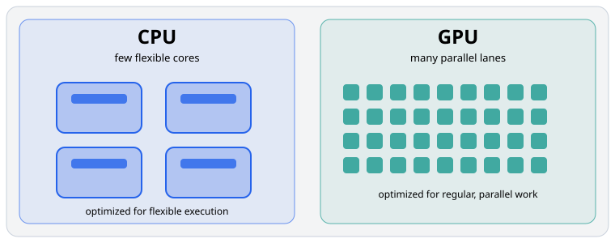
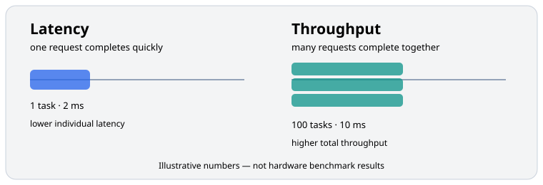
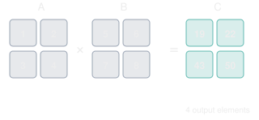
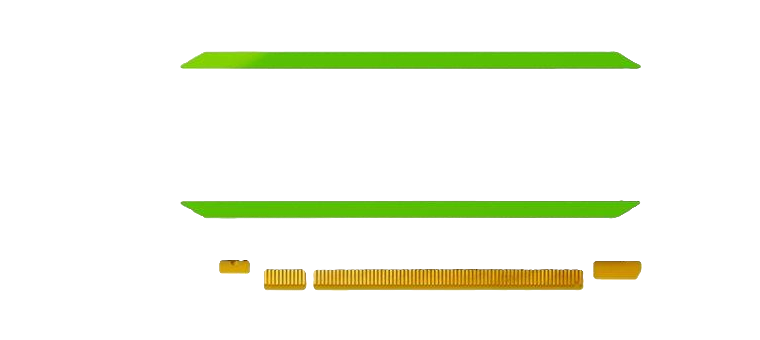
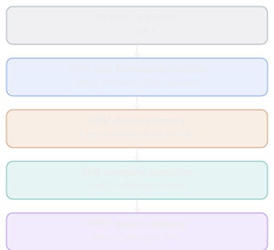
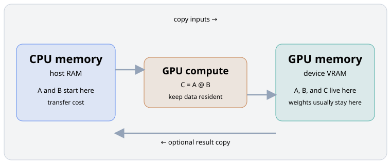
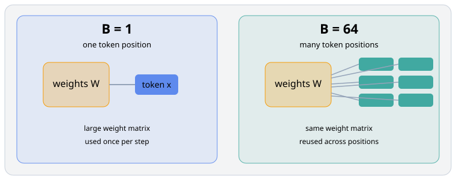

# Module 01 — CPU vs GPU: Why GPU Computing Exists

_vLLM & GPU Inference Engineering Masterclass · Module 01 of 64_

**Practical:** NVIDIA T4 · Lightning AI · 1 GPU

Today, we’re going to understand something fundamental:

> Why does an LLM need a GPU when a CPU can already perform every mathematical operation required by a Transformer?

The answer takes us into parallel computing, matrix operations, GPU hardware, and the first important inference-engineering tradeoff.

By the end of this module, you should be able to explain why GPUs are so effective for LLMs, why they aren’t always faster, and how to measure the difference yourself.

## 1. The first principle: CPU and GPU solve different problems

Imagine that we need to perform one million independent multiplications.

A CPU could perform them. A GPU could also perform them. Both ultimately execute arithmetic instructions.

The real difference is how their hardware is organized to execute work.

### CPU: optimized for low latency and flexible execution

CPUs typically dedicate substantial transistor area to complex control logic, branch prediction, caches, and out-of-order execution. These capabilities make them effective at handling unpredictable instructions and varied tasks.

Examples include running an operating system, processing API requests, tokenizing text, and managing queues.

### GPU: optimized for high throughput

GPUs dedicate more resources to running many arithmetic operations concurrently. They are particularly effective when the same kinds of operations need to be performed on a large amount of data.

Examples include matrix multiplication, image processing, attention projections, and neural-network inference.

This does not mean that a CPU executes only one operation at a time. Modern CPUs have multiple cores and SIMD vector instructions. Nor does a GPU literally give every multiplication its own core. GPU work is divided into groups and executed across its processing units.

The fundamental difference is the balance of hardware resources and the resulting performance characteristics.



_Illustrative comparison: a CPU uses a few flexible cores, while a GPU exposes many parallel lanes for regular work._

## 2. Latency versus throughput — the most important distinction

These two words will appear throughout the course.

Latency measures how long one operation takes. Throughput measures how much total work a system completes per unit time.

Consider a hypothetical processor that completes one task in 2 milliseconds versus another that completes 100 tasks together in 10 milliseconds.

| Processor | One task | Tasks per second at full utilization |
| --- | ---: | ---: |
| A | 2 ms | 500 |
| B | 10 ms for 100 tasks | 10,000 |

Processor B has significantly higher throughput even though its batch takes longer. These are hypothetical numbers, not CPU/GPU benchmark results; they illustrate that optimizing throughput and minimizing individual-request latency are different goals.



_Latency and throughput are related but different optimization targets._

### Why this matters for vLLM

Imagine an LLM serving one user. It generates one token at a time. Now imagine 100 users, each waiting for the next token.

Instead of running 100 completely separate GPU execution passes, vLLM can combine active requests into batches, subject to scheduling and memory constraints. The GPU can perform larger, more efficient operations.

However, batching can also introduce scheduling delays and contention. A bigger batch is not automatically better for every latency target. We’ll study those tradeoffs in Modules 14, 15, and 21.

## 3. The mathematical connection: why matrices matter

An LLM performs enormous numbers of linear-algebra operations. Let’s begin with a tiny example.

$$
A = \begin{bmatrix} 1 & 2 \\ 3 & 4 \end{bmatrix},
\qquad
B = \begin{bmatrix} 5 & 6 \\ 7 & 8 \end{bmatrix}
$$

Their product is `C = AB`. Each output element is a dot product:

```text
C11 = 1(5) + 2(7) = 19
C12 = 1(6) + 2(8) = 22
C21 = 3(5) + 4(7) = 43
C22 = 3(6) + 4(8) = 50
```

Therefore:

$$
C = AB = \begin{bmatrix} 19 & 22 \\ 43 & 50 \end{bmatrix}
$$

Each output element can be computed independently once its required input data is available. That property exposes a lot of parallelism.



_The four output elements can be evaluated independently, exposing parallel work._

For general matrix multiplication:

$$
A \in \mathbb{R}^{M\times K},\qquad
B \in \mathbb{R}^{K\times N},\qquad
C \in \mathbb{R}^{M\times N}
$$

Each output element requires `K` multiplications and approximately `K` additions. Counting one multiplication and one addition as two floating-point operations:

$$
\mathrm{FLOPs} \approx 2MNK
$$

For two square matrices of size `2048 × 2048`:

$$
2\times 2048^3 = 17{,}179{,}869{,}184
$$

That is roughly 17.18 billion floating-point operations for a single matrix multiplication: exactly the kind of large, regular computation GPUs are designed to accelerate.

## 4. What hardware do we actually have?

The NVIDIA T4 is a Turing-architecture, compute-capability-7.5 inference-oriented data-center GPU.

| Specification | Published value |
| --- | ---: |
| CUDA cores | 2,560 |
| Tensor Cores | 320 |
| GPU memory | 16 GB GDDR6 |
| Memory bandwidth | 320+ GB/s |
| Peak FP32 compute | 8.1 TFLOPS |
| Peak mixed FP16 compute | 65 TFLOPS |
| Power rating | 70 W |

These are published peak specifications, not guaranteed application performance.



_The NVIDIA T4 used for the practical experiments in this course._

The key distinctions are:

- CUDA cores execute general-purpose arithmetic instructions.
- Tensor Cores accelerate supported matrix operations, particularly those used in neural networks.
- GPU memory holds data including model weights and activations.
- Memory bandwidth determines how quickly data can move between device memory and compute units, subject to real workload efficiency.

For now, don’t memorize all of these. Modules 02–06 explain why each one matters.

## 5. How a Python operation reaches the GPU

Suppose you execute:

```python
C = A @ B
```

with PyTorch and both tensors on CUDA.

The CPU does not disappear. It remains responsible for launching operations and orchestrating execution. The GPU executes the device-side computations.

Crucially, GPU operations are usually asynchronous relative to the CPU. Python may enqueue GPU work and return before the GPU has completed it.



_A simplified view of how a PyTorch operation reaches the GPU._

This matters when benchmarking: measuring Python wall-clock time around a GPU operation without synchronization can give misleading results. Use CUDA events or explicit synchronization when measuring GPU execution time.

## 6. Your first Lightning AI experiment

We’re going to answer three questions experimentally:

1. How much faster is a T4 than the CPU for large matrix multiplication?
2. What happens for small matrices?
3. What changes when we include CPU-to-GPU data transfer?

We’ll use one T4, not all three.

### Step 1 — Open a Lightning AI Studio

1. Visit [Lightning AI Studios](https://studio.lightning.ai/).
2. Create or open a Studio.
3. Choose a machine with one NVIDIA T4 GPU.
4. Open JupyterLab or the terminal.

In a terminal, run:

```bash
nvidia-smi
```

You should see an NVIDIA T4 listed if the GPU is correctly attached.

Then run:

```bash
python code/module-01/inspect_and_benchmark.py --sizes 128 512 1024 2048 --repeats 30 --include-transfer
```

For an interactive version of the same experiment, open [`inspect_and_benchmark.ipynb`](../../code/module-01/inspect_and_benchmark.ipynb).

The script prints PyTorch and CUDA information, device properties, CPU/GPU timings, estimated throughput, memory usage, correctness error, and optional transfer-inclusive timings.

You can also inspect the device directly in Python:

```python
import torch

print("PyTorch:", torch.__version__)
print("CUDA available:", torch.cuda.is_available())
assert torch.cuda.is_available(), "Switch Studio to a GPU machine."
print("GPU count:", torch.cuda.device_count())
print("GPU name:", torch.cuda.get_device_name(0))
print("CUDA capability:", torch.cuda.get_device_capability(0))

props = torch.cuda.get_device_properties(0)
print("Total GPU memory (GiB):", round(props.total_memory / 1024**3, 2))
```

Expected GPU information:

```text
CUDA available: True
GPU name: Tesla T4
CUDA capability: (7, 5)
```

The exact PyTorch version and available memory may vary. If PyTorch is missing, install a CUDA-enabled build using the command appropriate for your environment from [PyTorch’s official installation page](https://pytorch.org/get-started/locally/).

### Step 2 — Run a very small multiplication

```python
import torch

A_cpu = torch.tensor([[1., 2.], [3., 4.]])
B_cpu = torch.tensor([[5., 6.], [7., 8.]])
C_cpu = A_cpu @ B_cpu

A_gpu = A_cpu.to("cuda")
B_gpu = B_cpu.to("cuda")
C_gpu = A_gpu @ B_gpu

print("CPU result:")
print(C_cpu)
print("GPU result:")
print(C_gpu)
print("Same result:", torch.allclose(C_cpu, C_gpu.cpu()))
```

Expected result:

```text
tensor([[19., 22.],
        [43., 50.]])
Same result: True
```

The CPU and GPU compute the same mathematical result. What differs is the underlying execution machinery and its performance.

## 7. Interactive intuition: when does a GPU become worthwhile?

The following is a simple illustrative performance model, not a benchmark of your actual T4. Imagine that a CPU takes 12 ms per million operations and a GPU takes 0.8 ms per million operations plus a fixed 0.15 ms overhead.

```text
GPU time = fixed overhead + work / GPU throughput
```

For small amounts of work, the fixed overhead can dominate and the CPU can win. For large parallel workloads, the GPU’s higher arithmetic throughput can dominate instead.

These are teaching assumptions, not measured hardware characteristics. Real performance depends on workload shape, dtype, memory traffic, libraries, and system state. This is one reason batching is so important in LLM inference systems.

## 8. Practical benchmark — CPU vs T4

The companion script measures actual matrix multiplication speed for several square matrix sizes. It:

- generates two random `N × N` matrices;
- performs multiplication on CPU and GPU;
- warms up both paths;
- uses a median of repeated measurements;
- uses CUDA events for GPU elapsed time;
- reports CPU time divided by GPU time.

CPU benchmark times use a wall-clock timer; GPU times use device events. This is useful for learning, although it is not a perfectly equivalent end-to-end latency comparison. The benchmark uses FP32 and keeps GPU matrices resident during compute-only timing. Later modules optimize precision and study transfer costs in more detail.

### What to expect

| Matrix size | Likely lesson |
| --- | --- |
| 128 × 128 | GPU overhead can matter a lot |
| 512 × 512 | More parallel work becomes available |
| 1024 × 1024 | GPU arithmetic throughput becomes increasingly important |
| 2048 × 2048 | Large matrix multiplication favors GPU parallelism |

These are predictions about the pattern, not guaranteed measured speedups. CPU model, available cores, PyTorch build, CUDA libraries, and T4 configuration can change the results.

## 9. A second experiment: is GPU data transfer free?

Absolutely not.

For two FP32 matrices, each `2048 × 2048`:

$$
\begin{aligned}
\text{Input bytes} &= 2\times 2048^2\times 4 \\
&= 33{,}554{,}432\ \text{bytes} \\
&= 32\ \text{MiB}
\end{aligned}
$$

That is 32 MiB of input data that must reach the GPU before computation. The transfer does not contribute useful arithmetic to the multiplication itself.



_Inputs may travel from host RAM to device VRAM before computation; keeping data resident avoids repeated transfers._

Run the transfer-inclusive measurement:

```bash
python code/module-01/inspect_and_benchmark.py --sizes 2048 --repeats 20 --include-transfer --include-projection
```

Compare:

- **Compute only:** inputs are already resident in GPU memory.
- **Transfer + compute + result:** inputs begin in CPU memory and the result is copied back.

The core transfer comparison is:

```python
import statistics
import time
import torch

n = 2048
repeats = 20
A_cpu = torch.randn(n, n)
B_cpu = torch.randn(n, n)
A_gpu = A_cpu.to("cuda")
B_gpu = B_cpu.to("cuda")

# Case 1: inputs are already on the GPU.
for _ in range(5):
    _ = A_gpu @ B_gpu
torch.cuda.synchronize()

compute_times = []
for _ in range(repeats):
    start = torch.cuda.Event(enable_timing=True)
    end = torch.cuda.Event(enable_timing=True)
    start.record()
    C_gpu = A_gpu @ B_gpu
    end.record()
    end.synchronize()
    compute_times.append(start.elapsed_time(end))

# Case 2: copy inputs to the GPU and the result back to the CPU.
roundtrip_times = []
for _ in range(repeats):
    torch.cuda.synchronize()
    start = time.perf_counter()
    A = A_cpu.to("cuda")
    B = B_cpu.to("cuda")
    C_cpu = (A @ B).cpu()
    torch.cuda.synchronize()
    roundtrip_times.append((time.perf_counter() - start) * 1000)

print(f"Compute only: {statistics.median(compute_times):.3f} ms")
print(f"Transfer + compute + return: {statistics.median(roundtrip_times):.3f} ms")
```

This example deliberately measures a serialized round trip. More advanced systems can overlap some transfers and computation. Normal inference servers keep model weights on the GPU and avoid repeatedly transferring them; managing GPU-resident data is therefore central to inference engineering.

## 10. Connecting CPU and GPU execution to a real LLM

Suppose we serve a simplified LLM with:

- 1 billion parameters;
- FP16 weights;
- one NVIDIA T4;
- autoregressive token generation.

### Weight memory

Each FP16 parameter uses 2 bytes:

$$
\text{Weight memory} = 10^9\times 2\ \text{bytes} \approx 2\ \text{GB}
$$

The same estimate in Python:

```python
import torch

parameter_count = 1_000_000_000
bytes_per_fp16_parameter = torch.tensor([], dtype=torch.float16).element_size()
weight_bytes = parameter_count * bytes_per_fp16_parameter

print("Weight memory:", weight_bytes / 2**30, "GiB")
```

This is only weight storage. Actual execution needs additional memory for activations, KV cache, kernel workspaces, and runtime data.

### What happens when we generate one token?

Consider a linear projection:

$$
X \in \mathbb{R}^{B\times 4096},\qquad
W \in \mathbb{R}^{4096\times 4096},\qquad
Y \in \mathbb{R}^{B\times 4096}
$$

Here `B` is the number of token positions processed together. The operation count grows with `B`, but the logical weight tensor stays the same.



_A larger batch lets the same weight matrix participate in work for more token positions._

With `B = 1`, the GPU processes one token position through the projection. The large weight matrix participates in relatively little work per loaded value, resembling matrix-vector multiplication.

With `B = 64`, the GPU processes 64 token positions through the same projection. The operation resembles a larger matrix-matrix multiplication and can make better use of GPU parallelism and Tensor Cores.

You can measure the shape, arithmetic work, and memory footprint directly:

```python
import torch

hidden_size = 4096
dtype = torch.float16
W = torch.randn(hidden_size, hidden_size, device="cuda", dtype=dtype)

for B in (1, 64):
    X = torch.randn(B, hidden_size, device="cuda", dtype=dtype)
    torch.cuda.reset_peak_memory_stats()
    start = torch.cuda.Event(enable_timing=True)
    end = torch.cuda.Event(enable_timing=True)
    start.record()
    Y = X @ W
    end.record()
    end.synchronize()

    flops = 2 * B * hidden_size * hidden_size
    print(
        f"B={B:2d} | X={tuple(X.shape)} | Y={tuple(Y.shape)} | "
        f"FLOPs={flops / 1e9:.3f}B | "
        f"peak memory={torch.cuda.max_memory_allocated() / 2**20:.1f} MiB | "
        f"time={start.elapsed_time(end):.3f} ms"
    )
```

That is the essential link to vLLM: continuous batching helps inference systems reuse model computation resources across concurrent requests, improving aggregate throughput. More arithmetic operations can also mean higher latency for some requests, so throughput and latency must be measured together.

## 11. The CPU still has an important job in vLLM

The CPU is not merely an inconvenience to eliminate.

| CPU-side work | GPU-side work |
| --- | --- |
| Accepting API requests | Transformer forward passes |
| Preparing and tokenizing inputs | Matrix multiplications |
| Scheduling requests | Attention operations |
| Managing allocation metadata | Reading and writing KV-cache tensors |
| Coordinating execution | Generating logits |
| Processing and streaming outputs | Sampling operations where implemented on GPU |

The precise placement varies with engine configuration. A vLLM server can therefore be slow even when GPU arithmetic capability is high. If the CPU cannot prepare and schedule work quickly enough, the GPU can experience idle gaps.

This is a potential CPU-side bottleneck and a key reason to study the entire inference system rather than only CUDA kernels.

## References

- [NVIDIA CUDA Programming Guide](https://docs.nvidia.com/cuda/cuda-c-programming-guide/) — GPU programming and execution.
- [NVIDIA T4 specifications](https://www.nvidia.com/en-us/data-center/tesla-t4/) — Official GPU hardware information.
- [PyTorch CUDA semantics](https://docs.pytorch.org/docs/stable/notes/cuda.html) — GPU execution and correct benchmarking.
- [Roofline: An Insightful Visual Performance Model for Multicore Architectures](https://doi.org/10.1145/1498765.1498785) — Compute versus memory bottlenecks.
- [Efficient Memory Management for Large Language Model Serving with PagedAttention](https://arxiv.org/abs/2309.06180) — Foundational vLLM serving work.
- [vLLM GPU installation requirements](https://docs.vllm.ai/en/stable/getting_started/installation/gpu/) — Current hardware and platform requirements.

## Core takeaway

GPUs excel at high-throughput parallel computation, but actual inference performance also depends on scheduling, batching, data movement, and the amount of parallel work available.

Next: [Module 02 — GPU Architecture: SMs, CUDA Cores, Tensor Cores, Warps](02-gpu-architecture.md)
