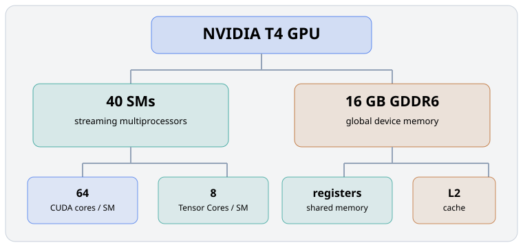
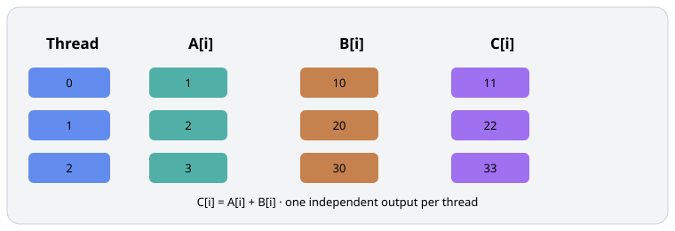
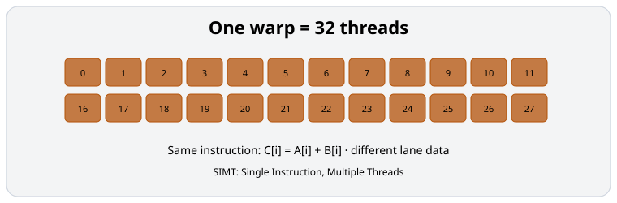
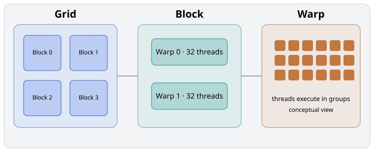
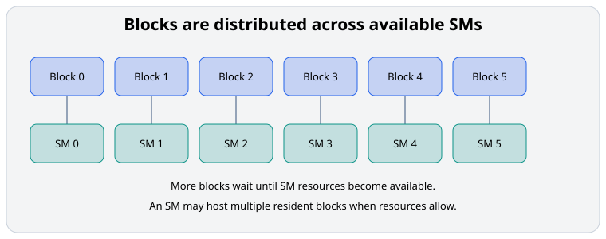
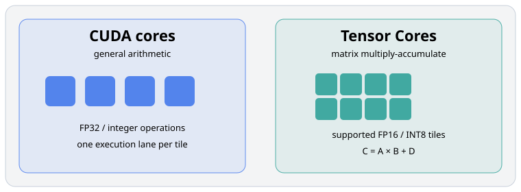
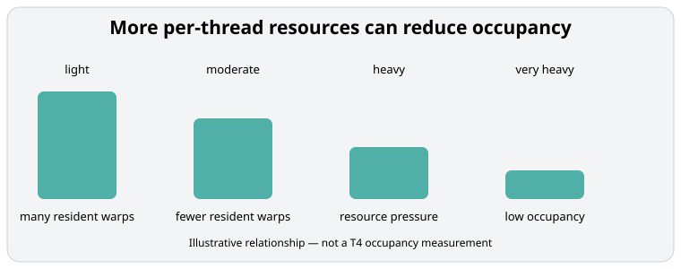

# Module 02 — Anatomy of a GPU: SMs, CUDA Cores, Tensor Cores, Warps & Threads

_vLLM & GPU Inference Engineering Masterclass · Module 02 of 64_

**Hands-on:** Lightning AI · NVIDIA T4 · 1 GPU

In Module 01, we learned that GPUs are designed for high-throughput parallel computation.

But that raises an important question:

> If your NVIDIA T4 has 2,560 CUDA cores, does that mean it can execute exactly 2,560 threads at a time?

No. Understanding why is the main objective of today’s module.

We’ll explore how GPU hardware is organized, how CUDA schedules work, and how these concepts influence LLM inference performance.

### 1. Learning objectives

By the end of Module 02, you should understand:

- what a Streaming Multiprocessor (SM) does;
- the difference between a GPU thread, warp, thread block, and CUDA core;
- how thousands of software threads are mapped onto GPU hardware;
- how Tensor Cores differ from CUDA cores;
- what GPU occupancy means and why 100% occupancy does not guarantee maximum performance;
- why these ideas matter when running models through vLLM.

You’ll also implement a small CUDA kernel on your T4 and experiment with different thread-block sizes.

### 2. The NVIDIA T4: understanding its physical structure

The NVIDIA T4 is a Turing-architecture inference GPU with these important structural numbers:

| Component | T4 value |
| --- | ---: |
| Streaming Multiprocessors | 40 |
| CUDA cores | 2,560 |
| Tensor Cores | 320 |
| GPU memory | 16 GB GDDR6 |



_Conceptual hierarchy; this is an educational model, not a transistor-level floorplan._

The simple relationships are:

$$
\text{CUDA cores per SM} = \frac{2560}{40} = 64
$$

$$
\text{Tensor Cores per SM} = \frac{320}{40} = 8
$$

So the T4 contains 40 SMs, each associated with 64 CUDA arithmetic lanes and 8 Tensor Cores in the published specification.

An SM also contains registers, warp schedulers, shared memory, load/store hardware, and other execution resources.

#### Think of an SM as a miniature parallel processor

A GPU is not simply one giant collection of 2,560 independent processors. It is composed of multiple SMs. Each SM can manage many software threads and execute instructions using its own hardware resources.

A CUDA core is a hardware execution resource. A CUDA thread is a software execution context. They are not interchangeable.

### 3. What exactly is a CUDA thread?

Suppose you have two arrays:

$$
A = [1,2,3,4,5,6,7,8],\qquad
B = [10,20,30,40,50,60,70,80]
$$

You want:

$$
C_i = A_i + B_i
$$

A CPU program could loop through the eight elements. On a GPU, we could create eight logical threads, each responsible for one output element.



_Each thread computes one independent output element in this simplified example._

The CUDA thread is the logical unit of work. Every thread gets an ID and can execute the same kernel code using different data.

When we create eight threads, CUDA does not allocate eight dedicated physical cores for their entire lifetime. Instead, threads are scheduled onto the GPU’s available hardware.

### 4. What is a warp?

A warp is a group of 32 CUDA threads scheduled together on an NVIDIA GPU.

$$
\boxed{1\ \text{warp} = 32\ \text{threads}}
$$



Suppose you launch 128 threads in a block:

$$
128 / 32 = 4\ \text{warps}
$$

Within a warp, threads generally execute instructions together using NVIDIA’s SIMT model: Single Instruction, Multiple Threads. Each thread has its own registers and logical execution state, but the warp is the central execution-scheduling unit.

For example, all 32 threads may execute:

```python
C[i] = A[i] + B[i]
```

while using different values of `i`.

NVIDIA Turing supports independent thread scheduling, so the precise execution model is more flexible than saying all 32 threads must always have the same program counter. Nevertheless, divergence within a warp can reduce execution efficiency.

#### Why not simply use one gigantic thread?

A single thread can execute a long sequence of instructions. But a GPU is designed to expose and schedule large amounts of independent work.

If one thread processes a million elements, most GPU hardware could remain idle. If you expose thousands or millions of independent operations, the GPU can distribute that work across SMs and warps.

More threads expose more potential parallelism. They do not guarantee better performance because resource limits and scheduling overhead still matter.

### 5. Thread blocks and grids

CUDA organizes threads into a hierarchy:

$$
\boxed{\text{Grid} \rightarrow \text{Blocks} \rightarrow \text{Threads}}
$$

Warps are the hardware scheduling groups formed from threads inside a block.



#### Example with 1,000 elements

Suppose we need one CUDA thread per element and choose:

$$
\text{Threads per block} = 256
$$

Then:

$$
\text{Number of blocks} = \left\lceil\frac{1000}{256}\right\rceil = 4
$$

So we launch:

$$
4\times256 = 1024\ \text{threads}
$$

The final 24 threads have no valid array element to process. Kernels therefore include a bounds check:

```cuda
if (idx < N) {
    C[idx] = A[idx] + B[idx];
}
```

This prevents extra threads from reading or writing outside the allocated array.

One important rule: an ordinary CUDA thread block runs on a single SM, although an SM may host several blocks concurrently. Blocks are distributed across available SMs, and additional blocks execute as resources become available.

### 6. How do 40 SMs execute thousands of threads?

Imagine a CUDA kernel containing 80 blocks, each with 256 threads.

Total threads:

$$
80\times256 = 20{,}480
$$

Total warps:

$$
20{,}480 / 32 = 640
$$

You have 40 SMs in the T4. Does that mean each SM runs exactly two blocks?

Not necessarily. The scheduler distributes blocks according to available hardware resources. One SM may have multiple blocks resident simultaneously, depending on the registers, shared memory, thread slots, and other resources required by the kernel.



#### How the warp scheduler helps

Imagine that warp A needs data from GPU memory. While its memory request is pending, the scheduler can issue instructions from another ready warp, say warp B.

This is one reason GPUs maintain many resident warps: they can hide some instruction and memory latency by switching to other ready work.

Warps are not guaranteed to execute simultaneously, and the T4 has finite issue and execution resources.

#### Why this matters for inference

Think about an LLM loading weight matrices from GPU memory. If the relevant data is not immediately available, execution can stall. Having other independent work ready may help the GPU stay productive.

But some inference operations do not expose enough parallel work, particularly small-batch autoregressive decode. This is one reason inference performance is not determined by peak GPU FLOPs alone.

### 7. CUDA cores versus Tensor Cores

CUDA cores and Tensor Cores are different execution resources.



#### CUDA Cores

CUDA cores execute general arithmetic such as FP32 additions and multiplications, within the capabilities of the GPU’s execution pipelines.

#### Tensor Cores

Tensor Cores are specialized matrix multiply-accumulate hardware for supported shapes, data types, and instructions.

Tensor Cores are particularly useful because neural networks contain massive numbers of matrix multiplications:

$$
C = AB + D
$$

Your T4 supports Tensor Core acceleration for appropriate FP16 and integer workloads. It does not offer native BF16 or FP8 Tensor Core execution.

#### Does FP16 automatically make a model fast?

Not necessarily. Performance depends on whether the underlying kernel actually uses Tensor Core instructions, its matrix dimensions, memory traffic, and other constraints.

A small or poorly configured matrix multiplication may not make effective use of Tensor Cores. We’ll explore these details in Modules 04 and 26.

### 8. GPU occupancy: an important concept

Occupancy is the fraction of the maximum supported active warps on an SM that are actually resident.

For example, suppose an SM can support 32 resident warps for a particular configuration. If a kernel has 16 resident warps:

$$
\text{Occupancy} = \frac{16}{32} = 50\%
$$

If it has 32 resident warps:

$$
\text{Occupancy} = 100\%
$$

This example is illustrative; hardware limits depend on GPU architecture and kernel configuration.



#### Why occupancy can be limited

An SM has finite resources. Every active block consumes some combination of registers, shared memory, thread slots, and other resources.

If every thread uses many registers, fewer warps may fit on the SM at once. If a block uses substantial shared memory, that can also limit how many blocks are resident.

But be careful: 100% occupancy does not mean 100% GPU utilization, and maximum occupancy does not always deliver maximum performance. A kernel with lower occupancy might run faster if it has better data reuse, fewer memory transactions, or more efficient instructions.

The goal is not to maximize one metric blindly. The goal is to minimize execution time for the workload.

### 9. Hands-on lab: exploring CUDA threads on Lightning AI

We’ll do three experiments on one T4:

1. inspect the GPU;
2. launch a real vector-add CUDA kernel with Numba;
3. compare different thread-block sizes.

#### Experiment A — Inspect the GPU

```python
import torch

assert torch.cuda.is_available(), "Select a GPU runtime."
device = torch.device("cuda:0")
props = torch.cuda.get_device_properties(device)

print("GPU:", props.name)
print("Compute capability:", torch.cuda.get_device_capability(device))
print("Number of GPUs:", torch.cuda.device_count())
print("Total VRAM (GiB):", round(props.total_memory / 1024**3, 2))
print("Threads per SM:", getattr(props, "max_threads_per_multi_processor", "not exposed"))
print("Multiprocessors:", getattr(props, "multi_processor_count", "not exposed"))
```

Expected hardware identifiers for a T4 include compute capability `(7, 5)` and 40 multiprocessors.

#### Experiment B — Launch your own CUDA kernel

Install the Numba CUDA components if needed:

```bash
pip install numba numba-cuda numpy
```

The current Numba CUDA target is distributed separately as `numba-cuda`. It uses the CUDA driver and requires a compatible CUDA runtime. If the environment lacks the required components, kernel compilation may fail even when PyTorch CUDA works.

The complete implementation is available in [`vector_add_numba.py`](../../code/module-02/vector_add_numba.py). The core kernel is:

```python
import numpy as np
from numba import cuda


@cuda.jit
def vector_add(A, B, C, N):
    idx = cuda.grid(1)
    if idx < N:
        C[idx] = A[idx] + B[idx]
```

`@cuda.jit` compiles the function as a CUDA kernel. `cuda.grid(1)` calculates the global thread index. The bounds check prevents extra threads from accessing invalid memory.

Run it with:

```bash
python code/module-02/vector_add_numba.py --elements 1000 --threads 256
```

The launch configuration is:

```python
N = 1000
threads_per_block = 256
blocks_per_grid = (N + threads_per_block - 1) // threads_per_block
vector_add[blocks_per_grid, threads_per_block](d_A, d_B, d_C, N)
```

Expected launch arithmetic:

$$
\left\lceil\frac{1000}{256}\right\rceil = 4\ \text{blocks},
\qquad
4\times256 = 1024\ \text{threads launched}
$$

The last 24 threads fail the `idx < N` check and do no useful work.

#### Experiment C — Does block size affect performance?

```bash
python code/module-02/vector_add_numba.py --elements 2000000 --benchmark
```

The benchmark varies threads per block across `[32, 64, 128, 256, 512, 1024]` while keeping the total computational work constant. It reports the number of blocks and median launch-plus-execution time.

This is a short kernel, so host launch overhead and synchronization may obscure small differences. Later modules use CUDA events and profiler traces to separate those costs more carefully.

### 10. How this connects to vLLM

Imagine vLLM executing a matrix multiplication for a Transformer layer.

The engine does not individually instruct all 2,560 CUDA cores what to do. Instead, it invokes a GPU operation implemented by a CUDA, Triton, or another supported kernel.

That kernel exposes parallel work through threads, warps, and blocks. The GPU then schedules that work on its SMs.

```text
vLLM scheduler
      ↓
model runner / GPU operation
      ↓
kernel launch: grid → blocks → warps → threads
      ↓
SMs execute instructions using CUDA cores or Tensor Cores
```

A larger batch may expose larger matrix operations and more parallel work. That can improve Tensor Core utilization and amortize fixed overheads. But memory-bound kernels, decode operations, and complex attention patterns behave differently.

This is why vLLM performance depends on the interaction between scheduling, tensor shapes, kernel implementation, memory movement, and GPU resources.

### References

- [NVIDIA CUDA Programming Guide](https://docs.nvidia.com/cuda/cuda-programming-guide/) — Thread hierarchy, SIMT execution, warps, scheduling, and occupancy.
- [NVIDIA T4 Specifications](https://www.nvidia.com/en-us/data-center/tesla-t4/) — T4 hardware specifications and Tensor Core capabilities.
- [Mixed Precision Training](https://arxiv.org/abs/1710.03740) — Foundational work on mixed-precision arithmetic for deep learning.
- [Numba CUDA documentation](https://numba.readthedocs.io/en/stable/cuda/index.html) — Building and executing Python-authored CUDA kernels.

### Core takeaway

The four concepts worth remembering are:

1. An SM is a major GPU processing unit containing schedulers, execution units, and local storage.
2. A CUDA thread is a software execution context, while a warp groups 32 threads for scheduling.
3. CUDA cores and Tensor Cores are execution hardware, not the same thing as threads.
4. More threads or higher occupancy does not automatically mean faster execution.

Next: [Module 03 — GPU Memory Hierarchy: Registers, Shared Memory, L1/L2 Cache, and VRAM](03-gpu-memory-hierarchy.md)
