# Module 03 — GPU Memory Hierarchy: Registers, Shared Memory, L1/L2 Cache & VRAM

_vLLM & GPU Inference Engineering Masterclass · Module 03 of 64_

**Practical:** Lightning AI · NVIDIA T4 · 1 GPU

In Module 02, we learned that your T4 has 40 Streaming Multiprocessors (SMs), 2,560 CUDA cores, and 320 Tensor Cores.

Now imagine that these processing units are ready to perform billions of calculations.

What happens if the data required for those calculations has not reached the processing units yet?

The hardware may have to wait.

This is one of the most important reasons why GPU performance is not determined by FLOPS alone.

Today, we’ll understand how GPU memory works from the hardware level all the way up to LLM inference and vLLM’s KV-cache management.

### What we’ll cover

1. Why GPUs have multiple kinds of memory.
2. Registers, shared memory, L1 cache, L2 cache, and VRAM.
3. Where tensors and intermediate calculations actually live.
4. Memory bandwidth versus memory latency.
5. Coalesced memory access and why layout matters.
6. GPU memory reuse and its effect on matrix multiplication.
7. Why autoregressive decoding can be memory-bandwidth-bound.
8. Practical benchmarks on your NVIDIA T4.

By the end, you should be able to reason about where data lives, how many bytes need to move, and why that movement can dominate inference time.

### 1. Why doesn’t a GPU just have one large, extremely fast memory?

We want memory to be extremely fast so arithmetic units rarely wait, and extremely large so it can hold billions of model parameters.

Making memory simultaneously very large, very fast, low-power, and inexpensive is difficult. GPU designers therefore use a hierarchy of different memory technologies.

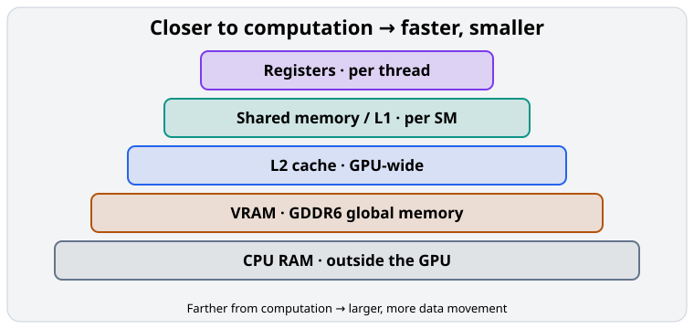

#### The GPU memory hierarchy

The hierarchy is conceptual, not a single sequential pipeline. Registers, shared memory, and caches have different access rules and are managed by different parts of the hardware/software stack.

| Level | Intuition | Typical scope |
| --- | --- | --- |
| Registers | Numbers currently in a thread’s working set | One thread |
| Shared memory | A whiteboard for nearby cooperating threads | One block / SM |
| L1 cache | Hardware-managed nearby reuse | One SM |
| L2 cache | Shared hardware-managed reuse | All SMs |
| VRAM | Large storage for weights and tensors | Whole GPU |
| CPU RAM | Storage outside the GPU | Host system |

The closer data is to computation, the cheaper it generally is to access. The smaller storage levels also have much less capacity.

### 2. The actual memory available on your T4

Let’s establish the T4-specific numbers.

| Memory resource | T4 capacity | Scope |
| --- | --- | --- |
| Registers | 65,536 32-bit registers per SM | Individual thread values |
| Shared memory / L1 | 96 KiB unified physical pool per SM | SM-local |
| Configurable shared memory | Up to 64 KiB per SM | Threads within a block |
| L2 cache | 4 MiB | Shared by all 40 SMs |
| Global memory | 16 GB GDDR6 | GPU-wide |

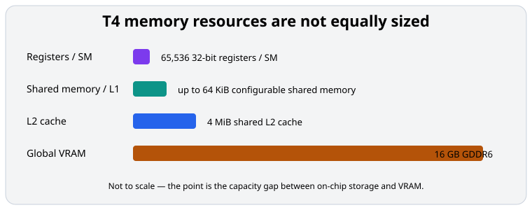

The Turing architecture uses a unified L1/shared-memory design, with configurable partitioning rather than a separate, fully dedicated shared-memory allocation. NVIDIA specifies more than 320 GB/s of peak global-memory bandwidth for the T4.

Notice the capacity gap: 16 GB of VRAM is enormous compared with a 4 MiB L2 cache. Large LLM weight matrices cannot remain entirely inside L2. The hardware must bring required portions closer to the compute units as execution proceeds.

### 3. Registers — the closest storage to computation

Imagine one GPU thread executing:

```python
a = 10
b = 20
c = a + b
```

At a hardware level, the compiler may keep these values in registers. Registers are extremely fast, on-chip storage used for each thread’s working values.

A register is not the same as a Python variable. The compiler decides which values are assigned to registers and which calculations can be optimized away.

#### Numerical example

Suppose a kernel needs 32 registers per thread and launches 256 threads per block.

$$
256\times32 = 8192\ \text{registers per block}
$$

If we increase to 128 registers per thread:

$$
256\times128 = 32768\ \text{registers per block}
$$

The second configuration consumes four times as many registers per block.

Ignoring other constraints, register allocation granularity, and occupancy limits:

- 8,192 registers per block could fit eight blocks using registers alone.
- 32,768 registers per block could fit two blocks using registers alone.

On T4, maximum resident threads, block limits, and other resources further constrain these numbers.

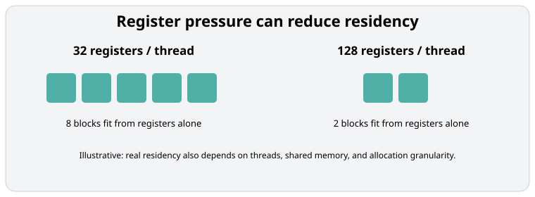

#### Why does this matter?

If a thread uses too many registers, fewer thread blocks may fit on an SM. If register pressure becomes excessive, values may spill into local memory.

Despite its name, CUDA local memory is generally backed by device memory and cached through the memory hierarchy—not a tiny private on-chip RAM. Register spills can therefore introduce additional memory traffic.

This is one reason a kernel that performs fewer arithmetic operations is not necessarily faster: it might require much more data movement.

### 4. Shared memory — why reuse matters

Suppose 32 threads all need the same 100 numbers. A naive implementation might repeatedly load those numbers from global memory. An optimized kernel may load the values into shared memory and allow threads in the same block to reuse them.

Shared memory is:

- physically located on the SM;
- explicitly managed by the kernel;
- accessible to threads within the same block;
- much smaller than global memory;
- useful for cooperation and data reuse.

Unlike L1 cache, shared memory generally requires the program to decide what gets stored there and to coordinate access correctly.

#### Example: tiled matrix multiplication

Suppose we multiply:

$$
C = AB
$$

with:

$$
A,B\in\mathbb{R}^{1024\times1024}
$$

A naive strategy might repeatedly fetch values of A and B while calculating each element of C. But many output elements use the same input values. The first row of A, for example, contributes to many elements of C.

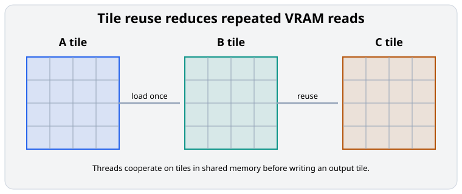

An optimized algorithm divides A and B into tiles, loads reusable pieces into shared memory, and lets threads cooperate on an output tile.

We’ll derive tiled GEMM in Module 05 and write an actual tiled kernel in Module 26.

For now, remember:

> Fast GPU computation is often about reusing data that has already been loaded, rather than doing fewer mathematical operations.

### 5. L1 and L2 cache — hardware-managed data reuse

Shared memory is explicitly programmed. Caches generally work more automatically.

When a kernel accesses global memory, the hardware may retain recently accessed data in caches.

#### L1 cache

The T4’s L1 data cache is associated with individual SMs. It can reduce repeated accesses to more distant memory when caching is applicable.

#### L2 cache

The L2 cache is shared across all SMs. If SM 1 accesses data and SM 2 subsequently needs it, L2 may supply it without another trip to GDDR6.

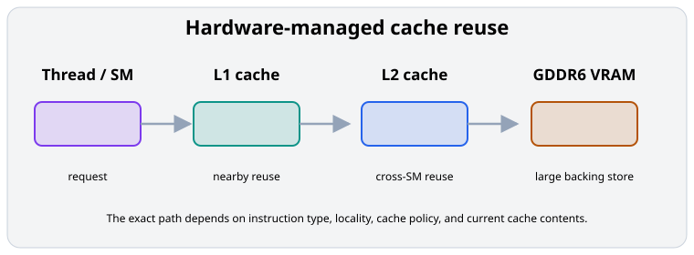

A GPU memory load does not always traverse every cache in a fixed sequence. Behavior depends on the instruction, memory access pattern, cache policy, and current cache contents.

For inference engineering, the important insight is that cache reuse can reduce the number of bytes transferred from relatively slow global memory.

### 6. Memory latency versus memory bandwidth

Latency is how long an individual memory access takes to return data. Bandwidth is how much data can be transferred per second.

Imagine two water systems. One delivers the first drop quickly but carries little water each second. The other takes longer to start but transfers enormous amounts continuously. The second system has higher bandwidth but not necessarily lower latency.

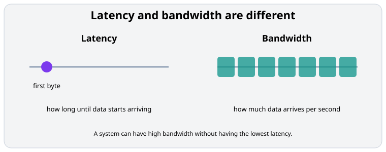

For the T4:

$$
\text{Peak memory bandwidth}\approx320\ \text{GB/s}
$$

Imagine a kernel needs to read 2 GB from GDDR6. The theoretical minimum transfer time, using a rounded 320 GB/s bandwidth, is:

$$
T = \frac{\text{Bytes}}{\text{Bandwidth}}
$$

$$
T = \frac{2\ \text{GB}}{320\ \text{GB/s}} = 6.25\ \text{ms}
$$

That is a lower bound under ideal sustained-bandwidth conditions. Real execution may be longer because of inefficient access, additional reads or writes, contention, and imperfect bandwidth utilization.

#### Explore how memory size affects transfer time

For an assumed achieved bandwidth of 224 GB/s:

$$
T = \frac{2\ \text{GB}}{224\ \text{GB/s}} \approx 8.93\ \text{ms}
$$

This model assumes the stated data volume must actually be transferred from GDDR6, without additional overhead or cache reuse. It is not a measured T4 benchmark.

### 7. Coalesced versus scattered memory access

A GPU can have fast memory and still access it inefficiently.

Consider 32 threads in a warp, each loading one FP32 value. Each FP32 value is 4 bytes.

#### Scenario A — contiguous memory

Thread 0 loads element 0. Thread 1 loads element 1. Thread 2 loads element 2, and so on.

The 32 threads collectively request:

$$
32\times4 = 128\ \text{bytes}
$$

If the data is properly aligned, it can be served through a small number of memory sectors.

#### Scenario B — strided memory

Thread 0 loads element 0. Thread 1 loads element 32. Thread 2 loads element 64, and so on.

Adjacent threads now access distant addresses. The warp may require many more memory transactions to service the same 128 bytes of useful values.

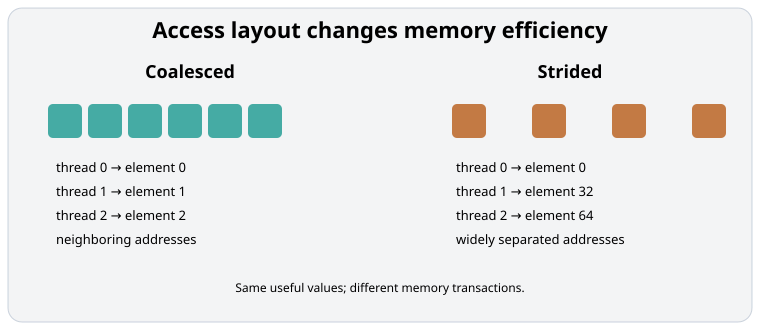

This concept is called memory coalescing. Two kernels may implement exactly the same mathematical operation, but one can achieve much higher effective bandwidth because its access pattern is better organized.

### 8. Why LLM inference is often limited by memory bandwidth

Now connect the hierarchy to inference.

Imagine a simplified dense language model with:

$$
P = 1\ \text{billion parameters}
$$

Stored in FP16, its weights occupy approximately:

$$
P\times2\ \text{bytes} = 2\ \text{GB}
$$

During single-token decoding at batch size 1, many major operations resemble matrix-vector multiplications.

For a large linear layer:

$$
Y = XW
$$

where:

$$
X\in\mathbb{R}^{1\times K},\qquad W\in\mathbb{R}^{K\times N}
$$

The calculation performs approximately two floating-point operations per weight element, while each FP16 weight occupies two bytes. Considering weight reads alone:

$$
\text{Arithmetic intensity}\approx\frac{2\ \text{FLOPs}}{2\ \text{bytes}} = 1\ \text{FLOP/byte}
$$

That is low. The GPU fetches a lot of data relative to the arithmetic performed.

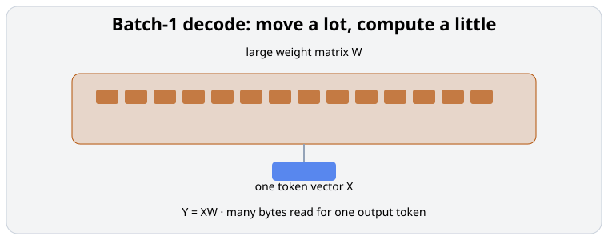

#### A simplified decode estimate

If roughly 2 GB of weights must be streamed from memory per token:

$$
T_{\text{weight-read}}\geq\frac{2\ \text{GB}}{320\ \text{GB/s}} = 6.25\ \text{ms}
$$

That is an idealized estimate, not a measured time per token. Actual decoding also involves attention, KV-cache access, intermediate activations, synchronization, other operations, and real bandwidth utilization.

Caching, batching, quantization, and architecture-specific optimizations can change the traffic substantially. Nevertheless, this explains why small-batch LLM decoding is often memory-bandwidth-bound.

#### Why batching helps

Suppose instead of one token position, we process 32 token positions through the same weight matrix:

$$
X\in\mathbb{R}^{32\times K}
$$

The arithmetic increases by approximately 32 times, but the weight matrix does not need to be replicated 32 times. With efficient reuse, the GPU can amortize weight loading over much more work.

This is one reason serving multiple requests together can improve throughput. We’ll analyze this formally with arithmetic intensity and the roofline model in Module 06.

### 9. Connection to vLLM’s KV cache

Model weights are not the only data consuming GPU memory. During autoregressive generation, Transformers also store previously computed keys and values: the KV cache.

For a conventional attention layer, consider:

- 32 transformer layers;
- 8 KV heads;
- head dimension 128;
- 2 bytes per value (FP16);
- context length 2,048 tokens.

The total KV-cache memory for one sequence is approximately:

$$
M_{\text{KV}} = 2\times L\times H_{\text{KV}}\times D\times S\times b
$$

The leading factor of 2 accounts for both keys and values. Substituting:

$$
M_{\text{KV}} = 2\times32\times8\times128\times2048\times2
$$

$$
M_{\text{KV}} = 268{,}435{,}456\ \text{bytes} = 256\ \text{MiB}
$$

For 20 such sequences:

$$
20\times256\ \text{MiB} = 5\ \text{GiB}
$$

This becomes substantial on a T4 with 16 GB of VRAM.

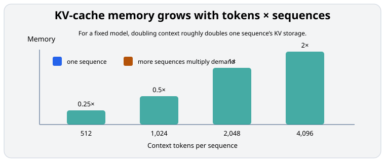

_Longer contexts increase per-sequence storage; concurrent sequences multiply the total demand._

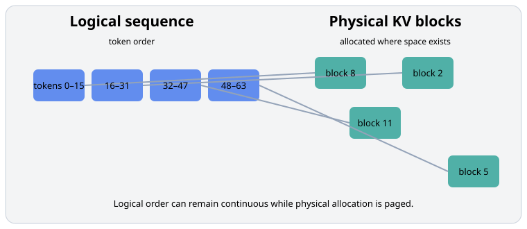

#### What does vLLM do differently?

The original vLLM research introduced PagedAttention, a technique for managing KV-cache data in fixed-size blocks.

Instead of requiring a sequence’s physical KV allocation to occupy one large contiguous region, the engine can manage separate physical blocks and map them to the logical token sequence. This reduces memory waste and enables more efficient allocation and sharing.

PagedAttention is about KV-cache memory management and access; it does not make physical registers or GDDR6 faster. We’ll study block management, reference counting, prefix sharing, and the real implementation in Modules 19–20.

### 10. Lightning AI lab — measure GPU memory behavior

Run the experiments in [`memory_benchmarks.py`](../../code/module-03/memory_benchmarks.py) or open [`memory_benchmarks.ipynb`](../../code/module-03/memory_benchmarks.ipynb).

#### Experiment A — How much GPU memory does a tensor consume?

```python
import torch

assert torch.cuda.is_available(), "Select a GPU runtime."
device = torch.device("cuda:0")

def show_memory():
    allocated = torch.cuda.memory_allocated(device) / 2**20
    reserved = torch.cuda.memory_reserved(device) / 2**20
    print(f"Allocated: {allocated:.2f} MiB")
    print(f"Reserved:  {reserved:.2f} MiB")

show_memory()
x = torch.empty((4096, 4096), dtype=torch.float32, device=device)
print("Logical tensor memory:", x.numel() * x.element_size() / 2**20, "MiB")
show_memory()
```

The logical tensor size is:

$$
4096\times4096\times4 = 67{,}108{,}864\ \text{bytes} = 64\ \text{MiB}
$$

`memory_allocated()` reports memory occupied by live tensors managed by PyTorch. `memory_reserved()` reports memory managed by its caching allocator, including unused cached allocations.

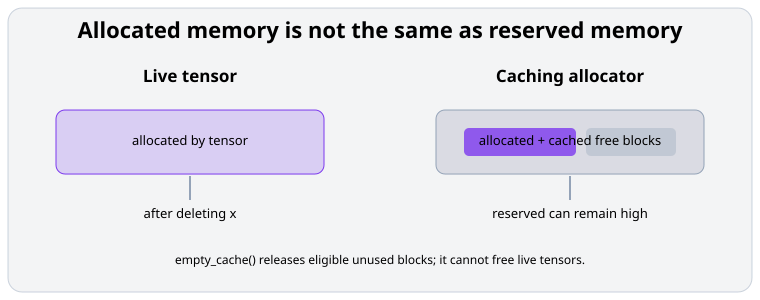

_A deleted tensor can reduce allocated memory while reserved memory remains available to the allocator._

```python
del x
print("After deleting tensor:")
show_memory()

torch.cuda.empty_cache()
print("After empty_cache():")
show_memory()
```

`empty_cache()` releases eligible unused cached blocks, but it does not free memory occupied by live tensors.

#### Experiment B — Measure effective global-memory bandwidth

For two large tensors:

$$
C = A+B
$$

With FP32, each element logically reads A, reads B, and writes C:

$$
4+4+4 = 12\ \text{bytes per element}
$$

The runnable script measures this with CUDA events. Run:

```bash
python code/module-03/memory_benchmarks.py --bandwidth
```

The result is an effective useful-data rate, not a direct DRAM measurement. Cache hits, transactions, kernel overhead, and timing variability affect the result.

#### Experiment C — Compare contiguous and strided access

The script also includes optional Numba kernels that compare neighboring-thread access with strided access:

```bash
python code/module-03/memory_benchmarks.py --coalescing
```

Higher strides usually make memory transactions less efficient for this type of kernel. Measured times can also depend on caching, launch overhead, and the exact T4 environment.

### 11. A deeper engineering thought experiment

Imagine deploying a 7B-parameter dense LLM on your T4. If the model is stored in FP16:

$$
7\times10^9\times2 = 14\ \text{GB}
$$

The weights alone would occupy approximately 14 GB decimal, leaving relatively little space for KV cache, CUDA buffers, activations, and runtime overhead in 16 GB of VRAM.

This does not automatically prove the model cannot run. The exact situation depends on parameter count, weight format, allocator overhead, offloading, and runtime configuration.

| Approach | Primary benefit | Tradeoff |
| --- | --- | --- |
| Quantization | Reduce model-weight memory | Precision, quality, and kernel support considerations |
| Smaller model | Reduce memory and compute | Potential quality reduction |
| Tensor parallelism | Distribute weights across GPUs | Communication overhead |
| Lower concurrency | Reduce simultaneous KV-cache demand | Lower service capacity |
| Shorter context | Reduce KV-cache consumption | Reduced usable context |
| Prefix caching | Reuse applicable KV blocks | Benefits depend on repeated prefixes |

Notice how a memory-hierarchy discussion naturally leads to vLLM configuration and capacity-planning decisions.

### References

- [NVIDIA CUDA C++ Best Practices Guide](https://docs.nvidia.com/cuda/cuda-c-best-practices-guide/) — Device memory access, coalescing, shared memory, and optimization.
- [Discovering the Turing T4 GPU Architecture with Microbenchmarks](https://developer.download.nvidia.com/video/gputechconf/gtc/2019/presentation/s9839-discovering-the-turing-t4-gpu-architecture-with-microbenchmarks.pdf) — T4-specific architectural observations.
- [Roofline: An Insightful Visual Performance Model for Multicore Architectures](https://doi.org/10.1145/1498765.1498785) — Understanding memory bandwidth versus compute performance.
- [Efficient Memory Management for Large Language Model Serving with PagedAttention](https://arxiv.org/abs/2309.06180) — vLLM KV-cache memory management.

### Summary — five ideas to remember

- Registers hold a thread’s immediate working values; excessive register usage can restrict occupancy or cause spills.
- Shared memory and caches reduce expensive accesses to global memory by exploiting data reuse.
- Coalescing allows neighboring GPU threads to access data efficiently.
- Bandwidth and latency are different: bandwidth describes sustained transfer capacity, while latency describes how long individual accesses take.
- LLM inference is often about moving data efficiently, not simply maximizing arithmetic FLOPs.

Next: [Module 04 — Inside an NVIDIA T4: Loading and Executing a 1B Model](04-inside-t4-1b-model.md)
