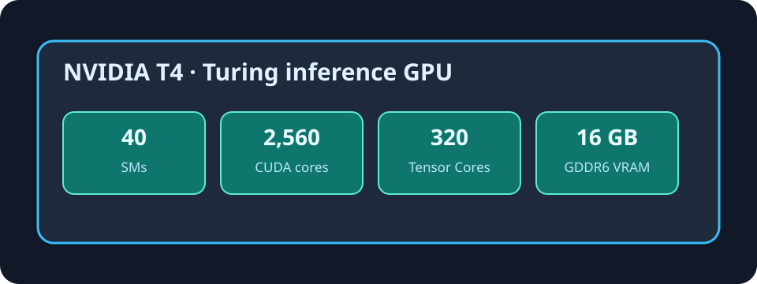
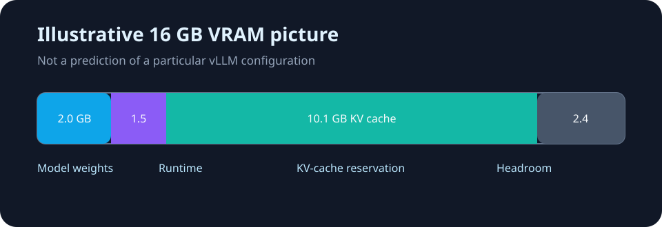
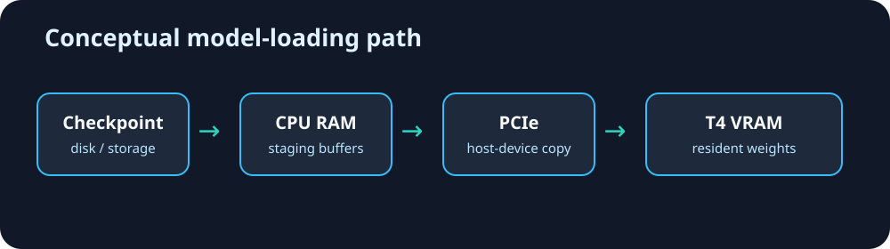
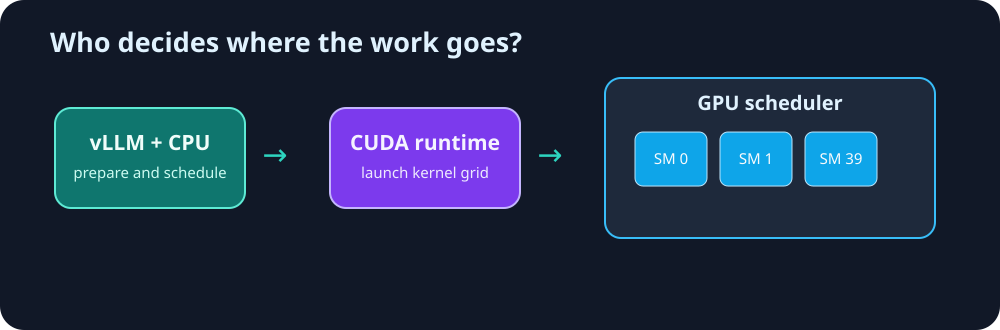
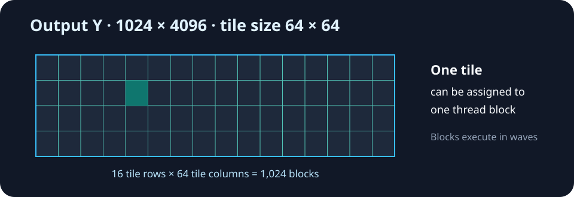
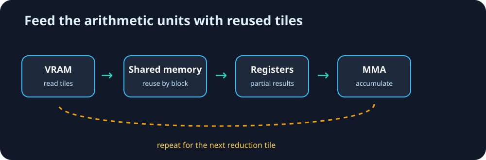
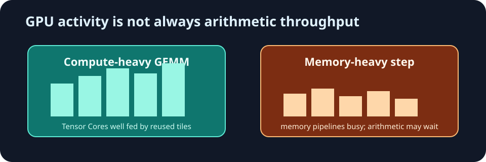
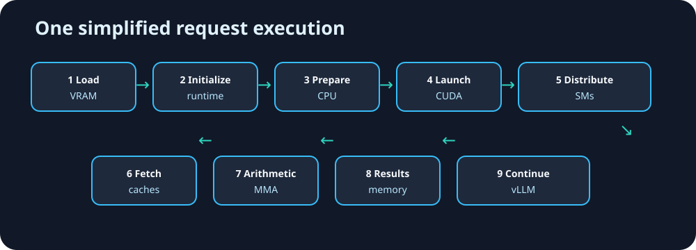

# Module 04 — Inside an NVIDIA T4: Loading and Executing a 1B Model

_vLLM & GPU Inference Engineering Masterclass · Module 04 of 64_

**Practical:** Lightning AI · NVIDIA T4 · 1 GPU

This module is a practical extension of Modules 01–03. We will combine CPU/GPU execution, T4 hardware, CUDA thread scheduling, and the memory hierarchy to follow one simplified inference execution from the GPU’s perspective.

The model in this lesson is hypothetical: exactly 1 billion parameters stored in FP16. The arithmetic is intentionally simple so that the hardware behavior is easier to see. It is not a claim about one particular model architecture or a prediction of vLLM’s exact allocator output.

### What we will understand

1. Where model weights live when vLLM loads them.
2. How host storage, CPU RAM, PCIe, and GPU VRAM participate in loading.
3. How vLLM and CUDA launch work without assigning one parameter to one core.
4. How a large matrix operation becomes tiles, blocks, warps, and instructions.
5. How VRAM, caches, shared memory, registers, CUDA cores, and Tensor Cores cooperate.
6. Why a GPU can be busy while its arithmetic units are not fully utilized.
7. How to measure model-sized allocation and matrix execution on a T4.

By the end, you should be able to narrate one complete execution path: model bytes are loaded into VRAM, kernels are launched, blocks are scheduled on SMs, data moves through the hierarchy, and execution units perform the arithmetic.

### 1. Our hardware and model

The NVIDIA T4 is a Turing-generation inference-oriented GPU.



| Resource | T4 specification |
| --- | ---: |
| Streaming Multiprocessors | 40 |
| CUDA cores | 2,560 |
| Tensor Cores | 320 |
| GPU memory | 16 GB GDDR6 |
| Peak memory bandwidth | approximately 320 GB/s |
| Peak FP16 mixed precision | approximately 65 TFLOPS |

These are published peak specifications. Application performance depends on matrix shapes, data reuse, memory traffic, kernel implementation, scheduling, and the actual runtime environment.

Our simplified model has 1 billion FP16 parameters. Since each FP16 parameter uses 2 bytes:

$$
10^9	imes2 	ext{bytes}=2{,}000{,}000{,}000 	ext{bytes}approx2 	ext{GB}
$$



The 2 GB figure represents raw model weights only. Activations, the KV cache, CUDA workspaces, allocator reservations, and runtime metadata also consume VRAM.

> Loading a model into GPU memory does not load it into CUDA cores or Tensor Cores. Memory stores parameters and tensors; execution units fetch data when kernels run.

### 2. What happens when vLLM loads the model?

The following is a conceptual command. The checkpoint path, model architecture, vLLM version, and supported dtype must match the actual environment.

```python
from vllm import LLM

llm = LLM(
    model="path/to/compatible-1b-model",
    dtype="float16",
    tensor_parallel_size=1,
    gpu_memory_utilization=0.85,
)
```

#### The model-loading path



The broad sequence is:

1. **Metadata and checkpoint loading.** The host process reads model configuration and determines the tensors required by the model.
2. **GPU allocation.** PyTorch/CUDA reserves device memory for parameter tensors. Allocation is not the same as execution.
3. **Weight transfer.** Weight bytes are staged and copied from host-side storage through CPU memory and PCIe into T4 VRAM. For this example, approximately 2 GB reaches device memory.
4. **Runtime initialization.** vLLM initializes workers and execution resources, profiles available memory, and determines how much space can be used for its KV-cache pool.

The exact implementation may use memory mapping, staging buffers, streaming, asynchronous copies, compilation, profiling kernels, or other mechanisms. The useful mental model is that model weights become long-lived GPU-resident data while requests arrive later.

#### A useful VRAM picture

The following partition is illustrative, not a measurement of a particular vLLM launch:

| Allocation | Illustrative amount |
| --- | ---: |
| Model weights | 2.0 GB |
| Runtime and working memory | 1.5 GB |
| KV-cache reservation | 10.1 GB |
| Unallocated headroom | 2.4 GB |

Actual values depend on model architecture, vLLM version, attention backend, CUDA libraries, configuration, and workload. The important distinction is that weights can remain resident while many requests reuse them.

### 3. A request arrives: who does what?

From the hardware perspective, a request is data that must pass through a sequence of mathematical operations. The CPU and vLLM organize the work; the GPU executes the kernels.

| Component | Responsibility |
| --- | --- |
| vLLM and CPU | Accept requests, prepare inputs, schedule work, and coordinate execution |
| CUDA runtime and GPU scheduler | Launch kernels and distribute thread blocks among SMs |
| Individual SM | Schedule warps and execute instructions using available hardware units |



vLLM does not manually send parameter 1 to CUDA core 1 and parameter 2 to CUDA core 2. It invokes kernels through supported computational backends. The kernel exposes a grid of thread blocks, and the GPU schedules those blocks as SM resources become available.

### 4. One illustrative matrix operation

Imagine one layer performs:

$$
Y=XW
$$

with:

$$
Xinmathbb{R}^{1024	imes4096},qquad
Winmathbb{R}^{4096	imes4096},qquad
Yinmathbb{R}^{1024	imes4096}
$$

Each output element is a dot product:

$$
Y_{ij}=sum_{k=1}^{4096}X_{ik}W_{kj}
$$

The approximate operation count is:

$$
2(1024)(4096)(4096)=34{,}359{,}738{,}368 	ext{FLOPs}
$$

That is approximately 34.36 billion FLOPs for one illustrative operation.

#### Step 1 — Divide the output into tiles

Suppose a simplified matrix-multiplication kernel divides the output into 64×64 tiles.



The output has:

$$
rac{1024}{64}=16 	ext{tile rows},qquad
rac{4096}{64}=64 	ext{tile columns}
$$

so the simplified grid contains:

$$
16	imes64=1024 	ext{output tiles}
$$

If one block handled one tile and only one block could be resident on each SM, an illustrative wave count would be:

$$
leftlceilrac{1024}{40}
ight
ceil=26 	ext{waves}
$$

This is not an execution-time prediction. Real SMs can host multiple resident blocks, and resource limits determine the actual schedule.

#### Step 2 — What happens inside one SM?

Each T4 SM includes CUDA arithmetic lanes, Tensor Cores, warp schedulers, registers, shared-memory/L1 resources, load/store units, and other execution hardware.


The SM does not understand the entire billion-parameter model. It executes instructions for the current blocks and warps. The model is represented by data and code; the scheduler keeps issuing ready work as resources allow.

### 5. What Tensor Cores do

For one conceptual output tile:

$$
Y_{	ext{tile}}=X_{	ext{tile}}W_{	ext{tile}}
$$

We can visualize the arithmetic with a small 4×4 example:

$$
X=egin{bmatrix}1&2&3&4\\2&1&0&3\\0&1&2&1\\3&2&1&0\end{bmatrix},qquad
W=egin{bmatrix}1&0&1&0\\0&1&0&1\\1&0&1&0\\0&1&0&1\end{bmatrix}
$$

which gives:

$$
Y=XW=egin{bmatrix}4&6&4&6\\2&4&2&4\\2&2&2&2\\4&2&4&2\end{bmatrix}
$$

For example:

$$
Y_{11}=1(1)+2(0)+3(1)+4(0)=4
$$


A CUDA-core implementation can perform individual arithmetic instructions. Tensor Cores are specialized for matrix multiply-accumulate operations at high throughput for supported shapes and precisions. On T4, supported FP16 matrix operations can use Tensor Cores, commonly with FP32 accumulation.

The 4×4 example is only a visual aid. It does not mean one 4×4 matrix is assigned to one physical Tensor Core. Real instructions have architecture-specific shapes, warp participation, tiling, and accumulator behavior.

| Hardware | Example activity |
| --- | --- |
| VRAM | Supplies model weights, inputs, and outputs |
| L2 cache | Provides shared hardware-managed reuse |
| L1/shared memory | Keeps selected tiles close to cooperating threads |
| Registers | Hold thread-local operands, addresses, and partial results |
| Tensor Cores | Execute supported matrix multiply-accumulate instructions |
| CUDA cores | Execute scalar arithmetic and other supported instructions |
| SM schedulers | Select ready warps and issue instructions |

Tensor Cores do not perform every part of a layer. Normalization, activation functions, additions, indexing, synchronization, and memory movement use other instructions and units. CUDA cores and Tensor Cores are complementary.

### 6. How data reaches the arithmetic units

One possible strategy for a 64×64 output tile is:

1. Read small input and weight tiles from global memory.
2. Stage reusable data in shared memory.
3. Load operands into registers or the operand paths used by matrix instructions.
4. Execute matrix multiply-accumulate instructions.
5. Accumulate partial results.
6. Repeat for the next tiles along the reduction dimension.
7. Write the completed output tile to global memory.



#### Why shared-memory reuse matters

Suppose we load a 64×32 input tile and a 32×64 weight tile in FP16:

$$
64	imes32	imes2=4096 	ext{bytes}
$$

for the input tile and the same 4096 bytes for the weight tile. Together they are 8 KiB of source data. They support approximately:

$$
2	imes64	imes64	imes32=262{,}144 	ext{FLOPs}
$$

if each source tile is fetched once and reused by the block. Each value participates in multiple operations instead of being fetched repeatedly from VRAM.

This is why fast inference is not only about having powerful Tensor Cores. The kernels must continuously feed them with reusable data.

### 7. Busy GPU versus useful arithmetic

Different workloads use different hardware resources.

| Workload | Likely behavior |
| --- | --- |
| Large FP16 matrix multiplication | Tensor Cores can handle much of the matrix arithmetic while other SM units support data movement and control |
| Elementwise addition or activation | Ordinary CUDA arithmetic may dominate; Tensor Cores can be idle |
| Large data movement | Memory pipelines can be busy while arithmetic units wait for data |



High reported GPU activity does not guarantee high Tensor Core utilization. A GPU can spend substantial time moving data without producing arithmetic at peak rate.

#### A concrete comparison

If an operation reads 2 GB of weights once, an idealized bandwidth lower bound is:

$$
T_{	ext{memory}}geqrac{2 	ext{GB}}{320 	ext{GB/s}}=6.25 	ext{ms}
$$

For the illustrative matrix operation above, a peak-compute lower bound using 65 TFLOPS is:

$$
T_{	ext{compute}}geqrac{34.36	imes10^9}{65	imes10^{12}}approx0.53 	ext{ms}
$$

These are deliberately different simplified bounds, not measured latency for the same complete inference step. They show why a large matrix operation with strong weight reuse can be compute-sensitive, while a narrow matrix-vector-like operation can be memory-sensitive.

Batch size changes this balance: more token positions can reuse the same weights and turn smaller operations into larger matrix-matrix operations.

### 8. One complete execution



| Stage | What happens | Main hardware involved |
| --- | --- | --- |
| 1. Model loading | FP16 weights move from storage into GPU VRAM | CPU, system RAM, PCIe, VRAM |
| 2. Initialization | vLLM prepares runtime resources and profiles memory | CPU, GPU, VRAM |
| 3. Request preparation | Inputs and execution work are prepared | CPU, system RAM |
| 4. Kernel launch | CUDA kernels are submitted | CPU, CUDA runtime, GPU |
| 5. Work distribution | Thread blocks are assigned to SMs | GPU scheduler, SMs |
| 6. Data fetching | Weights and inputs move through caches and shared memory | VRAM, L2, L1, shared memory |
| 7. Arithmetic | Warps execute matrix and other instructions | Tensor Cores, CUDA cores, SM units |
| 8. Results | Outputs move through registers and memory hierarchy | Registers, caches, VRAM |
| 9. Continuation | vLLM schedules the next execution step using resident weights | CPU and GPU |

Real implementations overlap activities, use specialized kernels, and make architecture-specific choices. This table is a mental model for connecting the first three modules to an inference engine.

### 9. Lightning AI lab

The companion files are:

- [`inside_t4.py`](../../code/module-04/inside_t4.py) — command-line experiments;
- [`inside_t4.ipynb`](../../code/module-04/inside_t4.ipynb) — notebook version with explanations.

#### Experiment A — Allocate a 1B-parameter FP16 tensor

Run the script with allocation enabled:

```bash
python code/module-04/inside_t4.py --allocate-model
```

The experiment allocates a 1-billion-element FP16 tensor, initializes it, synchronizes, and reports PyTorch’s allocated and reserved memory. The tensor is only a storage simulation; it is not a complete runnable language model.

#### Experiment B — Measure a large matrix operation

Run:

```bash
python code/module-04/inside_t4.py --matmul-repeats 20
```

The benchmark creates:

$$
Ainmathbb{R}^{1024	imes4096},qquad Binmathbb{R}^{4096	imes4096}
$$

in FP16, warms up the operation, measures repeated CUDA-event intervals, and reports approximate TFLOP/s. The inputs remain on the GPU during the timed region.

While the experiment runs, a separate Lightning AI terminal can show coarse device-level activity:

```bash
nvidia-smi -l 1
```

`nvidia-smi` can show memory usage, utilization, and power, but it does not directly report the percentage of CUDA cores or Tensor Cores executing useful instructions. Detailed instruction and memory counters require a profiler, which belongs to a later module.

#### What to record

Record the GPU name, PyTorch version, CUDA runtime, dtype, matrix shapes, repeat count, median or average event time, approximate TFLOP/s, and memory allocated/reserved. Explain which parts represent storage, data movement, and arithmetic.

### References

- NVIDIA, [Turing GPU Architecture Whitepaper](https://www.nvidia.com/content/dam/en-zz/Solutions/design-visualization/technologies/turing-architecture/NVIDIA-Turing-Architecture-Whitepaper.pdf) — Turing SM and Tensor Core architecture.
- NVIDIA, [T4 Tensor Core GPU Specifications](https://www.nvidia.com/en-in/data-center/tesla-t4/) — T4 hardware specifications.
- Kwon et al., [Efficient Memory Management for Large Language Model Serving with PagedAttention](https://arxiv.org/abs/2309.06180) — GPU memory management in LLM serving.
- vLLM, [GPU worker and memory profiling reference](https://docs.vllm.ai/en/latest/api/vllm/v1/worker/gpu_worker/) — Runtime memory profiling context.

### Summary

- Model weights live in VRAM; they are not permanently assigned to CUDA or Tensor Cores.
- vLLM and the CPU organize work, while CUDA and the GPU schedule blocks and warps on SMs.
- Tensor Cores accelerate supported matrix operations, but other parts of a layer use other SM resources.
- Shared-memory and cache reuse help feed arithmetic units without repeatedly fetching the same data from VRAM.
- GPU activity is not the same as peak useful arithmetic throughput.

Next is Module 05 — GPU Hardware: T4 vs A100 vs H100 and GPU Selection.
