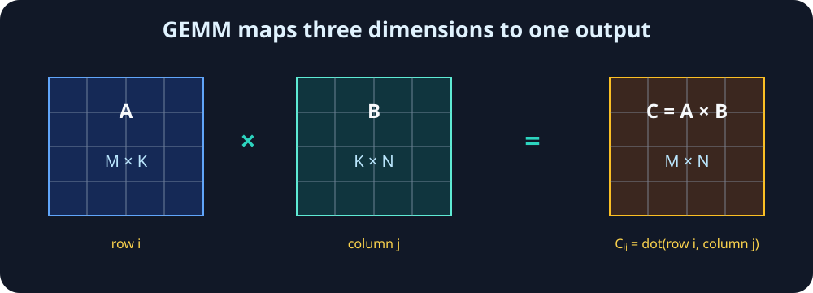
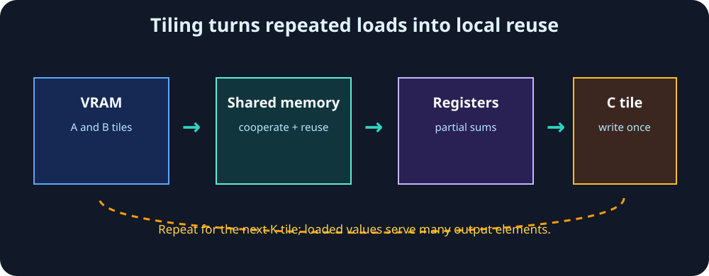
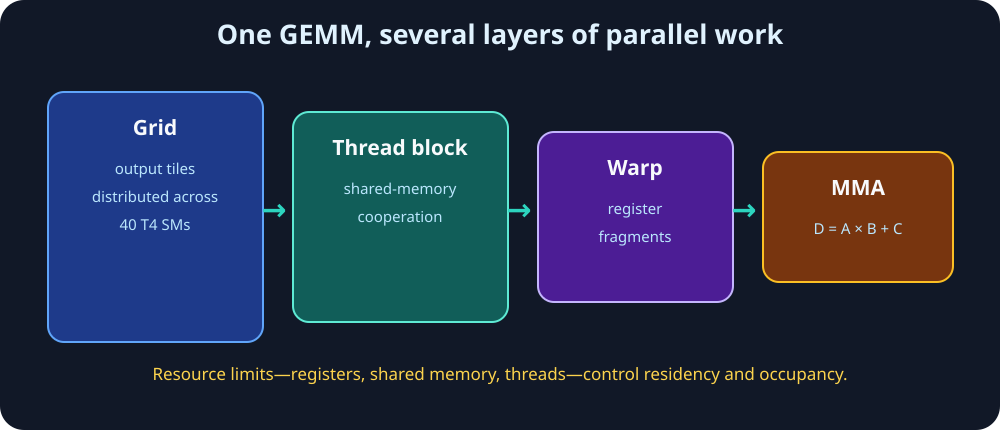
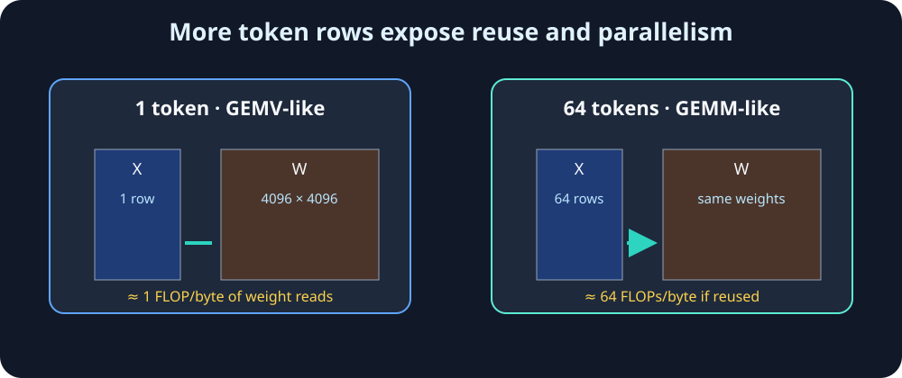
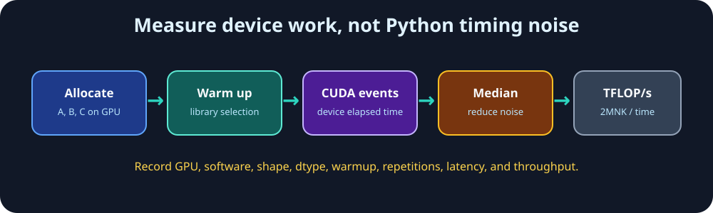

# Module 05 — Matrix Multiplication on GPUs: GEMM, FLOPs, Tiling & Tensor Cores

_vLLM & GPU Inference Engineering Masterclass · Module 05 of 64_

**Practical:** Lightning AI · NVIDIA T4 · 1 GPU

Modules 01–03 established GPU parallelism, SMs and warps, and the memory hierarchy. This module connects those ideas through the operation that dominates much of Transformer inference: matrix multiplication.

## Learning goals

By the end, you should be able to:

- derive the shape and FLOP count of a GEMM;
- explain why a naive one-thread-per-output approach repeats memory accesses;
- describe how tiled GEMM reuses data through shared memory and registers;
- distinguish hardware peak throughput from achieved TFLOP/s;
- explain why Tensor Cores accelerate supported mixed-precision matrix operations;
- connect batch size and token count to GEMV-like versus GEMM-like inference.

## 1. GEMM from first principles

GEMM means **general matrix-matrix multiplication**:

$$
C=\alpha AB+\beta C
$$

We will focus on the common case $C=AB$. If $A\in\mathbb{R}^{M\times K}$ and $B\in\mathbb{R}^{K\times N}$, then $C\in\mathbb{R}^{M\times N}$ and:

$$
C_{ij}=\sum_{k=0}^{K-1}A_{ik}B_{kj}
$$

For example,

$$
\begin{bmatrix}1&2\\3&4\end{bmatrix}
\begin{bmatrix}5&6\\7&8\end{bmatrix}
=
\begin{bmatrix}19&22\\43&50\end{bmatrix}
$$

Each output element is independent of the others, although it contains a reduction over $K$. That independence exposes parallel work to the GPU.



## 2. FLOPs and theoretical limits

There are $MN$ output elements, and each performs approximately $K$ multiplies and $K$ adds. Counting a multiply and an add as two FLOPs:

$$
\boxed{\text{FLOPs}\approx 2MNK}
$$

For a square $N\times N$ multiplication, the work grows as $2N^3$:

| Dimension | Approximate work |
| ---: | ---: |
| $128^3$ | 4.19 million FLOPs |
| $512^3$ | 268 million FLOPs |
| $1024^3$ | 2.15 billion FLOPs |
| $2048^3$ | 17.18 billion FLOPs |
| $4096^3$ | 137.44 billion FLOPs |

NVIDIA publishes approximately 8.1 TFLOP/s FP32 and 65 TFLOP/s mixed FP16/FP32 Tensor Core peak for the T4. An idealized $4096^3$ operation therefore has compute-only lower bounds of about 16.97 ms and 2.11 ms respectively:

$$
T_{\text{ideal}}=\frac{\text{FLOPs}}{\text{peak FLOPs/s}}
$$

These are not runtime predictions. Memory traffic, kernel launch overhead, shape-specific kernels, synchronization, and resource limits make achieved throughput lower and variable.

## 3. Why naive GEMM wastes reuse

A conceptual one-thread-per-output kernel looks like this:

```cpp
int row = ...;
int col = ...;
float sum = 0.0f;

for (int k = 0; k < K; ++k) {
    sum += A[row * K + k] * B[k * N + col];
}
C[row * N + col] = sum;
```

It is mathematically correct, but neighboring threads computing $C_{00}$, $C_{01}$, and $C_{02}$ repeatedly request values from the same row of $A$. Caches may help, but the algorithm does not explicitly organize cooperation or reuse.

## 4. Tiling: move each value once, use it many times

An efficient GEMM divides $A$, $B$, and $C$ into tiles. A thread block cooperatively loads an $A$ tile and a $B$ tile, places reusable values in shared memory, and accumulates one output tile. Threads then advance through tiles along the reduction dimension $K$.

For a $T\times T$ tile and an inner tile width of $T$:

$$
\text{FLOPs}=2T^3
$$

For FP32 inputs, loading both input tiles costs $8T^2$ bytes, so this simplified local model has:

$$
\boxed{\text{Arithmetic intensity}=\frac{2T^3}{8T^2}=\frac{T}{4}\text{ FLOPs/byte}}
$$



For the local FP32 tile model:

| Tile width $T$ | Input tile storage | FLOPs | Local intensity | One-thread/output threads |
| ---: | ---: | ---: | ---: | ---: |
| 8 | 0.5 KiB | 1,024 | 2 FLOPs/byte | 64 |
| 16 | 2.0 KiB | 8,192 | 4 FLOPs/byte | 256 |
| 32 | 8.0 KiB | 65,536 | 8 FLOPs/byte | 1,024 |
| 64 | 32.0 KiB | 524,288 | 16 FLOPs/byte | 4,096 |

This is a teaching model, not the full arithmetic intensity of a production GEMM. Output stores, boundary conditions, cache reuse, and the complete matrix shape also matter.

For a $2\times2$ output tile of two $4\times4$ matrices, four independent dot products issue 32 scalar input-load requests in the naive model. With inner tiles of width 2, two iterations load 8 values each, or 16 source values total. The arithmetic is unchanged; the input data is reused.

Larger tiles can increase reuse, but consume more shared memory and registers and may reduce occupancy. The fastest tile is therefore a hardware- and shape-dependent choice, not necessarily the largest one.



## 5. Blocks, warps, and Tensor Cores

For a $1024\times1024$ output with $64\times64$ block tiles:

$$
\frac{1024}{64}\times\frac{1024}{64}=256\text{ output tiles}
$$

Those blocks are distributed across the T4's 40 SMs. Inside each block, warps cooperate on sub-tiles; registers hold partial accumulators and operands; shared memory provides a software-managed staging area.

Tensor Cores execute specialized matrix multiply-accumulate instructions, conceptually:

$$
D=AB+C
$$

On T4, FP16 inputs with FP32 accumulation are a key supported mode. A Tensor Core does not independently receive an arbitrary whole matrix: warp-level instructions operate on architecture-specific fragments selected by the GEMM kernel. Loads, indexing, synchronization, epilogues, and unsupported operations still use other SM units.

T4 does not have Ampere's TF32 Tensor Core mode. Enabling a TF32 setting does not add TF32 capability to this GPU.

## 6. GEMV-like decode versus GEMM-like prefill

Consider a Transformer projection $Y=XW$ with $W\in\mathbb{R}^{4096\times4096}$.

With one token, $X\in\mathbb{R}^{1\times4096}$ and the operation performs:

$$
2\cdot1\cdot4096\cdot4096=33.55\text{ million FLOPs}
$$

The FP16 weight matrix occupies $4096^2\cdot2=32$ MiB. Considering weight reads alone gives roughly 1 FLOP/byte. This GEMV-like shape has little parallel work and limited opportunity to reuse each weight across rows.

With 64 token positions, the work becomes 2.15 billion FLOPs while the weight matrix remains 32 MiB. If the kernel reuses a weight across the 64 input rows, the idealized weight-read intensity rises to about 64 FLOPs/byte.

That is why prefill often reaches higher TFLOP/s than batch-one decode: more rows expose parallelism, amortize weight movement, and make Tensor Core tiles easier to fill. Batching decode requests can create the same effect; “decode” and “prefill” describe workload phases, not an absolute hardware limitation.

Higher throughput does not automatically mean lower latency for one request. Serving systems trade latency, batching delay, and aggregate throughput through scheduling.



## 7. T4 lab: benchmark real GEMM

The following is the complete core benchmark. Run it cell-by-cell in the Module 05 notebook, or save it as a Python file on a Lightning T4:

```python
import statistics

import torch

assert torch.cuda.is_available(), "Select a CUDA runtime."
device = torch.device("cuda:0")
props = torch.cuda.get_device_properties(device)
print("PyTorch:", torch.__version__)
print("CUDA runtime:", torch.version.cuda)
print("GPU:", props.name)
print("Compute capability:", f"{props.major}.{props.minor}")


def benchmark_matmul(m, k, n, dtype=torch.float16, warmup=10, repeats=40):
    """Return median device milliseconds and achieved TFLOP/s."""
    a = torch.randn((m, k), device=device, dtype=dtype)
    b = torch.randn((k, n), device=device, dtype=dtype)
    c = torch.empty((m, n), device=device, dtype=dtype)

    for _ in range(warmup):
        torch.mm(a, b, out=c)
    torch.cuda.synchronize(device)

    samples_ms = []
    for _ in range(repeats):
        start = torch.cuda.Event(enable_timing=True)
        end = torch.cuda.Event(enable_timing=True)
        start.record()
        torch.mm(a, b, out=c)
        end.record()
        end.synchronize()
        samples_ms.append(start.elapsed_time(end))

    median_ms = statistics.median(samples_ms)
    flops = 2 * m * k * n
    tflops = flops / (median_ms / 1000.0) / 1e12
    return median_ms, tflops


def show(label, shape, dtype, result):
    milliseconds, tflops = result
    print(
        f"{label:18s} shape={shape!s:20s} "
        f"dtype={str(dtype).removeprefix('torch.'):7s} "
        f"time={milliseconds:9.3f} ms TFLOP/s={tflops:7.2f}"
    )


# Experiment A — square FP16 GEMM.
square_results = []
for n in [256, 512, 1024, 2048, 4096]:
    result = benchmark_matmul(n, n, n, torch.float16)
    square_results.append((n, *result))
    show(f"N={n}", (n, n, n), torch.float16, result)

# Experiment B — compare FP16 and FP32.
for dtype in [torch.float16, torch.float32]:
    print(f"\\nTesting {dtype}")
    for n in [512, 1024, 2048, 4096]:
        show(f"N={n}", (n, n, n), dtype, benchmark_matmul(n, n, n, dtype))

# Experiment C — GEMV-like to GEMM-like projection shapes.
projection_results = []
for tokens in [1, 4, 16, 64, 256, 1024]:
    result = benchmark_matmul(tokens, 4096, 4096, torch.float16)
    projection_results.append((tokens, *result))
    show(f"tokens={tokens}", (tokens, 4096, 4096), torch.float16, result)
```

The same code is available as [`gemm_benchmarks.py`](../../code/module-05/gemm_benchmarks.py), with command-line options for warmup, repetitions, plotting, the tile model, numerical error, and the optional CPU loop. The complete interactive version is [`gemm_benchmarks.ipynb`](../../code/module-05/gemm_benchmarks.ipynb).

Plot the square-GEMM results from the first experiment:

```python
import matplotlib.pyplot as plt

plt.figure(figsize=(8, 4))
plt.plot(
    [row[0] for row in square_results],
    [row[2] for row in square_results],
    marker="o",
)
plt.xlabel("Square matrix dimension")
plt.ylabel("Achieved TFLOP/s")
plt.title("NVIDIA T4 — FP16 GEMM throughput")
plt.grid(alpha=0.3)
plt.show()
```

```bash
python code/module-05/gemm_benchmarks.py
```

The script uses GPU-resident tensors, warms up each shape, measures with CUDA events, and reports median device time plus:



$$
\text{Achieved TFLOP/s}=\frac{2MNK}{T_{\text{seconds}}\cdot10^{12}}
$$

For a faster first pass:

```bash
python code/module-05/gemm_benchmarks.py --sizes 256 512 1024 --tokens 1 16 64 --repeats 20
```

The script also prints the simplified tile-size model for 8, 16, 32, and 64 element tiles. It reports input storage, FLOPs, arithmetic intensity, and the number of one-thread-per-output threads. Use `--skip-tile-model` to omit it.

### Experiment A — square FP16 GEMM

Benchmark dimensions from 256 through 4096. Plot dimension against achieved TFLOP/s. Small shapes commonly underutilize the GPU because launch overhead and incomplete tiles are significant. Larger shapes often improve utilization, but throughput need not increase monotonically.

Save the plot directly from the benchmark:

```bash
python code/module-05/gemm_benchmarks.py --plot gemm_tflops.png
```

### Experiment B — FP16 versus FP32

Compare the same shapes in FP16 and FP32. FP16 can select T4 Tensor Core kernels when shape alignment and library heuristics permit it. This experiment shows performance, not which instructions executed; instruction-level confirmation requires a profiler.

Precision also changes results. A simple comparison is:

```python
torch.manual_seed(42)
a = torch.randn(512, 512, device="cuda")
b = torch.randn(512, 512, device="cuda")
c32 = a @ b
c16 = a.half() @ b.half()
error = (c32 - c16.float()).abs()
print(error.mean().item(), error.max().item())
```

The same measurement is available from the script with `--precision-error`.

### Experiment C — projection shapes

The script benchmarks $M\in\{1,4,16,64,256,1024\}$ with $K=N=4096$. Look for achieved TFLOP/s increasing as $M$ grows. Explain the result using **arithmetic intensity**, **weight reuse**, and **GPU utilization**. Identify where memory movement and under-filled tiles matter most.

### Optional experiment — naive CPU GEMM

Run the intentionally slow triple-loop implementation with:

```bash
python code/module-05/gemm_benchmarks.py --cpu
```

It uses a small $64\times64$ matrix by default, checks the result against NumPy, and demonstrates the three nested loops. This is not a fair CPU-vs-GPU benchmark: Python interpreter overhead dominates the loop. Choose a different size with `--cpu-size`, but keep it small.

The core loop is:

```python
import time
import numpy as np

n = 64
rng = np.random.default_rng(42)
a = rng.standard_normal((n, n), dtype=np.float32)
b = rng.standard_normal((n, n), dtype=np.float32)
c = np.zeros((n, n), dtype=np.float32)

started = time.perf_counter()
for i in range(n):
    for j in range(n):
        for k in range(n):
            c[i, j] += a[i, k] * b[k, j]
elapsed_ms = (time.perf_counter() - started) * 1000
print("Python loop time:", round(elapsed_ms, 2), "ms")
print("Correct:", np.allclose(c, a @ b, atol=1e-3))
```

## 8. vLLM connection

Transformer linear layers are GEMMs. A serving engine cannot change the T4's peak throughput, but it can influence the shapes presented to kernels by batching work, scheduling requests, selecting dtypes, and managing memory. Continuous batching is valuable partly because it combines otherwise small pieces of decode work into larger, more reusable matrix operations.

The same reasoning also explains why a GPU can report high activity while delivering modest TFLOP/s: memory pipelines, launch overhead, synchronization, or irregular work may be limiting the arithmetic units.

## Assignment checklist

- [ ] Benchmark FP16 square GEMMs from 256 to 4096.
- [ ] Plot achieved TFLOP/s against matrix dimension.
- [ ] Compare FP16 and FP32 execution time.
- [ ] Benchmark projection shapes with 1, 4, 16, 64, 256, and 1024 tokens.
- [ ] Explain which shapes achieve the highest TFLOP/s.
- [ ] Identify where memory bandwidth or underutilization matters most.
- [ ] Answer the final thought question using arithmetic intensity, weight reuse, and GPU utilization.

## References

- [NVIDIA CUDA C++ Programming Guide](https://docs.nvidia.com/cuda/cuda-c-programming-guide/) — Matrix multiplication and shared-memory programming.
- [NVIDIA CUDA C++ Best Practices Guide](https://docs.nvidia.com/cuda/cuda-c-best-practices-guide/) — Coalescing, reuse, and performance measurement.
- [NVIDIA T4 Tensor Core Datasheet](https://www.nvidia.com/content/dam/en-zz/Solutions/Data-Center/tesla-t4/t4-tensor-core-datasheet-951643.pdf) — T4 hardware capabilities.
- [Roofline: An Insightful Performance Model](https://doi.org/10.1145/1498765.1498785) — Arithmetic intensity and bottlenecks.
- [PagedAttention](https://arxiv.org/abs/2309.06180) — vLLM memory management and serving context.

## What to remember

| Concept | Key takeaway |
| --- | --- |
| GEMM | Approximately $2MNK$ FLOPs for $C=AB$. |
| Tiling | Reuses input data instead of independently fetching it for every output. |
| Tensor Cores | Specialized hardware for supported matrix multiply-accumulate operations. |
| Arithmetic intensity | Useful arithmetic divided by bytes moved. |
| Decode | Small token dimensions often behave GEMV-like and are harder to saturate. |
| Prefill and batching | More rows can improve reuse, parallelism, and Tensor Core utilization. |

## Final thought question

Suppose the same T4 has the same weight matrix resident in VRAM in two scenarios. Scenario A processes one decoding token. Scenario B processes 64 tokens together.

Why might scenario B achieve much higher TFLOP/s even though it uses the same GPU and the same weight matrix? Answer using **arithmetic intensity**, **weight reuse**, and **GPU utilization**.
