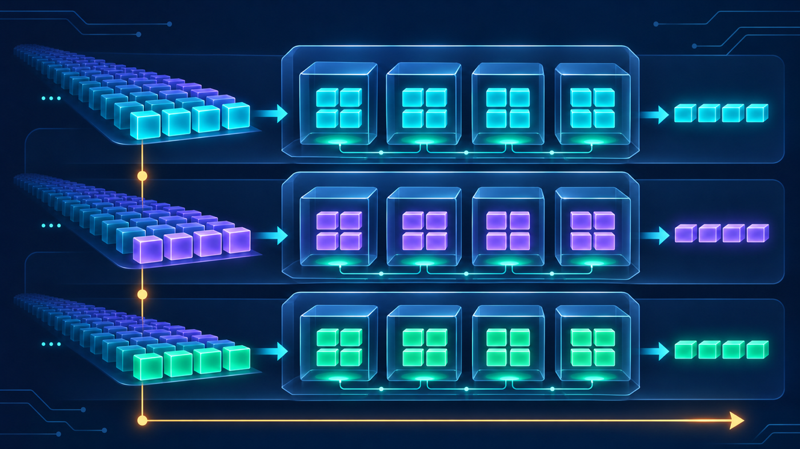
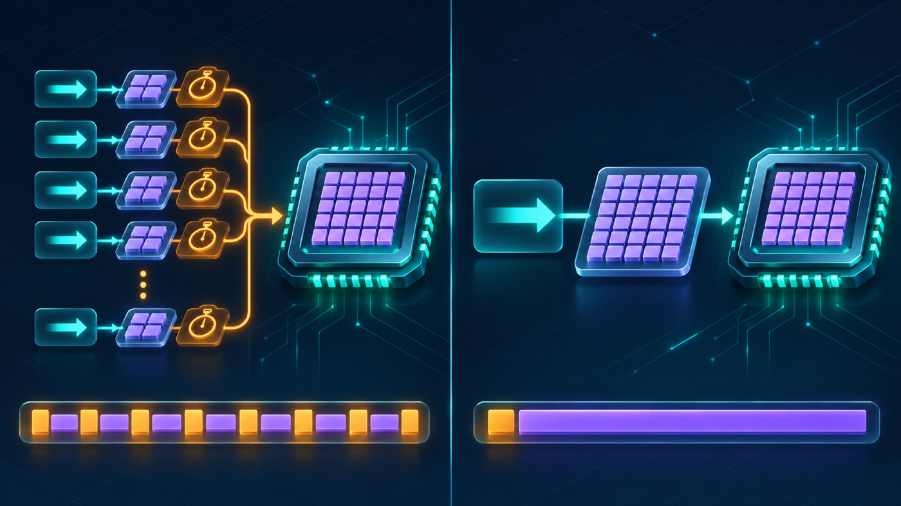

# Module 06 — CUDA Execution Model: Kernels, Threads, Blocks, Grids & Scheduling

_vLLM & GPU Inference Engineering Masterclass · Module 06 of 64_

**Practical:** Lightning AI · NVIDIA T4 · 1 GPU

In Module 05, we learned how matrix multiplication can be divided into tiles and distributed across the GPU.

But we have not fully answered one important question:

> When PyTorch executes C = A @ B, how does the GPU know which threads should calculate which parts of the result, and when should those threads execute?

That is what we will understand today.

Unlike Module 02, where we studied the GPU's physical architecture, this module focuses on the software execution model: how programmers express parallel work and how CUDA schedules that work on hardware.

## What you will learn

By the end of this module, you should understand:

1. What a CUDA kernel is and how it is launched.
2. How grids, blocks, warps, and threads relate to each other.
3. How a thread calculates its global ID.
4. How thousands of blocks execute on only 40 SMs.
5. Why CUDA launches are asynchronous.
6. How synchronization, grid-stride loops, and warp divergence work.
7. How the execution model connects to vLLM's model runner.

The companion labs are [cuda_execution_model.py](../../code/module-06/cuda_execution_model.py) and [cuda_execution_model.ipynb](../../code/module-06/cuda_execution_model.ipynb). They run on a T4 with Numba CUDA and PyTorch.

## 1. CPU code versus GPU code

Consider a simple problem. We have one million numbers and want to multiply every number by two.

On a CPU, a straightforward implementation is:

~~~python
for i in range(N):
    C[i] = 2 * A[i]
~~~

This expresses the calculation sequentially, although optimized CPU libraries can also use multiple cores and SIMD instructions.

Now imagine expressing the same calculation using GPU threads:

~~~text
i = my_thread_global_id
if i < N:
    C[i] = 2 * A[i]
~~~

Every thread runs the same kernel but receives a different thread ID.

That is the basic idea behind CUDA programming:

> Describe what each thread should do, then let the GPU execute many thread instances using its available hardware.

Creating one million CUDA threads does not mean one million threads run physically at the same moment. They are organized and scheduled in groups.

## 2. What is a CUDA kernel?

A kernel is a function that runs on the GPU. Numba lets us write a small CUDA kernel using Python syntax:

~~~python
from numba import cuda

@cuda.jit
def double_values(A, C, N):
    i = cuda.grid(1)
    if i < N:
        C[i] = 2 * A[i]
~~~

This is not ordinary CPU Python code. Numba compiles it into device-executable code, and the supported Python features inside such kernels are restricted.

Three important elements are:

- @cuda.jit marks the function for CUDA compilation;
- cuda.grid(1) computes a thread's global position in a one-dimensional grid;
- if i < N prevents threads from accessing elements beyond the valid array size.

The CPU launches the kernel, and the GPU executes the work.

### The execution path

~~~text
Python or vLLM
      ↓
PyTorch / Numba
      ↓
CUDA runtime
      ↓
kernel launch: grid → blocks → warps → threads
      ↓
SMs execute instructions
~~~

The CPU issues commands while the GPU processes them. This separation is central to how PyTorch, CUDA, and vLLM operate.

_A kernel launch expands into many blocks and warp-sized groups that execute across available SMs._

## 3. Grid → blocks → threads

Take 1,000 elements and choose 256 threads per block.

The number of blocks required is:

$$
\text{Blocks}=\left\lceil\frac{1000}{256}\right\rceil=4
$$

The kernel launch therefore creates:

$$
4\times256=1024\ \text{threads}
$$

There are 24 extra threads. They do no work because of the bounds check.

Remember the distinction:

- A **grid** is the collection of blocks launched by one kernel.
- A **block** contains threads that can cooperate through shared memory and block-level synchronization.
- A **warp** is a hardware scheduling group of 32 threads within a block.
- A **thread** executes the kernel instructions using its own indices and working values.

~~~text
one kernel launch
└── grid
    ├── block 0
    │   ├── warp 0: threads 0–31
    │   └── ...
    ├── block 1
    └── block 2
~~~

Each block has 256 threads, or eight warps. A diagram should show this hierarchy without implying that all 1,024 thread instances execute at the same time.

## 4. How does a thread know which element to process?

For a one-dimensional grid, a thread's global ID is:

$$
\boxed{\text{Global ID}=
\text{blockIdx.x}\times\text{blockDim.x}+\text{threadIdx.x}}
$$

blockIdx.x is the block's index in the grid. blockDim.x is the number of threads in each block. threadIdx.x is the thread's local position within its block.

### Numerical example

Suppose:

$$
\text{blockDim.x}=256
$$

For thread 17 inside block 2:

$$
\text{Global ID}=2\times256+17
$$

$$
\boxed{\text{Global ID}=529}
$$

This thread processes element 529. The code does not need to know which SM will execute it. The logical index is portable across devices with different numbers of SMs.

### Boundary check

With 64 threads per block:

| Global ID | Block | Local thread | Warp in block |
| ---: | ---: | ---: | ---: |
| 31 | 0 | 31 | 0 |
| 32 | 0 | 32 | 1 |
| 63 | 0 | 63 | 1 |
| 64 | 1 | 0 | 0 |
| 127 | 1 | 63 | 1 |
| 128 | 2 | 0 | 0 |
| 191 | 2 | 63 | 1 |

The local thread ID restarts at zero in every new block. The global ID does not.

## 5. How are blocks scheduled onto 40 SMs?

Imagine launching 8,000 blocks with 256 threads per block.

Total threads:

$$
8000\times256=2{,}048{,}000
$$

Total warps:

$$
2{,}048{,}000/32=64{,}000
$$

The T4 contains only 40 SMs, but the GPU does not need all two million threads to be running simultaneously. It assigns eligible blocks to SMs as resources become available.

An SM may host multiple resident blocks concurrently, depending on registers, shared memory, thread slots, and other resource limits. When a block finishes, its resources become available for another block.

### An idealized wave calculation

For Turing compute capability 7.5, the architectural limit is 1,024 resident threads per SM and 32 resident warps. The actual number may be lower because of registers, shared memory, or other constraints.

If each block contains 256 threads, the thread-count constraint alone permits:

$$
1024/256=4\ \text{resident blocks per SM}
$$

Across 40 SMs:

$$
40\times4=160\ \text{resident blocks}
$$

With 8,000 blocks, the simplified wave estimate is:

$$
8000/160=50\ \text{waves}
$$

This is an occupancy thought experiment, not an execution-time prediction. Waves do not necessarily take the same amount of time, and the actual schedule depends on resource usage and instruction behavior.

_Blocks arrive in waves as SM resources become available; not every block must be resident at once._

## 6. Can one block communicate with another block?

Ordinary CUDA blocks are designed to be independently schedulable. Threads within one block can cooperate through shared memory and synchronization, but different blocks cannot generally assume that they execute in any particular order.

Suppose block 0 writes a result needed by block 1. It is unsafe to assume block 0 will finish first just because its block index is smaller.

A common solution is to separate dependent stages into separate kernel launches. When two kernels are launched in order on the same CUDA stream, the second observes the completed effects of the first. Independent streams require explicit dependencies where needed.

More advanced CUDA features support cooperative grid synchronization under specific launch and hardware conditions, but ordinary kernels should be written so blocks can run independently.

## 7. Synchronization inside a thread block

Imagine eight threads cooperating to compute a sum. They first write values into shared memory, then read values written by neighbors. The reads must not happen before the writes are complete and visible.

CUDA provides block synchronization:

~~~python
cuda.syncthreads()
~~~

Conceptually:

~~~python
shared[thread_id] = value
cuda.syncthreads()

# Now read values produced by other threads.
result = shared[other_thread_id]
~~~

This is a block-wide barrier and provides the required ordering for cooperating threads.

One critical rule is that all threads in the block must reach the same barrier. Placing cuda.syncthreads() inside a conditional that only some threads execute can produce incorrect behavior or deadlock.

The practical lab implements a real reduction using shared memory and repeated barriers.

_Threads write partial values, wait at a block barrier, and then combine them through a reduction tree._

## 8. GPU execution is asynchronous

Consider:

~~~python
start = time.perf_counter()
C = A @ B
end = time.perf_counter()
~~~

If A and B are CUDA tensors, end minus start does not necessarily measure the entire matrix multiplication. A GPU operation often returns control to the CPU before device work has finished.

For a synchronized host-side measurement:

~~~python
torch.cuda.synchronize()
start = time.perf_counter()
C = A @ B
torch.cuda.synchronize()
elapsed = time.perf_counter() - start
~~~

This includes the GPU work and host-observed overhead. CUDA events provide a more device-focused timing mechanism and are used throughout the earlier labs.

### Why does this matter to vLLM?

An inference engine coordinates model execution, KV-cache management, sampling, and output delivery. Unnecessary synchronization can make the CPU wait while the GPU is working. Missing a required dependency can produce incorrect results.

Efficient GPU execution requires correct ordering with minimal avoidable waiting.

## 9. Practical lab A — inspect real thread IDs

Use a Lightning Studio with one NVIDIA T4.

Install the CUDA Python dependencies if needed:

~~~bash
pip install numpy numba numba-cuda
~~~

Run:

~~~bash
python code/module-06/cuda_execution_model.py --skip-grid-stride --skip-reduction --skip-launch-overhead
~~~

The lab launches three blocks with 64 threads each and writes these values for every thread:

- block index;
- local thread index;
- global thread ID;
- warp index within the block.

Inspect the boundary rows, especially global IDs 31, 32, 63, 64, 127, 128, and 191. They show where warps and blocks begin.

## 10. Practical lab B — grid-stride loops

Until now, one thread processed one data element. A thread can also process multiple elements by repeatedly jumping ahead by the total number of threads in the grid.

This is called a **grid-stride loop**.

The total grid size in threads is:

$$
S=\text{gridDim.x}\times\text{blockDim.x}
$$

Each thread processes:

$$
i,\quad i+S,\quad i+2S,\quad\dots
$$

Run:

~~~bash
python code/module-06/cuda_execution_model.py --skip-thread-inspection --skip-reduction --skip-launch-overhead
~~~

The default experiment launches 80 blocks with 256 threads:

$$
80\times256=20{,}480\ \text{threads}
$$

Those threads process one million elements. The launch size is independent of the array size because each thread loops over multiple indices.

Grid-stride loops make kernels flexible for variable-sized inputs and can simplify debugging. They do not automatically improve performance; the right launch configuration remains workload-dependent.

## 11. Practical lab C — synchronization with shared memory

The reduction experiment sums 256 values using one CUDA block:

~~~bash
python code/module-06/cuda_execution_model.py --skip-thread-inspection --skip-grid-stride --skip-launch-overhead
~~~

Initially, each of the 256 threads copies one value into shared memory. The reduction then proceeds in stages:

| Stage | Threads performing additions | Remaining partial sums |
| ---: | ---: | ---: |
| Initial | 256 loads | 256 |
| 1 | 128 | 128 |
| 2 | 64 | 64 |
| 3 | 32 | 32 |
| 4 | 16 | 16 |
| 5 | 8 | 8 |
| 6 | 4 | 4 |
| 7 | 2 | 2 |
| 8 | 1 | 1 |

After every stage, cuda.syncthreads() ensures that all participating threads have completed their writes before the next stage reads the partial sums.

This is a simplified educational reduction. Production reductions commonly use warp-level operations and other techniques to reduce synchronization overhead.

## 12. Warp divergence — when threads disagree

Imagine:

~~~python
if value > 0:
    operation_a()
else:
    operation_b()
~~~

If half the threads in a warp take one branch and half take the other, the warp may need to execute both instruction paths with different participating lanes active for each path. This is called **warp divergence**.

Important subtleties:

- divergence is primarily a within-warp issue;
- independent warps can follow different paths;
- some conditionals can be predicated instead of using explicit branch execution;
- divergence is not always the bottleneck—memory stalls or arithmetic work may dominate.

Dense matrix-multiplication kernels usually have regular control flow. Sampling, masking, indexing, cache management, and variable-length sequence processing can be more irregular.

## 13. Connecting the execution model to vLLM

Suppose vLLM receives 32 active requests. The scheduler selects work for the next model execution step. The model runner invokes a sequence of GPU operations, including matrix multiplications, attention, sampling, and other Transformer computations.

A simplified path is:

~~~text
vLLM scheduler
      ↓
model runner
      ↓
CUDA / Triton kernel launch
      ↓
grid → blocks → warps → threads
      ↓
SMs execute instructions and move data
~~~

Four practical implications follow:

1. **Launch overhead matters.** Many tiny GPU operations can spend a meaningful fraction of their time in dispatch and launch overhead.
2. **Kernel fusion can help.** Combining compatible operations can reduce launches and intermediate memory traffic.
3. **Synchronization can limit throughput.** Frequent host waits prevent the CPU from preparing work while the GPU executes.
4. **Batch size changes the work shape.** Larger batches expose more parallel work, but memory capacity and latency targets impose limits.

These ideas reappear in continuous batching, CUDA Graphs, kernel fusion, and the vLLM model runner.

## 14. Practical lab D — measuring launch overhead

This experiment compares many separate tiny PyTorch operations with one operation processing the same total number of elements:

~~~bash
python code/module-06/cuda_execution_model.py --skip-thread-inspection --skip-grid-stride --skip-reduction
~~~

The default experiment performs 100 × 1,024 elementwise multiplications in both cases:

- 100 separate launches, each operating on 1,024 elements;
- one launch operating on a 100 × 1,024 tensor.

The total number of elementwise multiplications is the same:

$$
100\times1024=102{,}400
$$

The first version repeats the same 1,024-element input rather than using 100 independent rows, so the memory access pattern is not identical. The experiment is therefore an illustration of launch and dispatch overhead, not a complete model of LLM kernel performance.

This is one motivation for CUDA Graph replay and kernel fusion.

_Many small dispatches expose repeated overhead; one larger launch consolidates the same broad class of work._

## 15. Knowledge check

Suppose a kernel has 10,000 independent blocks but the GPU has only 40 SMs. What must be true?

A. The kernel cannot execute because there are more blocks than SMs.

B. All 10,000 blocks must execute at exactly the same time.

C. Blocks are scheduled on available SMs over time, potentially with multiple resident blocks per SM.

D. Every block requires a separate physical GPU.

**Answer:** C.

## 16. References

- [NVIDIA CUDA Programming Guide](https://docs.nvidia.com/cuda/cuda-programming-guide/) — Programming model, grids, blocks, warps, scheduling, and execution.
- [NVIDIA Compute Capabilities](https://docs.nvidia.com/cuda/cuda-programming-guide/05-appendices/compute-capabilities.html) — T4 compute capability 7.5 and per-SM resource limits.
- [Numba CUDA: Writing Kernels](https://nvidia.github.io/numba-cuda/user/kernels.html) — Kernel launches, thread indexing, and grid-stride loops.
- [Numba CUDA Kernel API](https://nvidia.github.io/numba-cuda/reference/kernel.html) — Thread and block indices, barriers, and execution primitives.
- Harris, [CUDA Pro Tip: Write Flexible Kernels with Grid-Stride Loops](https://developer.nvidia.com/blog/cuda-pro-tip-write-flexible-kernels-grid-stride-loops/) — An implementation-oriented NVIDIA article.

## Module 06 recap

| Concept | Remember this |
| --- | --- |
| Kernel | GPU function launched by the CPU |
| Grid | Collection of blocks in one kernel launch |
| Block | Group of cooperating threads assigned to one SM |
| Warp | Scheduling group of 32 threads |
| Global index | Block index × block size + local thread index |
| Grid-stride loop | Allows each thread to process multiple elements |
| Synchronization | Ensures required ordering and visibility |
| Asynchronous launch | CPU can enqueue GPU work without waiting for completion |
| Warp divergence | Different paths inside a warp can reduce efficiency |

Module 06 complete.

You now have the foundations needed to understand how CUDA expresses and schedules GPU execution.

Next: Module 07 — coming soon.
