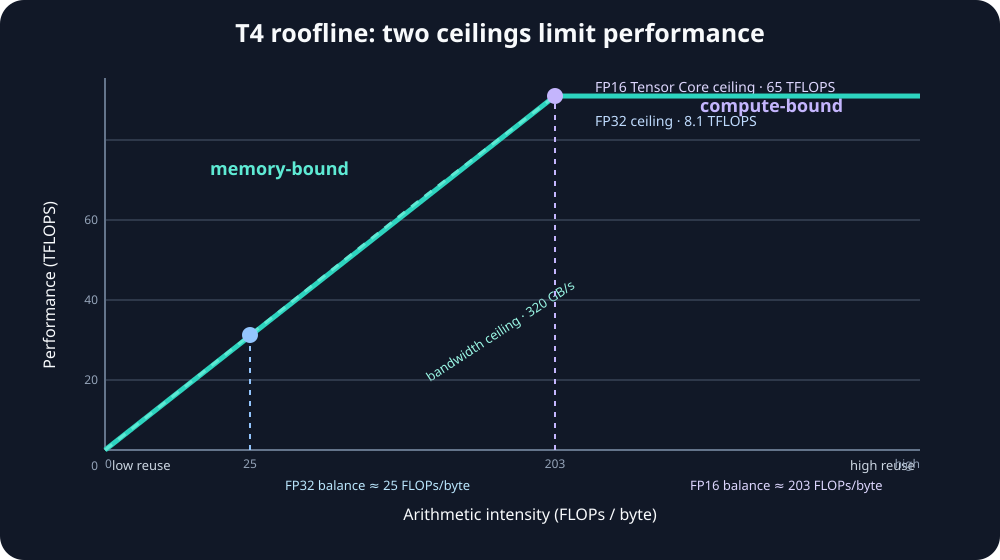

# Module 07 — GPU Bottlenecks: Memory Bandwidth, Compute & the Roofline Model

_vLLM & GPU Inference Engineering Masterclass · Module 07 of 64_

**Practical:** Lightning AI · NVIDIA T4 · 1 GPU

Modules 01–06 explained GPU architecture, memory, GEMM, and CUDA execution. This module combines those foundations into one of the most useful performance models in GPU engineering: the Roofline Model.

The key lesson is simple:

> GPU performance depends on the relationship between computation and data movement, not only on the number of FLOPs.

## Learning objectives

You will learn to:

- distinguish compute-bound, memory-bound, and launch-bound work;
- calculate FLOPs, bytes, and arithmetic intensity;
- use the Roofline equation to estimate a theoretical ceiling;
- understand why LLM prefill and decode have different bottlenecks;
- explain how batching changes weight reuse and arithmetic intensity;
- interpret GPU utilization without confusing it with achieved TFLOPS;
- measure the hypotheses with a T4.

## 1. Arithmetic intensity

Arithmetic intensity is:

$$
\boxed{AI=\frac{\text{Floating-point operations}}{\text{Bytes transferred}}}
$$

Vector addition performs one addition for every 12 useful FP32 bytes:

$$
AI_{\text{vector add}}=\frac{1}{12}\approx0.083\text{ FLOPs/byte}
$$

A tiled $1024\times1024$ FP16 matrix multiplication performs approximately 2.147 billion FLOPs while its minimum logical traffic is about 6.29 MB:

$$
AI_{\text{GEMM}}\approx341\text{ FLOPs/byte}
$$

The GEMM can reuse loaded values many times; the vector add cannot.

## 2. The Roofline Model

The idealized performance ceiling is:

$$
\boxed{P_{\text{achievable}}\leq\min\left(P_{\text{peak}},AI\times BW_{\text{peak}}\right)}
$$

For a representative T4, use approximately 8.1 TFLOPS FP32, 65 TFLOPS mixed FP16/FP32 Tensor Core arithmetic, and 320 GB/s peak memory bandwidth. The simplified balance points are:

| Compute path | Balance point |
| --- | ---: |
| FP32 | $8.1\text{ TFLOPS}/320\text{ GB/s}\approx25.3$ FLOPs/byte |
| FP16 Tensor Core | $65\text{ TFLOPS}/320\text{ GB/s}\approx203.1$ FLOPs/byte |

Below the balance point, more arithmetic intensity can increase the memory roof. Above it, the simplified compute roof becomes limiting. Real kernels fall below these ceilings because of shape, instruction efficiency, occupancy, synchronization, cache behavior, and overhead.



## 3. Decode, prefill, and batching

For a simplified dense model with 1 billion FP16 parameters, the weights occupy about 2 GB. If one generated token causes roughly $2P$ FLOPs and streams the weights once:

$$
AI_{\text{one token}}\approx\frac{2\times10^9}{2\times10^9}=1\text{ FLOP/byte}
$$

The memory lower bound at 320 GB/s is 6.25 ms, while the compute lower bound at 65 TFLOPS is only about 0.031 ms. The simplified decode step is therefore memory-sensitive.

If 64 token positions reuse the same weight stream:

$$
AI\approx64\text{ FLOPs/byte}
$$

The operation still sits below the FP16 Tensor Core balance point, but it has more parallel work and better reuse. At sufficiently large token batches, the compute roof can become relevant.

This is why continuous batching can improve aggregate throughput without guaranteeing lower latency for an individual request.

## 4. Practical T4 experiments

The companion script is [`roofline_benchmarks.py`](../../code/module-07/roofline_benchmarks.py), with an interactive notebook in [`roofline_benchmarks.ipynb`](../../code/module-07/roofline_benchmarks.ipynb).

Run the full lab on a T4:

```bash
python code/module-07/roofline_benchmarks.py \
  --plot module07_projection_tflops.png
```

It measures:

1. FP32 vector addition and useful-data bandwidth;
2. a large FP16 GEMM and achieved TFLOPS;
3. a fixed-weight projection across token/batch dimensions.

Use CUDA events, warmups, and medians. A roofline calculation gives a strong hypothesis; profiler counters are needed to confirm achieved DRAM throughput, Tensor Core activity, occupancy, and stalls.

### Experiment A — vector addition

For $N=16{,}000{,}000$, useful traffic is approximately 192 MB:

```python
N = 16_000_000
A = torch.randn(N, device="cuda", dtype=torch.float32)
B = torch.randn(N, device="cuda", dtype=torch.float32)
C = torch.empty_like(A)

torch.add(A, B, out=C)
```

Report useful GB/s and explain why the operation is memory-oriented even though its GPU utilization may be high.

### Experiment B — large GEMM

Compare achieved TFLOPS with the theoretical 65 TFLOPS T4 FP16 reference. Do not interpret the gap as a single bug: it may reflect shape, library choice, clocks, memory traffic, or instruction efficiency.

### Experiment C — projection shape

With $W\in\mathbb{R}^{4096\times4096}$, compare $XW$ for input rows 1, 4, 16, 32, 64, 128, 256, and 512. Plot achieved TFLOPS against rows and explain the change using weight reuse, arithmetic intensity, and available parallelism.

## 5. Utilization is not a bottleneck diagnosis

`nvidia-smi` GPU utilization indicates that the device was active during sampled intervals. It does not say that Tensor Cores ran at peak throughput or that DRAM bandwidth was saturated.

| Metric | What it tells you |
| --- | --- |
| GPU utilization | Whether work was running during sampling intervals |
| VRAM allocated | Memory occupied by allocations |
| Achieved TFLOPS | Arithmetic throughput for a defined operation |
| DRAM throughput | Device-memory traffic rate |
| Kernel time | Duration of one GPU operation |
| TTFT/ITL | User-visible inference latency |

High utilization with low TFLOPS can be a perfectly normal memory-bound workload. Low utilization with slow execution can indicate tiny kernels, CPU dispatch, synchronization, or insufficient parallel work.

## 6. vLLM connection

| Technique | Primary bottleneck it can change |
| --- | --- |
| Continuous batching | Parallelism and weight reuse |
| Quantization | Weight bytes and memory traffic |
| FlashAttention | Attention-related memory movement |
| PagedAttention | KV-cache allocation and access behavior |
| CUDA Graphs | CPU launch and dispatch overhead |
| Prefix caching | Repeated prompt computation |
| Tensor parallelism | Local compute, memory capacity, and communication |

The right optimization follows the measured limiting resource. Quantization does not directly fix CPU dispatch overhead; CUDA Graphs do not eliminate a weight-bandwidth ceiling.

## References

- [Roofline: An Insightful Performance Model](https://doi.org/10.1145/1498765.1498785)
- [NVIDIA CUDA C++ Best Practices Guide](https://docs.nvidia.com/cuda/cuda-c-best-practices-guide/)
- [PyTorch CUDA semantics](https://docs.pytorch.org/docs/stable/notes/cuda.html)
- [PagedAttention](https://arxiv.org/abs/2309.06180)

Module 07 complete.
