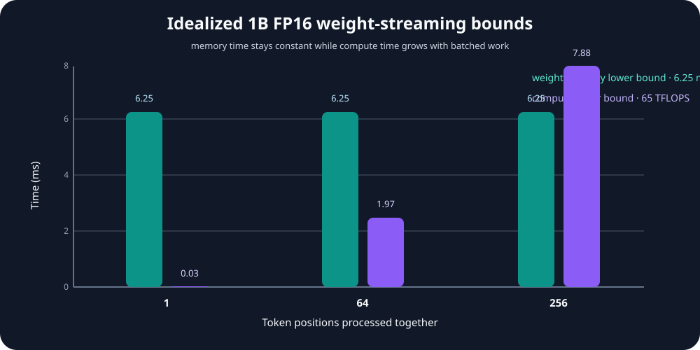

# Module 07 — GPU Bottlenecks: Memory Bandwidth, Compute & the Roofline Model

_vLLM & GPU Inference Engineering Masterclass · Module 07 of 64_

**Practical:** Lightning AI · NVIDIA T4 · 1 GPU

Modules 01–06 introduced GPU architecture, memory, GEMM tiling, Tensor Cores, and CUDA scheduling. This module combines those ideas into one practical question:

> What is actually limiting this workload?

A GPU can be busy while arithmetic units wait for data. It can also have memory bandwidth available while a matrix operation is limited by compute throughput, shape efficiency, or launch overhead.

The Roofline Model gives us a compact way to reason about these possibilities:

$$
P\leq\min(P_{\text{peak}},AI\times BW)
$$

The companion lab is [`roofline_benchmarks.py`](../../code/module-07/roofline_benchmarks.py). It measures a memory-oriented vector add, FP16 GEMM, and projection shapes on a T4.

## What you will learn

- calculate arithmetic intensity;
- separate memory-bandwidth and compute ceilings;
- distinguish memory-bound, compute-bound, and launch-sensitive work;
- explain why batch-one decode and prefill stress different GPU resources;
- interpret achieved TFLOP/s without confusing it with peak TFLOP/s;
- form and test a GPU bottleneck hypothesis.

## 1. Arithmetic intensity and the two ceilings

For a workload that performs $F$ floating-point operations and moves $B$ bytes:

$$
AI=\frac{F}{B}\quad\text{FLOPs/byte}
$$

The memory roof is $AI\times BW$. The compute roof is the hardware's peak throughput for the selected precision and instruction path. Achievable performance cannot exceed the smaller roof.


The arithmetic intensity where the two roofs meet is:

$$
AI_{\text{balance}}=\frac{P_{\text{peak}}}{BW}
$$

Using a T4 reference of 65 TFLOP/s mixed FP16/FP32 Tensor Core throughput and 300 GB/s memory bandwidth:

$$
AI_{\text{balance}}\approx\frac{65\times1{,}000}{300}\approx216.7\text{ FLOPs/byte}
$$

This is a simplified reference, not a guarantee that a real kernel reaches either peak.

## 2. Memory-oriented work: vector addition

For FP32 vector addition, each element reads two 4-byte values, writes one 4-byte result, and performs one addition:

$$
AI_{\text{add}}=\frac{1}{12}\approx0.083\text{ FLOPs/byte}
$$

At 300 GB/s, the simplified memory roof is approximately 0.025 TFLOP/s. Vector addition is therefore not expected to produce a large TFLOP/s number; its useful metric is effective bandwidth:

$$
BW_{\text{effective}}=\frac{3N\times4}{T_{\text{seconds}}}
$$

## 3. Compute-oriented work: GEMM

For $C=AB$ with $A\in\mathbb{R}^{M\times K}$ and $B\in\mathbb{R}^{K\times N}$:

$$
\text{FLOPs}=2MKN
$$

The achieved throughput is:

$$
\text{TFLOP/s}=\frac{2MKN}{T_{\text{seconds}}\times10^{12}}
$$

Large square GEMMs expose many blocks and warps, reuse operands through the memory hierarchy, and can use Tensor Core matrix instructions for supported FP16 shapes. Small or awkward shapes can be much less efficient on the same GPU and dtype.

## 4. Decode-like versus prefill-like shapes

Consider a projection with a fixed weight matrix $W\in\mathbb{R}^{4096\times4096}$. With one token, $X\in\mathbb{R}^{1\times4096}$; with 64 tokens, $X\in\mathbb{R}^{64\times4096}$. The weight matrix is the same, but the larger input has more rows over which to reuse the weights.

The one-token operation is GEMV-like and often has low effective arithmetic intensity. Prefill and batched decode are more GEMM-like and can use Tensor Cores more effectively. “Decode is memory-bound” is a useful hypothesis, not a universal law.

## 5. Launch overhead

GPU kernels are asynchronous from the CPU's perspective. A tiny kernel may perform so little work that submission, scheduling, and synchronization are a significant fraction of total time. Batching, fusion, fewer intermediate writes, and CUDA Graphs can help when measurements support those remedies.

## 6. T4 lab

```bash
python code/module-07/roofline_benchmarks.py \
  --elements 16000000 \
  --gemm-size 4096 \
  --batches 1 4 16 32 64 128 256 512 \
  --hidden-size 4096 \
  --warmup 15 \
  --repeats 50 \
  --plot projection_tflops.png
```

The script reports GPU metadata, simplified ceilings, FP32 vector-add bandwidth, FP16 GEMM throughput, and projection throughput as the token/batch dimension grows.



## 7. Interpret results carefully

| Observation | Hypothesis | Next check |
| --- | --- | --- |
| Vector add has high useful GB/s but low TFLOP/s | Memory-oriented work is behaving as expected | Inspect memory transactions and access pattern |
| GEMM throughput rises with matrix size | Small shapes were under-filled or launch-sensitive | Test more shapes and batch dimensions |
| FP16 is much faster than FP32 | A Tensor Core path is effective for that shape | Check numerical behavior and kernel selection |
| Projection throughput rises with batch | Weight reuse and parallelism improved | Compare decode, batched decode, and prefill traces |
| Results vary across repetitions | Background activity or clocking affects the run | Increase warmup and inspect `nvidia-smi` |

These are hypotheses. A profiler is needed to confirm which pipeline limits the actual kernel.

## Assignment

- [ ] Calculate arithmetic intensity for FP32 vector add.
- [ ] Calculate the T4 FP16 balance point using 65 TFLOP/s and 300 GB/s.
- [ ] Run the T4 roofline lab and save the projection plot.
- [ ] Identify one memory-oriented and one compute-oriented measurement.
- [ ] Compare projection batch 1 with batch 128 and relate the result to decode and prefill.
- [ ] Write one bottleneck hypothesis and one experiment that could falsify it.

## Module 07 recap

1. Arithmetic intensity links useful computation to data movement.
2. The Roofline Model provides memory and compute ceilings.
3. Vector addition is low-intensity and usually memory-oriented.
4. Large GEMM can use Tensor Cores more effectively than small or awkward shapes.
5. Decode, prefill, and batched decode stress different parts of the same GPU.
6. Measurements form hypotheses; profiling and end-to-end serving tests validate them.

Module 07 complete.

Next is Module 08 — GPU Hardware Selection: T4 vs A100 vs H100 vs H200 vs B200.
