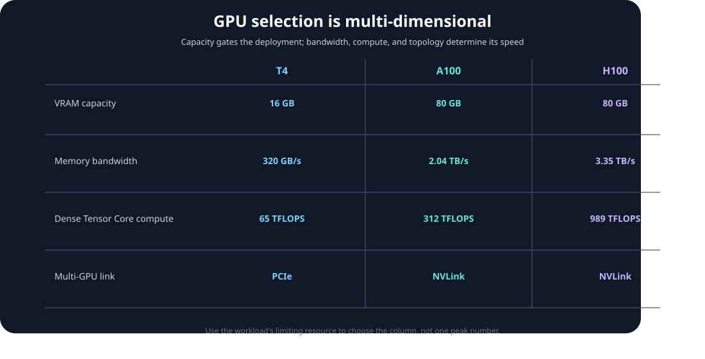
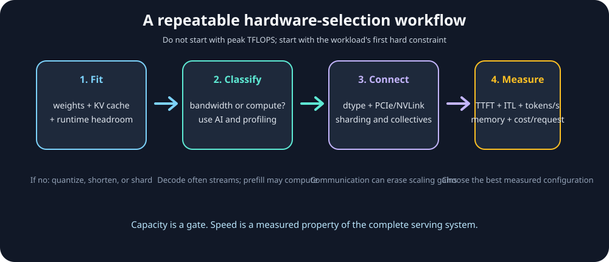

# Module 07 — GPU Hardware Selection: T4 vs A100 vs H100

_vLLM & GPU Inference Engineering Masterclass · Module 07 of 64_

**Practical:** Lightning AI · NVIDIA T4 · 1 GPU

In the first six modules, we learned how GPU execution works: SMs and warps, the memory hierarchy, tiled GEMM, and CUDA scheduling. We can now ask a practical engineering question:

> Which GPU should run this inference workload?

The answer is not simply “the GPU with the most TFLOPS.” A model must fit in memory, weights and KV-cache data must be delivered quickly, kernels must have enough compute capacity, and multi-GPU communication must not dominate the critical path.

This module compares three important NVIDIA data-center GPUs:

- **T4** — an efficient Turing inference GPU and the primary course device;
- **A100** — an Ampere accelerator available in 40 GB and 80 GB variants;
- **H100** — a Hopper accelerator designed for substantially higher AI throughput and memory bandwidth.

The goal is not to memorize a product table. It is to learn a repeatable selection process that you can apply to a new model, serving target, and budget.

## Learning goals

By the end of this module, you should be able to:

- separate capacity, bandwidth, compute, interconnect, and cost constraints;
- estimate whether model weights and KV cache fit in a GPU's usable VRAM;
- explain why decode throughput often follows memory bandwidth more closely than peak TFLOPS;
- identify when Tensor Core precision support changes the useful compute ceiling;
- explain why PCIe, NVLink, and multi-GPU sharding affect tensor-parallel serving;
- choose a reasonable GPU for a latency, throughput, or learning workload;
- measure the actual device available to you instead of trusting a requested SKU name.

The companion lab is [`hardware_selection.py`](../../code/module-07/hardware_selection.py). It runs without a GPU for capacity and roofline calculations, and it can inspect or benchmark a CUDA device when one is available.

The notebook version is [`hardware_selection.ipynb`](../../code/module-07/hardware_selection.ipynb). It follows the same sequence interactively and adds plots for capacity sensitivity and the simplified roofline.

## 1. A GPU is a set of constraints

For inference, think of a GPU as five coupled resources:

| Resource | The question it answers | Typical failure mode |
| --- | --- | --- |
| **Memory capacity** | Can weights, KV cache, workspaces, and runtime state fit? | Out-of-memory or a smaller usable batch |
| **Memory bandwidth** | How quickly can weights and activations be streamed? | Low decode tokens/sec despite high GPU activity |
| **Compute throughput** | How much supported arithmetic can the GPU execute? | Prefill or large-batch work is compute-limited |
| **Interconnect** | How quickly can data move between GPU, CPU, and peer GPUs? | Tensor-parallel communication dominates |
| **Power, price, and availability** | Can the service meet its cost and operational target? | A technically fast GPU is uneconomical to deploy |

These resources interact. More compute is useful only when the memory system can feed it. More memory capacity lets a model or batch fit, but does not automatically increase tokens/sec. An NVLink-connected pair can scale better than two PCIe-only GPUs, but the model still has to be partitioned and the collective communication still has a cost.

The first selection rule is therefore:

> **Capacity is a gate. Bandwidth and compute determine speed after the workload fits.**

## 2. The three GPUs at a glance

The following table uses representative data-center configurations: T4 PCIe, A100 80 GB SXM, and H100 80 GB SXM. A100 and H100 also have other form factors and memory sizes; always check the exact SKU.

| Specification | NVIDIA T4 | NVIDIA A100 80 GB SXM | NVIDIA H100 80 GB SXM |
| --- | ---: | ---: | ---: |
| Architecture | Turing | Ampere | Hopper |
| GPU memory | 16 GB GDDR6 | 80 GB HBM2e | 80 GB HBM3 |
| Peak memory bandwidth | 320 GB/s | 2,039 GB/s | 3.35 TB/s |
| Dense FP32 peak | 8.1 TFLOPS | 19.5 TFLOPS | 67 TFLOPS |
| Dense FP16/BF16 Tensor Core peak | 65 TFLOPS mixed FP16/FP32 | 312 TFLOPS | 989 TFLOPS |
| NVLink | Not available on the T4 | Up to 600 GB/s in supported systems | Up to 900 GB/s on SXM |
| Typical system link | PCIe Gen3 x16 | PCIe Gen4 and/or NVLink | PCIe Gen5 and/or NVLink |
| TDP class | 70 W | Up to 400 W SXM | Up to 700 W SXM |

The dense Tensor Core figures intentionally exclude the optional 2:4 structured-sparsity doubling published in the product datasheets. They are theoretical peaks, not guaranteed application throughput. T4's 65 TFLOPS figure is its published mixed FP16/FP32 Tensor Core rate; the exact instruction mode and accumulation type still matter.



_Capacity, bandwidth, compute, and interconnect improve in different proportions; there is no single “faster” axis._

### Why the memory technology matters

The T4 uses GDDR6 and offers 16 GB at roughly 320 GB/s. A100 uses HBM2e and raises both capacity and bandwidth substantially. H100 uses HBM3 and raises bandwidth again while adding newer Tensor Core capabilities.

For a bandwidth-bound decode step, the rough idealized time to stream $B$ bytes is:

$$
T_{\text{memory}}\geq\frac{B}{BW_{\text{peak}}}
$$

For 16 GB of data, the lower bounds are approximately:

| GPU | Idealized time to stream 16 GB once |
| --- | ---: |
| T4 at 320 GB/s | 50.0 ms |
| A100 at 2,039 GB/s | 7.85 ms |
| H100 at 3.35 TB/s | 4.78 ms |

Real kernels do not achieve the published peak on every pass. These numbers are useful because they show why a newer GPU can improve batch-one decode even when the operation does not have enough arithmetic intensity to use all available Tensor Core FLOPS.

## 3. Capacity comes first: will the model fit?

The raw parameter count is only the first term in a memory budget.

For a dense model, the weight estimate is:

$$
M_{\text{weights}}\approx P\times\text{bytes per parameter}
$$

Useful approximations are:

| Weight format | Approximate bytes per parameter | 7B weight storage before overhead |
| --- | ---: | ---: |
| FP32 | 4 | 28 GB |
| FP16 or BF16 | 2 | 14 GB |
| INT8 | 1 | 7 GB |
| INT4 | 0.5 | 3.5 GB |

The actual checkpoint can be larger because of metadata, per-group scales, padding, embeddings, and format-specific packing. Serving also needs memory for activations, temporary workspaces, CUDA graphs, allocator fragmentation, and the KV cache.

A safer planning estimate is:

$$
M_{\text{required}}\approx M_{\text{weights}}+M_{\text{KV}}+M_{\text{workspace}}+M_{\text{runtime}}
$$

Do not plan to use 100% of advertised VRAM. A conservative first pass reserves 10–15% for runtime and fragmentation. That makes a 16 GB T4 a poor target for a 7B FP16 model even though the raw weights are about 14 GB: there is not enough headroom for KV cache and execution state.

### KV-cache capacity

For one layer and one token, the key and value vectors require approximately:

$$
M_{\text{KV/token}}=2\times L\times H_{\text{KV}}\times D_{\text{head}}\times\text{bytes per element}
$$

where $L$ is the number of layers, $H_{\text{KV}}$ is the number of key/value heads, and $D_{\text{head}}$ is the head dimension. The leading 2 accounts for K and V.

For example, a model with 32 layers, 8 KV heads, head dimension 128, and FP16 KV cache uses approximately:

$$
2\times32\times8\times128\times2=131{,}072\text{ bytes/token}
$$

That is about 128 KiB per token, or about 512 MiB for a 4,096-token sequence. Multiply by the number of active sequences and include prefixes that remain cached. Grouped-query attention reduces KV memory because $H_{\text{KV}}$ is smaller than the number of query heads.

This is one reason the same model can fit for a short single request but fail under concurrent long-context traffic.

### Capacity is not a shared pool

Two 16 GB T4 cards provide 32 GB of physical VRAM, but a normal process cannot treat them as one transparent 32 GB allocation. The model must be sharded, replicated, or otherwise distributed, and communication is required when partitions exchange activations.

Tensor parallelism can make a model fit, but “it fits across two GPUs” is not the same as “it serves efficiently across two GPUs.”

## 4. Bandwidth versus compute

Modules 05 and 06 introduced GEMM shape and the Roofline Model. The same reasoning helps choose between GPUs.

For a workload with arithmetic intensity $AI$:

$$
P_{\text{achievable}}\leq\min\left(P_{\text{peak}},AI\times BW_{\text{peak}}\right)
$$

Using the representative dense FP16 figures above gives these approximate balance points:

$$
AI_{\text{critical}}=\frac{P_{\text{peak}}}{BW_{\text{peak}}}
$$

| GPU | Dense FP16/BF16 peak | Bandwidth | Approximate balance point |
| --- | ---: | ---: | ---: |
| T4 | 65 TFLOPS | 320 GB/s | 203 FLOPs/byte |
| A100 80 GB SXM | 312 TFLOPS | 2,039 GB/s | 153 FLOPs/byte |
| H100 80 GB SXM | 989 TFLOPS | 3,350 GB/s | 295 FLOPs/byte |

These are simplified external-memory roofs. Kernel tiling, cache reuse, instruction mix, shape, occupancy, and precision support move real behavior below the lines.

### Decode is often bandwidth-sensitive

During batch-one decode, a layer may perform a matrix-vector-like operation. The weight matrix is large, but the token dimension is only one row. The GPU may spend most of its time bringing weights and KV-cache data through the memory hierarchy rather than issuing enough matrix arithmetic to saturate Tensor Cores.

In that regime, moving from T4 to A100 or H100 helps because memory bandwidth increases dramatically. Reducing weight bytes with quantization can help for the same reason. More peak Tensor Core FLOPS may be mostly unused.

### Prefill and batching can become compute-sensitive

Prefill processes many prompt positions together. Continuous batching can also combine decode work from multiple active requests. More rows increase parallelism and let a weight value participate in more multiply-accumulate operations before it is evicted.

As arithmetic intensity rises, the workload can move toward the compute roof. Then Tensor Core generation, supported precision, matrix shape, and achieved TFLOPS matter much more.

This is why a hardware choice can differ by service objective:

- a low-concurrency, batch-one service may value bandwidth and capacity first;
- a high-throughput batch service may benefit strongly from compute and Tensor Core features;
- long-context service may be gated by capacity and KV-cache bandwidth before either peak compute metric.

## 5. Precision changes the useful hardware

Peak numbers are only comparable when the operation uses the same precision and instruction path.

| Precision or mode | T4 | A100 | H100 |
| --- | --- | --- | --- |
| FP32 CUDA arithmetic | Supported | Supported | Supported |
| FP16 Tensor Cores | Supported | Supported | Supported |
| BF16 Tensor Cores | Not the normal T4 path | Supported | Supported |
| TF32 Tensor Cores | Not supported | Supported | Supported |
| FP8 Tensor Cores | Not supported | Not supported | Supported |
| INT8/INT4 inference paths | Supported with library/kernel constraints | Supported | Supported, with newer optimized paths |

The practical implication is not “always use the newest precision.” It is:

> Select a precision that preserves model quality, is supported by the GPU, and has a fast kernel in the serving stack you actually use.

For example, a workload advertised as FP8-optimized cannot realize that benefit on a T4. On a T4, FP16 or INT8/INT4 paths may be more appropriate, depending on model support and accuracy requirements. A100 adds BF16 and TF32 options; H100 adds FP8 Tensor Core support and much larger published Tensor Core ceilings.

Quantization reduces weight storage and usually reduces the bytes moved per token, but its end-to-end benefit depends on dequantization overhead, kernel support, activation precision, and whether the workload was capacity-, bandwidth-, or compute-limited.

## 6. Interconnect: one GPU versus many

The GPU's HBM/GDDR bandwidth is not the same as its host or peer interconnect bandwidth.

### PCIe

PCIe connects a GPU to the host and, depending on platform, may provide a path between GPUs. It is general-purpose and widely available, but it has much lower bandwidth and higher latency than on-package HBM. A PCIe transfer can therefore become a bottleneck when a serving design frequently moves activation tensors or synchronizes partitions.

### NVLink

NVLink is a higher-bandwidth GPU interconnect used in supported A100 and H100 systems. It is valuable for tensor parallelism because every layer may exchange partial results across GPU partitions. The published NVLink number is a system and topology specification, not a guarantee that an all-reduce in your application will reach that number.

### Tensor parallelism is a communication problem too

If a layer is split across $N$ GPUs, each GPU does less local matrix work, but collective communication combines or exchanges the partial results. A rough mental model is:

$$
T_{\text{step}}\approx T_{\text{compute,local}}+T_{\text{collective}}+T_{\text{launch/other}}
$$

Adding GPUs helps when the reduction in local compute is larger than the communication and scheduling cost. NVLink can make this tradeoff much better than PCIe, especially for high-throughput tensor-parallel execution.

Data parallel replicas avoid per-layer communication but duplicate weights. That can be attractive for independent requests when the model fits on each GPU and the goal is aggregate throughput rather than a single larger model.

## 7. Choosing by workload, not by product name

Here is a useful first-pass decision matrix:

| Workload or constraint | Reasonable starting point | Why |
| --- | --- | --- |
| Learn CUDA, benchmark kernels, serve small quantized models | T4 | Low power, inexpensive access, enough for fundamentals |
| 1–3B FP16 model with moderate context | T4 or A100 40 GB | T4 can work if KV and runtime headroom are small; A100 provides margin |
| 7B FP16 model or long context | A100 40/80 GB | T4 capacity is usually the gate; HBM bandwidth helps decode |
| High-concurrency prefill and decode | A100 or H100 | More capacity, bandwidth, and compute expose better batching options |
| FP8-optimized serving | H100 | Hardware supports FP8 Tensor Core execution |
| Tensor parallel across several GPUs | A100/H100 NVLink system | Peer bandwidth can avoid PCIe becoming the dominant path |
| Lowest power for a small, predictable service | T4 | 70 W class can be compelling when throughput requirements are modest |

This matrix is deliberately not a price table. Cloud rental price, reserved capacity, utilization, and model quality change over time and by provider. Measure tokens/sec and latency under your actual request mix, then calculate cost per million output tokens or cost per request.

### A practical selection sequence

1. **Define the service target:** TTFT, inter-token latency, throughput, concurrency, context length, and availability.
2. **Estimate capacity:** weights + KV cache + workspace + runtime headroom.
3. **Classify the bottleneck:** use arithmetic intensity and a small benchmark to test bandwidth versus compute.
4. **Check precision support:** verify the dtype and kernel path on the target architecture.
5. **Check scale-out topology:** PCIe, NVLink, NUMA placement, and the number of GPUs per node.
6. **Measure end to end:** compare the complete vLLM configuration, not just a GEMM microbenchmark.



_Use capacity as a gate, then isolate bandwidth, compute, interconnect, and service-level behavior._

## 8. Practical lab — inspect the device and model fit

The lab has three parts. The first two can run on a laptop or CPU-only environment; the optional device probe needs CUDA.

### Experiment A — compare theoretical hardware

Run:

```bash
python code/module-07/hardware_selection.py --show-specs
```

The script prints memory capacity, bandwidth, compute ceilings, and simplified balance points for T4, A100, and H100. Confirm the arithmetic for one row by hand:

$$
AI_{\text{critical,T4}}=\frac{65\times10^{12}}{320\times10^9}\approx203\text{ FLOPs/byte}
$$

### Experiment B — estimate a model budget

Start with a 7B model in FP16 and a conservative 2 GB non-weight reserve:

```bash
python code/module-07/hardware_selection.py \
  --model-params-b 7 \
  --weight-bytes 2 \
  --reserve-gb 2 \
  --kv-gb-per-1k-tokens 0.125 \
  --tokens 4096
```

Then repeat with `--weight-bytes 0.5` to model a rough INT4 weight footprint. The estimate is intentionally explicit: it is not a substitute for loading the real checkpoint, but it makes the capacity trade-off visible.

Record:

- raw weight storage;
- estimated KV-cache storage;
- total estimated allocation;
- usable memory after a 10% headroom reservation;
- which GPUs fit and which do not.

Change `--tokens` to 512, 4,096, and 16,384. Explain why a model can fit at one context length and fail at another without changing the weights.

### Experiment C — inspect the actual Lightning GPU

On a CUDA runtime:

```bash
python code/module-07/hardware_selection.py --probe
```

Record the GPU name, compute capability, total memory, free memory, PyTorch version, and CUDA runtime. Compare the actual device with the T4 row. This protects against a common benchmarking error: assuming that a cloud notebook supplied a T4 when the runtime actually attached a different GPU.

The optional transfer test measures host-to-device copy rate, which is a PCIe/system-path measurement and **not** HBM bandwidth:

```bash
python code/module-07/hardware_selection.py \
  --probe --measure-h2d --transfer-mb 256 --repeats 20
```

Do not compare this number directly with the 320 GB/s T4 memory-bandwidth specification. To measure HBM-bound kernels, use the companion [`roofline_benchmarks.py`](../../code/module-07/roofline_benchmarks.py) lab and profile the real vLLM workload.

## 9. Interpreting the lab

Use these observations to write a short hardware recommendation:

| Observation | Likely conclusion |
| --- | --- |
| Model estimate exceeds usable VRAM | Change quantization, reduce context/concurrency, shard, or choose a larger-memory GPU |
| Model fits but decode is slow and arithmetic throughput is low | Investigate memory bandwidth, weight traffic, KV-cache traffic, and batching |
| Large batched GEMM has high memory throughput but low achieved TFLOPS | Check shape, Tensor Core path, precision, and compute utilization |
| One GPU is fast but two-way tensor parallel is not faster | Profile collectives, topology, synchronization, and launch overhead |
| H2D rate is low while GPU kernels are fast | Investigate input pipeline, pinned memory, PCIe placement, and transfer frequency |

The numbers should lead to a hypothesis, not an automatic verdict. Use a profiler and end-to-end request traces to establish which resource is actually on the critical path.

## 10. vLLM connection

GPU selection appears throughout vLLM configuration:

- `--gpu-memory-utilization` controls how aggressively the engine plans to use device memory;
- `--max-model-len` changes the maximum KV-cache demand;
- quantization changes weight size and supported kernel paths;
- continuous batching changes matrix shapes and weight reuse;
- tensor parallelism changes the memory budget per GPU and introduces collectives;
- prefix caching can trade cache capacity for less repeated computation;
- CUDA Graph capture can reserve memory and impose shape or batch constraints.

An A100 or H100 does not automatically fix a poorly chosen `max_num_seqs`, an oversized context limit, or a communication-heavy tensor-parallel topology. Conversely, a T4 is not “slow” in the abstract: it can be an excellent learning and low-power inference device when the model and service target fit its constraints.

For production selection, benchmark the complete matrix:

$$
\text{GPU} \times \text{dtype/quantization} \times \text{context} \times \text{concurrency} \times \text{parallelism}
$$

Report TTFT, inter-token latency, output tokens/sec, p50/p99 latency, GPU memory, and cost. A single peak-TFLOPS number cannot represent that matrix.

## Assignment checklist

- [ ] Run the hardware specification comparison.
- [ ] Estimate weight and KV-cache memory for a model you care about.
- [ ] Repeat the estimate at short and long context lengths.
- [ ] Probe the actual Lightning GPU and record software versions.
- [ ] Explain why H2D bandwidth is not the same as GPU HBM bandwidth.
- [ ] Use the balance-point equation to classify one workload.
- [ ] Recommend T4, A100, or H100 for a stated serving target and justify the choice.
- [ ] Include at least one capacity argument and one bandwidth/compute argument.

## Knowledge check

A 7B model uses about 14 GB for FP16 weights. A T4 has 16 GB of VRAM. Can we conclude that the model will serve successfully in FP16 on the T4?

A. Yes. The weights fit, so the model fits.

B. No. KV cache, workspaces, runtime allocations, and allocator headroom also need memory.

C. Yes, because Tensor Cores reduce the weight size.

D. No, because a T4 cannot execute FP16 operations.

**Answer:** B. Raw weights are only one term in the memory budget. Quantization or sharding may make the model practical, but the actual checkpoint and serving configuration must be tested.

## References

- [NVIDIA T4 Product Brief](https://www.nvidia.com/content/dam/en-zz/Solutions/Data-Center/tesla-product-literature/T4%20Product%20Brief.pdf) — T4 memory, bandwidth, power, and PCIe specifications.
- [NVIDIA A100 Tensor Core GPU Datasheet](https://resources.nvidia.com/en-us-gpu/nvidia-a100-datashee-1) — A100 40/80 GB memory, bandwidth, Tensor Core, MIG, and NVLink specifications.
- [NVIDIA H100 GPU Datasheet](https://resources.nvidia.com/en-us-gpu-resources/h100-datasheet-24306) — H100 memory, bandwidth, precision, and NVLink specifications.
- [NVIDIA Hopper Architecture In-Depth](https://developer.nvidia.com/blog/hopper-architecture-in-depth/) — H100 architecture and fourth-generation NVLink context.
- [vLLM Parallelism and Scaling](https://docs.vllm.ai/en/latest/serving/parallelism_scaling.html) — Tensor, pipeline, and data-parallel serving considerations.
- [PagedAttention](https://arxiv.org/abs/2309.06180) — KV-cache memory management in LLM serving.

## What to remember

| Concept | Key takeaway |
| --- | --- |
| Capacity | Weights, KV cache, workspaces, and runtime state all need VRAM. |
| Bandwidth | Decode often benefits from moving weights and cache data faster. |
| Compute | Large batched GEMM and prefill can use Tensor Core throughput. |
| Precision | A peak number matters only when the GPU supports the workload's dtype and kernel. |
| Interconnect | Tensor parallelism trades less local compute for communication. |
| Selection | Start with fit, then measure bandwidth, compute, topology, latency, throughput, and cost. |

## Final thought question

You can either serve a 7B FP16 model on one A100 80 GB or shard it across two T4 GPUs after quantizing it. Which option would you choose for low single-request latency, and which measurements would you collect before making the decision?

Module 07 complete.
