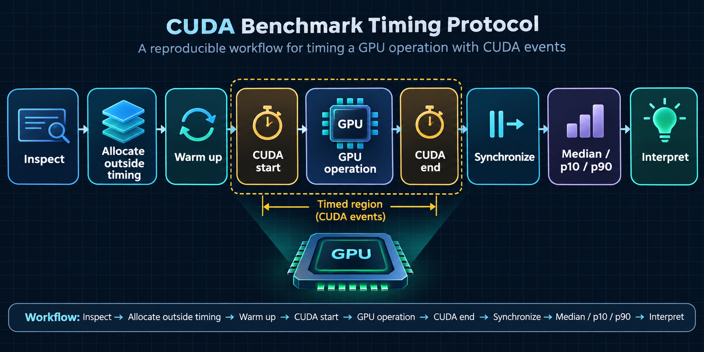
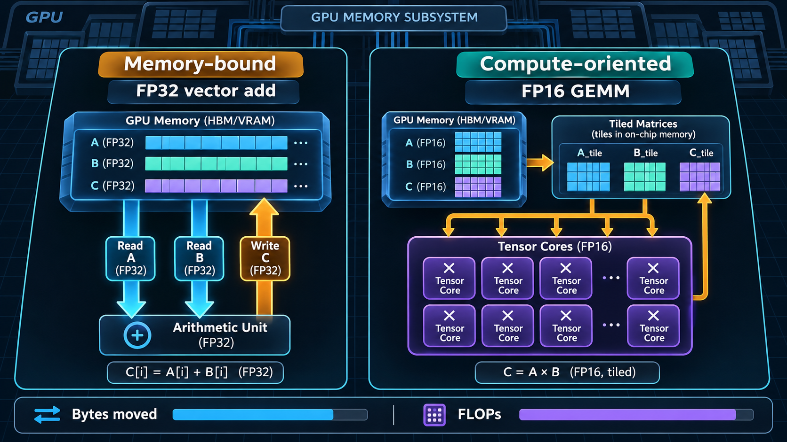
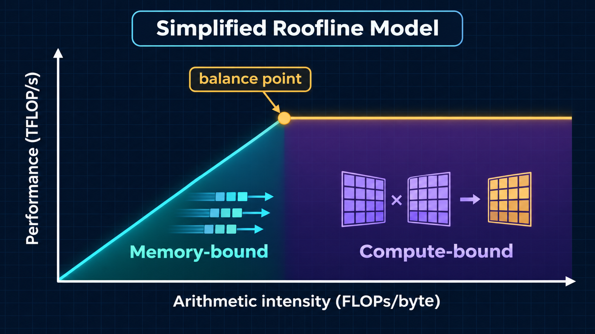

# Module 08 — Practical GPU Benchmarking Laboratory: Measure Before You Optimize

_vLLM & GPU Inference Engineering Masterclass · Module 08 of 64_

**Practical:** Lightning AI · NVIDIA T4 · 1 GPU

In Module 07, we compared GPU capacity, memory bandwidth, precision support, and interconnects. Those specifications let us form hypotheses, but a specification is not a workload measurement.

Today we will build a small, reproducible benchmarking laboratory. We will measure VRAM availability, device-to-device memory bandwidth, matrix-multiplication throughput, and the cost of launching small GPU operations. Then we will use arithmetic intensity and the Roofline Model to explain the results.

The goal is not to produce one impressive number. The goal is to learn whether a workload is limited by memory movement, arithmetic throughput, launch overhead, shape efficiency, or the surrounding runtime.

The companion lab is [`benchmark_lab.py`](../../code/module-08/benchmark_lab.py). It uses PyTorch and CUDA events and is designed for a Lightning AI T4.

The interactive notebook version is [`benchmark_lab.ipynb`](../../code/module-08/benchmark_lab.ipynb). It follows the same experiments with explanatory cells, plots, and an optional JSON export.

## What you will learn

By the end of this module, you should be able to:

- distinguish physical VRAM capacity from currently free VRAM;
- time asynchronous GPU work correctly;
- calculate useful-data bandwidth and achieved TFLOP/s;
- explain why a large GEMM and a tiny elementwise operation behave differently;
- identify launch-bound, memory-bound, and compute-bound measurements;
- record enough context for another person to reproduce a benchmark;
- connect microbenchmarks to prefill, decode, and vLLM kernel behavior.

## 1. A benchmark is a controlled experiment

An output such as `42.1 TFLOP/s` is incomplete. A useful benchmark result also needs to say:

| Field | Example |
| --- | --- |
| GPU | NVIDIA T4, `cuda:0` |
| Compute capability | 7.5 |
| Software | PyTorch version, CUDA runtime, driver |
| Operation | `C = A @ B` or FP32 vector add |
| Shape | `M=2048, K=2048, N=2048` |
| Dtype | FP16 or FP32 |
| Warmup | 10 iterations |
| Timed repetitions | 30 iterations |
| Reported statistic | median, p10, p90 |
| Memory state | free VRAM before the experiment |

If any of these change, the result may change. A benchmark is evidence about a specific workload and environment, not a permanent property of the GPU.

### The four rules for this lab

1. **Warm up first.** CUDA libraries, memory allocators, and kernels may perform one-time initialization.
2. **Keep timed tensors on the GPU.** Otherwise a host-to-device transfer can dominate the result.
3. **Synchronize correctly.** GPU launches are asynchronous from the CPU's perspective.
4. **Report a distribution.** A median hides less noise than one lucky sample; p10 and p90 reveal spread.

The script uses CUDA events for device-side timing. It also measures host-observed time for small operations so we can see the difference between GPU execution and CPU submission overhead.



_The timed region should contain the GPU operation itself. Allocation, initialization, warmup, and interpretation belong outside it._

## 2. Check the machine before measuring

Run these commands in the Lightning AI Studio terminal:

```bash
nvidia-smi
nvidia-smi --query-gpu=index,name,driver_version,memory.total,memory.used,utilization.gpu --format=csv
python -c "import torch; print(torch.__version__, torch.version.cuda, torch.cuda.is_available())"
```

Record the output. If another process is using the GPU, memory availability and timing may be different. A shared cloud machine can also have background activity that produces occasional outliers.

The lab reports the device properties through PyTorch as well. The two sources answer slightly different questions:

- `nvidia-smi` describes the device and current system state from the driver;
- PyTorch describes the device visible to the current Python process and its allocator state.

## 3. Experiment A — VRAM capacity and availability

The first experiment does not try to fill the GPU. It reports:

- physical device memory;
- free memory currently reported by CUDA;
- memory allocated by PyTorch tensors;
- memory reserved by the PyTorch caching allocator.

These quantities are related but not interchangeable.

$$
\text{usable memory for this run}
\leq
\text{physical VRAM}-\text{other allocations}-\text{runtime headroom}
$$

A T4 may have approximately 16 GB of physical memory while a process has less available because of the driver, CUDA context, another process, existing tensors, or a serving runtime. `free` is a point-in-time observation, not a promise that the entire amount should be allocated.

Run the memory report by itself:

```bash
python code/module-08/benchmark_lab.py \
  --skip-bandwidth --skip-gemm --skip-launch
```

The optional allocation probe is deliberately disabled by default. If you want to see a bounded allocation change, opt in with a small fraction such as:

```bash
python code/module-08/benchmark_lab.py \
  --skip-bandwidth --skip-gemm --skip-launch \
  --probe-fraction 0.25
```

The probe is not a production memory-capacity test. It allocates and touches a fraction of currently free memory, then releases it. Never interpret a successful probe as proof that a model, KV cache, and runtime will fit together.

### Capacity exercise

For a model with $P$ billion parameters and $b$ bytes per parameter:

$$
M_{\text{weights}}\approx P\times b\text{ GB}
$$

Complete this table using the free-memory number from your run:

| Model | FP16 weights | 4-bit weights | Does weight-only fit in observed free VRAM? |
| ---: | ---: | ---: | --- |
| 1B | 2 GB | 0.5 GB | |
| 3B | 6 GB | 1.5 GB | |
| 7B | 14 GB | 3.5 GB | |
| 13B | 26 GB | 6.5 GB | |

The final column is only a weight-storage check. Add KV cache, activations, temporary workspaces, allocator headroom, and quantization metadata before making a serving decision.

## 4. Experiment B — memory bandwidth

The lab measures two GPU-resident operations:

1. **Device-to-device copy:** one read and one write per element.
2. **Vector add:** two reads, one write, and one floating-point addition per element.

For a vector of $N$ FP32 elements, the useful-data accounting is:

$$
\text{copy bytes}=2N\times4
$$

$$
\text{vector-add bytes}=3N\times4
$$

The effective bandwidth is:

$$
\boxed{BW_{\text{effective}}=\frac{\text{useful bytes}}{\text{measured seconds}}}
$$

This is not automatically the same as the memory controller's physical bandwidth. It includes the operation's useful reads and writes and may be lower because of instruction overhead, access patterns, cache behavior, scheduling, and contention.

Run the bandwidth experiment:

```bash
python code/module-08/benchmark_lab.py \
  --skip-gemm --skip-launch \
  --vector-mib 128
```

Increasing `--vector-mib` can make the operation more representative of device-memory traffic, but it also increases allocation pressure. Keep the vector size within the available memory budget.

### What should you expect?

The vector add has very low arithmetic intensity:

$$
AI_{\text{add}}=\frac{1}{12}\approx0.083\text{ FLOPs/byte}
$$

Using the 300 GB/s T4 reference value used by this lab, its simplified memory-bound ceiling is:

$$
AI\times BW=0.083\times300\approx25\text{ GFLOP/s}=0.025\text{ TFLOP/s}
$$

The point is not that vector addition should reach exactly 300 GB/s. The point is that the Roofline Model predicts a very low arithmetic-throughput ceiling because the operation moves much more data than arithmetic.



_A vector add performs little arithmetic for each byte moved; a sufficiently large tiled GEMM offers much more reusable arithmetic work._

## 5. Experiment C — FP16 and FP32 GEMM throughput

For:

$$
C=AB,
\qquad A\in\mathbb{R}^{M\times K},\quad B\in\mathbb{R}^{K\times N}
$$

the approximate operation count is:

$$
\text{FLOPs}=2MKN
$$

The achieved throughput is:

$$
\boxed{\text{TFLOP/s}=\frac{2MKN}{T_{\text{seconds}}\times10^{12}}}
$$

Run square GEMMs in both dtypes:

```bash
python code/module-08/benchmark_lab.py \
  --skip-bandwidth --skip-launch \
  --sizes 512 1024 2048 4096
```

The script allocates matrices before timing and uses `torch.mm` with an output tensor. Allocation and random-number generation are therefore outside the measured matrix operation.

### Why does size matter?

Small matrices may not provide enough blocks and warps to keep all SM resources busy. Larger matrices expose more parallel work and amortize fixed costs, but they can also put pressure on memory capacity and make a single operation less representative of a real request.

For a simplified GEMM traffic estimate that reads $A$ and $B$ and writes $C$ once:

$$
AI_{\text{GEMM}}
\approx
\frac{2MKN}{(MK+KN+MN)\times\text{bytes per element}}
$$

For a square FP16 GEMM, the arithmetic intensity grows approximately with the matrix dimension. That moves the operation toward the compute side of the Roofline Model, especially when a kernel reuses values efficiently through caches, shared memory, registers, and Tensor Cores.

### FP16 is not merely “half the memory”

On a T4, FP16 matrix operations can use Tensor Core paths for supported shapes and accumulation modes. FP32 uses a different throughput ceiling. A dtype changes:

- the amount of memory moved;
- the available arithmetic instructions;
- the kernel selected by the library;
- numerical range and accuracy;
- the shapes that map efficiently to hardware tiles.

Therefore, compare both performance and numerical behavior before changing a vLLM model's dtype.

## 6. Experiment D — launch overhead and small work

The lab repeatedly adds one scalar to a small FP32 vector. It reports two times:

- **GPU event time:** time between CUDA events on the device stream;
- **host-observed time:** CPU wall-clock time from submitting the loop until synchronization completes.

Run it by itself:

```bash
python code/module-08/benchmark_lab.py \
  --skip-bandwidth --skip-gemm \
  --launch-elements 1024 --launch-count 1000
```

The operation contains very little work. A fixed cost from launching and scheduling a kernel can therefore be a substantial fraction of the total. For large matrix operations, the same fixed cost is amortized over many more FLOPs.

This explains why “the GPU is extremely fast” does not mean every individual GPU operation is fast. A workload with many tiny kernels can be launch-bound even when the GPU's theoretical arithmetic peak is high.

The host-observed result includes Python submission and synchronization overhead, so it is not a pure CUDA launch latency. That is intentional: serving systems pay both device execution costs and orchestration costs.

## 7. Run the complete lab and save results

Run all experiments and save a machine-readable record:

```bash
python code/module-08/benchmark_lab.py \
  --vector-mib 128 \
  --sizes 512 1024 2048 4096 \
  --warmup 10 \
  --repeats 30 \
  --json module-08-results.json
```

The JSON file records device metadata, median latency, p10/p90 latency, and derived measurements. For a fair comparison between two runs, keep the following constant:

- GPU model and visible device count;
- PyTorch and CUDA versions;
- tensor shapes and dtypes;
- vector size and launch count;
- warmup and repetition counts;
- background GPU activity;
- power, clock, and thermal conditions where possible.

Do not compare a median FP16 GEMM result from a T4 directly with an FP32 result from an H100 and call the difference “GPU speed.” That comparison changes the GPU, precision, and likely the kernel path at the same time.

## 8. Interpret the measurements with the Roofline Model

The simplified model is:

$$
P\leq\min(P_{\text{peak}},AI\times BW)
$$



_The crossover is a conceptual balance point. The image is an explanatory illustration, not a measured T4 curve._

Use the output this way:

| Observation | Likely interpretation | Next experiment |
| --- | --- | --- |
| Vector bandwidth is much lower than expected | Access pattern, size, contention, cache effects, or measurement issue | Change vector size; inspect utilization and memory counters |
| GEMM throughput rises with matrix size | Small shapes were under-filled or launch-bound | Test more shapes and token dimensions |
| FP16 is much faster than FP32 | FP16 Tensor Core path is effective for that shape | Check numerical error and supported inference dtype |
| Tiny operation has high host time per operation | Launch and orchestration overhead matter | Fuse work, batch operations, or use CUDA Graphs where appropriate |
| Larger vector size changes bandwidth | Cache residency or memory-system behavior changed | Compare working sets above and below cache-sized ranges |
| Results vary widely between repetitions | Background activity, initialization, clocking, or allocation effects | Increase warmup; inspect GPU processes and repeat later |

The table suggests hypotheses; it does not prove a bottleneck. A real diagnosis combines benchmark results with a profiler, kernel shapes, memory usage, and the serving workload.

## 9. Connection to vLLM

These microbenchmarks map to real inference behavior:

- **Model loading:** large transfers and allocations compete for memory bandwidth and VRAM capacity.
- **Prefill:** many prompt tokens create matrix shapes closer to GEMM, improving parallelism and weight reuse.
- **Decode:** one or a few new tokens per request produce smaller projection shapes and repeatedly read model weights and KV-cache data.
- **Continuous batching:** combines requests to make more operations GEMM-like, but scheduling and latency constraints remain.
- **Kernel fusion:** can reduce intermediate memory traffic and the number of launches.
- **CUDA Graphs:** can reduce repeated CPU launch overhead when shapes and execution structure are sufficiently stable.

The benchmark is intentionally smaller than a full model. Its value is that each result has a clear explanation. Later modules will apply the same discipline to KV-cache throughput, batching, attention kernels, quantization, and end-to-end vLLM serving.

## 10. Assignment

Complete the following checklist and save your JSON output:

- [ ] Record the GPU name, compute capability, PyTorch version, and CUDA runtime.
- [ ] Record physical and free VRAM before running the experiments.
- [ ] Measure FP32 copy and vector-add bandwidth at two vector sizes.
- [ ] Measure FP16 and FP32 GEMM at three matrix sizes.
- [ ] Measure small-kernel GPU event time and host-observed time.
- [ ] Compute the vector-add arithmetic intensity and simplified Roofline ceiling.
- [ ] Identify one result that is memory-bound, one that is compute-oriented, and one that is launch-sensitive.
- [ ] Repeat one experiment after changing the repetition count and explain the difference.
- [ ] Write down one benchmark limitation that prevents it from being an end-to-end vLLM result.

### Extension: projection shapes

Modify the script or use the GEMM helper to benchmark:

```text
(1, 4096)   @ (4096, 4096)
(16, 4096)  @ (4096, 4096)
(64, 4096)  @ (4096, 4096)
(256, 4096) @ (4096, 4096)
```

Keep the weight matrix fixed and vary only the number of rows. Plot achieved TFLOP/s against rows. Explain how this simplified experiment relates to batch-one decode, batched decode, and prefill.

## Technical references

- [NVIDIA T4 Tensor Core GPU Datasheet](https://www.nvidia.com/content/dam/en-zz/Solutions/Data-Center/tesla-t4/t4-tensor-core-datasheet.pdf) — memory bandwidth, Tensor Cores, and peak specifications.
- [PyTorch CUDA semantics](https://pytorch.org/docs/stable/notes/cuda.html) — asynchronous execution, synchronization, and CUDA behavior.
- [PyTorch CUDA Event](https://pytorch.org/docs/stable/generated/torch.cuda.Event.html) — device-side timing events.
- [NVIDIA CUDA C Best Practices Guide](https://docs.nvidia.com/cuda/cuda-c-best-practices-guide/) — performance measurement and memory behavior.
- [NVIDIA CUDA Programming Guide](https://docs.nvidia.com/cuda/cuda-c-programming-guide/) — blocks, warps, resources, and execution limits.

## Module 08 recap

1. Physical VRAM capacity and currently free VRAM answer different questions.
2. Correct GPU timing requires warmup and synchronization-aware measurement.
3. Effective bandwidth and achieved TFLOP/s describe a workload, not the entire GPU.
4. Large GEMMs can amortize launch costs and use Tensor Cores more effectively than tiny operations.
5. Arithmetic intensity helps explain whether memory movement or arithmetic is the likely limiting resource.
6. A reproducible result records the device, software, shape, dtype, timing method, and memory state.

Module 08 complete.

Next is Module 09 — Transformer Inference Fundamentals, where we will connect these GPU-level measurements to prefill, decode, token throughput, latency, and the KV cache.
