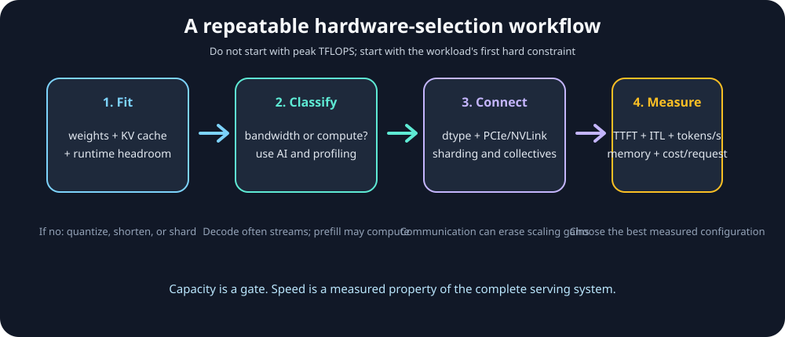
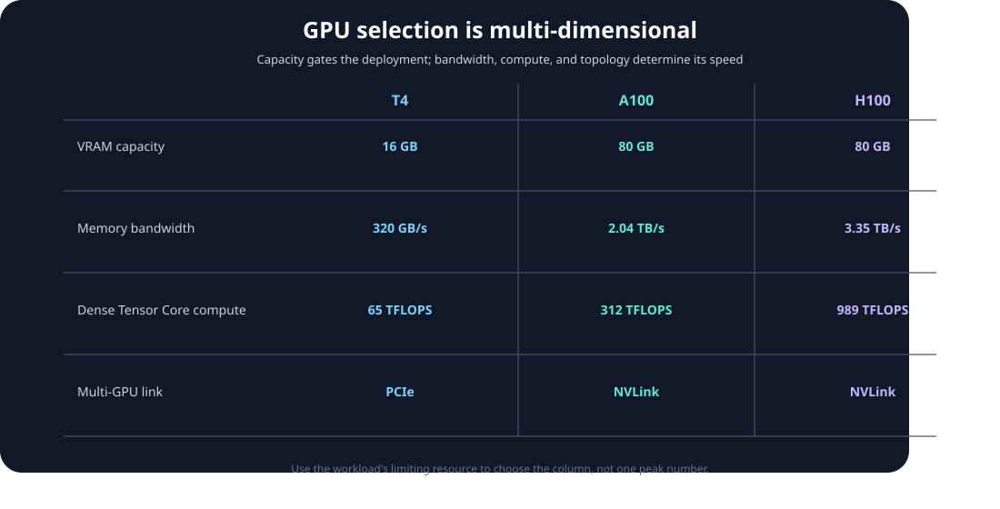

# Module 08 — GPU Hardware Selection: T4 vs A100 vs H100 vs H200 vs B200

_vLLM & GPU Inference Engineering Masterclass · Module 08 of 64_

**Practical:** Lightning AI · Up to 3× NVIDIA T4

In Module 07, we derived the Roofline Model:

$$
P\leq\min(P_{\text{peak}},AI\times BW)
$$

We learned that a GPU's performance depends on both its arithmetic capability and the speed at which it moves data. Now imagine that you are responsible for deploying a large language model in production.

You have five possible GPU choices: T4, A100, H100, H200, and B200.

How would you choose the right one? Would you buy the GPU with the highest TFLOPS, the most memory, the best bandwidth, or the cheapest hourly price?

The correct answer depends on the workload. This module turns GPU specifications into a repeatable selection process for capacity planning and inference deployment.

The companion lab is [`hardware_selection.py`](../../code/module-08/hardware_selection.py). It runs the capacity and bandwidth calculations without CUDA and can inspect the attached Lightning GPU with `--probe`.

## What you will learn

By the end of this module, you should be comfortable answering:

- Why might an H200 outperform an H100 for memory-heavy inference even though both use Hopper?
- Why can three T4s with 48 GB of combined VRAM be less convenient than one GPU with 48 GB?
- What is the practical difference between GDDR and HBM?
- How do PCIe, NVLink, and NVSwitch affect multi-GPU inference?
- Why does hardware support for BF16, FP8, or FP4 matter?
- How do we estimate whether a 7B, 13B, or 70B model will fit?
- How do we inspect GPU capacity and topology on Lightning AI?

We will focus on deployment decisions rather than semiconductor fabrication details.

## 1. Capacity is a gate; speed comes later

For inference, treat a GPU as several coupled resources:

| Resource | Question | Typical failure mode |
| --- | --- | --- |
| Memory capacity | Can weights, KV cache, workspaces, and runtime state fit? | Out-of-memory or a smaller batch |
| Memory bandwidth | How quickly can weights and KV-cache data move? | Low decode tokens/sec |
| Compute throughput | How much supported arithmetic can the GPU execute? | Slow prefill or large-batch work |
| Interconnect | How quickly can partitions exchange data? | Tensor-parallel communication dominates |
| Cost and availability | Can the service meet its operational target? | Fast hardware is uneconomical |

The first selection rule is:

> **Capacity is a gate. Bandwidth, compute, interconnect, and cost determine speed after the workload fits.**



_Use a workload-first workflow: fit the model, classify the bottleneck, check precision and topology, then benchmark end to end._

## 2. Meet the GPU generations

The following table compares representative variants: T4 PCIe, A100 80GB SXM, H100 SXM, H200 SXM, and HGX B200. Exact capacity, clocks, form factor, and bandwidth can differ across products.

| GPU | Architecture | VRAM | Memory bandwidth | Native precision highlights |
| --- | --- | ---: | ---: | --- |
| T4 | Turing | 16 GB GDDR6 | 300 GB/s | FP16, INT8, INT4 |
| A100 80GB | Ampere | 80 GB HBM2e | 2.04 TB/s | FP16, BF16, TF32 |
| H100 SXM | Hopper | 80 GB HBM3 | 3.35 TB/s | FP16, BF16, FP8 |
| H200 SXM | Hopper | 141 GB HBM3e | 4.8 TB/s | FP16, BF16, FP8 |
| B200 HGX | Blackwell | 180 GB HBM3e | Up to 8 TB/s | FP16, BF16, FP8, FP4 |

These are manufacturer specifications, not guaranteed application performance. The B200 row refers to the 180 GB HGX variant. The exact product and platform matter.



_There is no single “faster” axis: capacity, bandwidth, compute, topology, and cost improve in different proportions._

An important correction for this course: NVIDIA's T4 datasheet specifies 300 GB/s, although some secondary materials cite 320 GB/s. We use 300 GB/s for official-specification comparisons and measure achieved bandwidth on Lightning AI.

## 3. Why memory bandwidth matters

Published device-memory bandwidth is a property of the memory interface. If a workload must move $B$ bytes through device memory, an idealized lower bound is:

$$
T_{\text{memory}}\geq\frac{B}{BW_{\text{peak}}}
$$

Comparing the B200 with the T4:

$$
\frac{8{,}000}{300}\approx26.7
$$

The B200 has approximately 26.7 times the T4's published peak memory bandwidth. That does **not** mean it generates tokens 26.7 times faster. Real throughput depends on model architecture, precision, batch size, attention, KV-cache traffic, scheduling, kernel quality, and other bottlenecks.

For a strongly memory-bandwidth-bound operation with similar data traffic, however, the difference can be enormous.

Run the lower-bound comparison without requiring a GPU:

```bash
python code/module-08/hardware_selection.py \
  --show-specs \
  --lower-bound-gb 14
```

Expected idealized read times are approximately:

| GPU | Time to read 14 GB once |
| --- | ---: |
| T4 | 46.7 ms |
| A100 80GB | 6.9 ms |
| H100 | 4.2 ms |
| H200 | 2.9 ms |
| B200 | 1.75 ms |

These are hypothetical minimum transfer times, not token-generation latencies. A model does not necessarily read every weight exactly once per token, and kernels do not achieve peak bandwidth on every access pattern.

## 4. VRAM capacity versus memory bandwidth

Capacity answers: **How much data can the GPU hold?**

Bandwidth answers: **How quickly can data move?**

Consider two hypothetical GPUs:

| GPU | Capacity | Bandwidth |
| --- | ---: | ---: |
| A | 80 GB | 2 TB/s |
| B | 48 GB | 4 TB/s |

GPU A can hold larger models or more KV cache. GPU B might process a memory-intensive workload faster, provided the complete workload fits in 48 GB.

The two constraints are:

$$
\boxed{M_{\text{required}}\leq M_{\text{available}}}
$$

and:

$$
\boxed{T_{\text{memory}}\gtrsim\frac{\text{Bytes transferred}}{BW}}
$$

A GPU can be excellent in one dimension and limited in the other.

## 5. GDDR6 versus HBM

The T4 uses GDDR6. The A100, H100, H200, and B200 variants in this comparison use generations of HBM, or High Bandwidth Memory.

HBM places stacked memory close to the processor and connects it using very wide interfaces. That enables high aggregate bandwidth. GDDR uses a different package and memory-channel design and can be attractive when board cost, power, capacity, and platform complexity have different priorities.

HBM is not inherently faster for every individual memory access. In this module, its key advantage is the much larger sustained bandwidth available to an accelerator workload.

### Why H100 and H200 differ

Both use the Hopper architecture, but H200 provides substantially more HBM capacity and bandwidth. That can make it especially useful for long-context or high-concurrency serving, where model weights and KV-cache traffic consume significant memory resources.

The benefit may come primarily from the memory subsystem rather than from a completely new compute architecture.

## 6. Precision changes the useful hardware

A value can be stored in a low-precision format without the GPU executing that format efficiently. Native instruction support and compatible kernels matter.

For this comparison:

- T4 has FP16 Tensor Core support and supported INT8/INT4 inference paths;
- T4 is not the normal native BF16, FP8, or FP4 Tensor Core target;
- A100 adds efficient BF16 and TF32 options;
- H100 adds native FP8 Tensor Core support;
- B200 adds newer low-precision capabilities including FP4-related Tensor Core execution.

For an idealized 7B model, raw weight storage is:

| Weight precision | Bytes per parameter | Approximate weights |
| --- | ---: | ---: |
| FP32 | 4 | 28 GB |
| FP16/BF16 | 2 | 14 GB |
| FP8/INT8 | 1 | 7 GB |
| INT4/FP4 | 0.5 | 3.5 GB |

Quantized checkpoints need scales, metadata, packing overhead, and sometimes higher-precision layers. The practical rule is:

> Select a precision that preserves quality, is supported by the GPU, and has a fast kernel in the serving stack you actually use.

## 7. Model memory planning

For a model with $P$ billion parameters and $b$ bytes per parameter, the approximate weight memory in decimal GB is:

$$
\boxed{M_{\text{weights}}=P\times b\text{ GB}}
$$

A more realistic serving estimate is:

$$
M_{\text{required}}\approx M_{\text{weights}}+M_{\text{KV}}+M_{\text{workspace}}+M_{\text{runtime}}
$$

For the KV cache, one token across one model with $L$ layers, $H_{\text{KV}}$ key/value heads, head dimension $D$, and $b$ bytes per element requires approximately:

$$
M_{\text{KV/token}}=2\times L\times H_{\text{KV}}\times D\times b
$$

The leading 2 accounts for keys and values. Grouped-query attention reduces KV memory when the number of KV heads is smaller than the number of query heads.

Run the calculator for a 7B FP16 model:

```bash
python code/module-08/hardware_selection.py \
  --model-params-b 7 \
  --weight-bytes 2 \
  --reserve-gb 3 \
  --kv-gb-per-1k-tokens 0.125 \
  --tokens 4096
```

The script uses a conservative 90% planning budget. Treat that as a first estimate, not a guarantee.

### What can a T4 hold?

A 7B FP16 model has approximately:

$$
7\times2=14\text{ GB}
$$

of raw weights. A 16 GB T4 therefore has very little room left for KV cache, activations, CUDA workspaces, allocator reservations, and runtime metadata. It is an uncomfortable single-GPU serving target even if the raw weights technically fit.

With approximate 4-bit weights:

$$
7\times0.5=3.5\text{ GB}
$$

there is substantially more room, assuming the quantization method and inference kernels are compatible with the T4.

### Capacity is not a shared pool

Three T4s provide 48 GB of physical VRAM, but they do not become one transparent 48 GB allocation. The model must be replicated, sharded, or otherwise distributed. Tensor parallelism can make a model fit, but communication is required when partitions exchange activations.

“It fits across three GPUs” is not the same as “it serves efficiently across three GPUs.”

## 8. PCIe, NVLink, and NVSwitch

The GPU's HBM/GDDR bandwidth is not the same as its host or peer interconnect bandwidth.

### PCIe

PCIe connects a GPU to the host and, depending on the platform, can provide a path between GPUs. It is widely available but has much lower bandwidth and higher latency than on-package memory. Frequent tensor-parallel transfers over PCIe can become a critical-path bottleneck.

### NVLink

NVLink provides a higher-bandwidth peer path on supported GPUs and systems. It can make tensor-parallel collectives substantially cheaper than PCIe-only communication, but it does not eliminate synchronization, partitioning, or kernel overhead.

### NVSwitch

NVSwitch provides a switched fabric in supported multi-GPU platforms. It helps create more uniform high-bandwidth GPU-to-GPU connectivity than a collection of independent PCIe paths. The exact topology still matters and must be inspected on the actual machine.

For tensor parallelism, a useful simplified model is:

$$
T_{\text{step}}\approx T_{\text{compute}}+T_{\text{communication}}-T_{\text{overlap}}
$$

If each GPU computes for 2 ms and communication costs 1.5 ms, communication is already a large part of the step before considering synchronization and imperfect overlap.

The T4 has PCIe connectivity but not the NVLink fabric found in selected A100/H100/H200 systems. Do not assume three T4s scale linearly for tightly coupled tensor parallelism.

## 9. Three T4 replicas versus one larger GPU

Suppose a 3B model comfortably fits on one T4 and the goal is throughput for independent requests.

Three independent replicas can be a strong starting point:

- each request uses one local GPU;
- no per-layer cross-GPU collective is required;
- failures and queues can be isolated per replica;
- aggregate throughput can scale with request-level parallelism.

Tensor parallelism may be appropriate when one model does not fit or when a single-request latency target requires it. It should be measured, not assumed.

Compare the resources:

| Configuration | Physical memory | Memory interfaces | Main concern |
| --- | ---: | --- | --- |
| 3× T4 replicas | 48 GB total | 3 separate 300 GB/s interfaces | Request routing and replication |
| 3× T4 tensor parallel | 48 GB total | 3 interfaces plus PCIe communication | Collective overhead |
| 1× A100 80GB SXM | 80 GB local | One 2.04 TB/s HBM interface | Hourly cost and availability |

The three T4 bandwidth numbers can be used concurrently for independent replicas, but cannot be added into one uniform memory interface for a sharded model.

## 10. Hardware selection is also an economic problem

Suppose two configurations deliver:

- Configuration A: 500 tokens/sec at ₹100 per GPU-hour;
- Configuration B: 1,200 tokens/sec at ₹300 per GPU-hour.

Useful work per rupee is:

$$
\text{Tokens per rupee}=\frac{\text{tokens/sec}\times3600}{\text{rupees/hour}}
$$

For A:

$$
\frac{500\times3600}{100}=18{,}000
$$

For B:

$$
\frac{1200\times3600}{300}=14{,}400
$$

B is faster, but A is more cost-efficient at that measured load. If B is the only configuration that meets a strict latency target, cost per token alone does not decide the deployment.

## 11. Practical Lightning AI lab

### Experiment A — inspect the installed hardware

```bash
nvidia-smi
nvidia-smi -q
nvidia-smi --query-gpu=index,name,memory.total,memory.used,utilization.gpu,power.draw --format=csv
```

The Python companion script reports every visible GPU, compute capability, free VRAM, total VRAM, and SM count:

```bash
python code/module-08/hardware_selection.py --probe
```

### Experiment B — inspect topology

On a multi-GPU machine:

```bash
python code/module-08/hardware_selection.py --probe --topology
```

or directly:

```bash
nvidia-smi topo -m
```

Topology indicators such as `PIX`, `PXB`, `PHB`, and `SYS` describe the route between devices through PCIe switches, host bridges, CPU interconnects, or NUMA domains. Topology predicts communication difficulty; it is not a direct measurement of achieved NCCL bandwidth.

### Experiment C — compare capacity assumptions

Run the calculator for FP16, INT8, and INT4:

```bash
for bytes in 2 1 0.5; do
  python code/module-08/hardware_selection.py \
    --model-params-b 7 --weight-bytes "$bytes" \
    --reserve-gb 3 --kv-gb-per-1k-tokens 0.125 --tokens 4096
done
```

Remember that this calculates a planning estimate, not the actual vLLM allocation.

## Technical references

- [NVIDIA T4 Tensor Core GPU Datasheet](https://www.nvidia.com/content/dam/en-zz/Solutions/Data-Center/tesla-t4/t4-tensor-core-datasheet.pdf) — Turing specifications, memory, and PCIe interface.
- [NVIDIA A100 Product Specifications](https://www.nvidia.com/en-us/data-center/a100/) — Ampere, BF16, HBM2e, and NVLink.
- [NVIDIA H100 Specifications](https://www.nvidia.com/en-in/data-center/h100/) — Hopper, FP8, and NVLink.
- [NVIDIA H200 Specifications](https://www.nvidia.com/en-in/data-center/h200/) — HBM3e and memory improvements.
- [NVIDIA HGX H100, H200, B200 Architecture](https://docs.nvidia.com/enterprise-reference-architectures/hgx-ai-factory-h100-h200-b200/latest/components.html) — comparative platform specifications.
- [NVIDIA CUDA Compute Capability Reference](https://developer.nvidia.com/cuda/gpus) — hardware generations and compute capabilities.

## Module 08 recap

1. VRAM capacity determines whether the model and cache can fit.
2. Memory bandwidth strongly affects weight- and KV-cache-intensive workloads.
3. Compute throughput and precision support determine the efficiency of suitable kernels.
4. PCIe, NVLink, and NVSwitch affect the cost of distributing a model across GPUs.
5. Three GPUs are not automatically one shared memory pool.
6. Cost, throughput, latency, power, and availability must be evaluated together.

Module 08 complete.

Next is Module 09 — LAB: Benchmark Matrix Multiplication and GPU Memory on T4.
