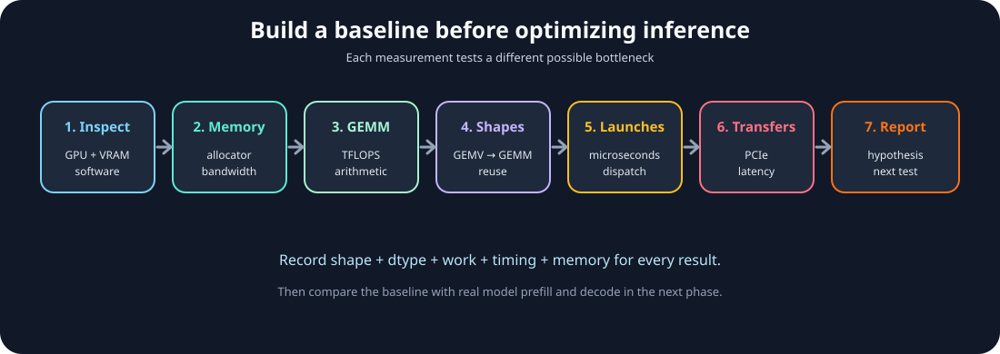

# Module 09 — LAB: Benchmark Matrix Multiplication and GPU Memory on T4

_vLLM & GPU Inference Engineering Masterclass · Module 09 of 64_

**Hands-on:** Lightning AI · NVIDIA T4 · 1 GPU

Today is our first complete engineering laboratory. We combine the concepts from Modules 01–08 and create a small, reproducible GPU performance baseline focused on matrix multiplication and GPU memory on a T4.

Suppose someone tells you:

> My LLM inference is slow. The GPU shows 95% utilization. Should I increase the batch size, quantize the model, or move to a faster GPU?

An inexperienced engineer might immediately recommend a bigger GPU. An inference engineer first asks:

> What exactly is limiting the workload: memory bandwidth, computation, kernel-launch overhead, data transfer, memory capacity, or something else?

This lab gives you measurements to answer that question before Module 10 introduces a real language-model request.

The complete suite is [`benchmark_lab.py`](../../code/module-09/benchmark_lab.py), with an interactive version in [`benchmark_lab.ipynb`](../../code/module-09/benchmark_lab.ipynb). Matrix throughput and memory behavior are the primary lab results; launch, transfer, and allocator measurements explain secondary bottlenecks.



_A useful benchmark is a chain of evidence: inspect, measure, compare, and explain._

## 1. Learning objectives

By the end of this module, you will have built and run benchmarks for:

| Experiment | What we measure | Engineering question |
| --- | --- | --- |
| 1. GPU inspection | Hardware, clocks, VRAM, software | What hardware am I actually running? |
| 2. Memory bandwidth | Useful GB/s | How quickly can the GPU stream data? |
| 3. Matrix multiplication | Achieved TFLOPS | How much arithmetic throughput can I achieve? |
| 4. Matrix shapes | GEMV-like vs GEMM-like efficiency | How does batching change reuse? |
| 5. Kernel launches | Small-operation latency | How expensive is dispatching tiny work? |
| 6. CPU–GPU transfers | GB/s and latency | How costly is moving tensors across PCIe? |
| 7. Memory allocation | Allocated/reserved MiB | Why does VRAM differ from tensor sizes? |

You will also create a JSON performance report and plots, then use the measurements to reason about LLM prefill and decoding.

## 2. The T4 baseline

For this course, use one NVIDIA T4:

- 40 SMs;
- 2,560 CUDA cores;
- 320 Tensor Cores;
- 16 GB GDDR6;
- FP32 peak: approximately 8.1 TFLOPS;
- mixed FP16/FP32 Tensor Core peak: approximately 65 TFLOPS.

NVIDIA publications and product pages have used slightly different rounded memory-bandwidth figures for T4. This lab uses **300 GB/s as a conservative reference**. Your measured useful-data bandwidth will be lower or higher depending on the operation, working set, cache behavior, contention, and measurement definition.

These are theoretical hardware ceilings, not expected benchmark results.

## 3. How engineers benchmark correctly

Five rules govern every experiment:

1. **Warm up first.** CUDA initialization, library setup, allocator growth, and kernel selection can make the first execution atypical.
2. **Account for asynchronous execution.** A Python call can return before the GPU finishes. Use CUDA events or explicit synchronization.
3. **Repeat measurements.** Report a median rather than trusting one noisy sample.
4. **Keep allocations outside compute timings.** Otherwise you measure allocation and initialization instead of the operation.
5. **Report the work.** “2 ms” is meaningless without shape, dtype, bytes, FLOPs, and device context.

The two equations used repeatedly are:

$$
\boxed{\text{Effective bandwidth}=\frac{\text{Useful bytes}}{\text{Time}}}
$$

and:

$$
\boxed{\text{Achieved FLOPS}=\frac{2MNK}{\text{Time}}}
$$

The companion script uses CUDA events for GPU-resident operations and a synchronized wall-clock timer when the experiment intentionally includes CPU orchestration or transfers.

## 4. Lightning AI setup

Start a Lightning AI Studio with one NVIDIA T4. In a terminal, record the environment:

```bash
nvidia-smi
```

Install the notebook dependencies if needed:

```bash
pip install torch matplotlib
```

Check PyTorch:

```python
import platform
import torch

print("Python:", platform.python_version())
print("PyTorch:", torch.__version__)
print("PyTorch CUDA runtime:", torch.version.cuda)
print("CUDA available:", torch.cuda.is_available())
assert torch.cuda.is_available(), "Select a GPU Studio."

device = torch.device("cuda:0")
print("GPU:", torch.cuda.get_device_name(0))
print("Compute capability:", torch.cuda.get_device_capability(0))
print("Visible GPUs:", torch.cuda.device_count())
free, total = torch.cuda.mem_get_info(device)
print("Total VRAM (GiB):", round(total / 1024**3, 2))
print("Free VRAM (GiB):", round(free / 1024**3, 2))
```

Use GPU 0 throughout the lab, even if the Studio exposes multiple devices.

Run the full suite with conservative defaults:

```bash
python code/module-09/benchmark_lab.py \
  --json module09_benchmark_results.json \
  --plot-dir module09_plots
```

The default run uses a 128 MiB vector, square GEMMs from 256 to 4096, projection batches from 1 to 512, 100 small launches, and 128 MiB host/device transfers. Reduce `--sizes`, `--batches`, or `--repeats` for a quick smoke test.

## 5. Experiment 1 — GPU inspection and memory state

Before measuring performance, record what is actually attached. The script reports:

- GPU name and compute capability;
- PyTorch and CUDA versions;
- visible GPU count;
- physical VRAM and point-in-time free memory;
- PyTorch allocated and reserved memory.

Allocated memory is live tensor storage known to PyTorch. Reserved memory includes blocks held by the caching allocator for reuse. Neither number alone is the complete amount of memory consumed by a process or serving system.

## 6. Experiment 2 — Effective memory bandwidth

We measure FP32 vector addition:

$$
C=A+B
$$

For each element, the logical traffic is:

- read $A$: 4 bytes;
- read $B$: 4 bytes;
- write $C$: 4 bytes.

Therefore:

$$
\boxed{B_{\text{useful}}=12N\text{ bytes}}
$$

The arithmetic intensity is only:

$$
AI=\frac{1}{12}\approx0.083\text{ FLOPs/byte}
$$

This is a memory-oriented workload. The script keeps $A$, $B$, and $C$ allocated outside the timed region and reports useful-data GB/s.

Run only this part with a smaller quick configuration by skipping the other experiments through the Python API in the notebook, or run the full script and inspect the vector-add row in the JSON report.

If the useful-data rate is 220 GB/s, the comparison against the conservative 300 GB/s reference is:

$$
\frac{220}{300}\times100\approx73.3\%
$$

This is not automatically physical DRAM bandwidth. It is the useful traffic implied by the algorithm divided by elapsed time. Cache hits, transaction granularity, instruction overhead, and contention affect the relationship.

### vLLM connection

Weight-heavy decode operations can stream substantial data from GPU memory while issuing relatively little arithmetic per byte. A bandwidth baseline helps distinguish “the arithmetic units are slow” from “the operands cannot arrive fast enough.”

## 7. Experiment 3 — FP16 GEMM throughput

For:

$$
C=AB,\qquad A,B\in\mathbb{R}^{4096\times4096}
$$

the approximate arithmetic work is:

$$
2\times4096^3\approx137.44\text{ billion FLOPs}
$$

The lab uses FP16 so supported T4 Tensor Core kernels may be selected. It reports median time, achieved TFLOPS, and an idealized arithmetic intensity based on minimum logical reads and writes.

The result should be below the 65 TFLOPS theoretical peak. That is normal. Shape, clocks, kernel selection, library versions, memory behavior, and other system activity all matter.

The suite also tests dimensions 256, 512, 1024, 2048, and 4096 and saves `gemm_tflops.png` when `--plot-dir` is provided. Larger matrices often expose more parallel work and amortize fixed costs, but throughput need not be perfectly monotonic.

## 8. Experiment 4 — Why matrix shape matters for LLMs

Consider a Transformer projection:

$$
Y=XW,\qquad W\in\mathbb{R}^{4096\times4096}
$$

The suite holds $W$ fixed and varies the number of rows in $X$:

$$
X\in\mathbb{R}^{M\times4096},\qquad M\in\{1,4,16,32,64,128,256,512\}
$$

For $M=1$, the operation is GEMV-like: one token has limited opportunity to reuse every weight across rows. As $M$ grows, the operation becomes more GEMM-like and can expose more parallelism and weight reuse.

Look for achieved TFLOPS improving with batch/token rows. This helps explain why continuous batching can improve aggregate throughput.

Do not overgeneralize this one projection. Real LLM inference also includes attention, KV-cache reads and writes, normalization, sampling, scheduling, and other operations.

## 9. Experiment 5 — Kernel-launch overhead

The lab compares 100 separate elementwise operations against one batched operation with the same broad number of elementwise calculations.

The small-work version repeatedly launches a kernel over a 1,024-element vector. The batched version launches once over a `[100, 1024]` tensor. The script reports both a GPU-event view and a synchronized host-observed cost through its launch experiment.

This is intentionally not a pure CUDA API launch-latency measurement: the host-observed result includes Python submission and synchronization. That is useful for inference engineering because an engine pays orchestration costs as well as device execution costs.

If many small launches take far longer than one larger launch, possible remedies include:

- kernel fusion;
- CUDA Graph replay for stable shapes;
- batching more work together;
- reducing Python-side synchronization.

## 10. Experiment 6 — CPU-to-GPU and GPU-to-CPU transfers

The lab moves a 128 MiB FP32 tensor from pageable host memory to the GPU and back. It reports latency and effective GB/s for both directions.

These are PCIe/system-path measurements, not GPU HBM bandwidth. They are also affected by host memory behavior, runtime synchronization, NUMA placement, and the cloud host configuration.

The measurement illustrates why an inference server normally keeps model weights on the GPU. Moving gigabytes of weights across PCIe for every generated token would overwhelm the actual model computation.

Pinned host memory and asynchronous copies can behave differently. We will study transfer overlap and input pipelines in later modules; this lab establishes a simple baseline first.

## 11. Experiment 7 — PyTorch memory allocation

The suite allocates and initializes a 4096×4096 FP32 tensor:

$$
4096^2\times4=67{,}108{,}864\text{ bytes}=64\text{ MiB}
$$

It records memory before allocation, during allocation, after deletion, and after `torch.cuda.empty_cache()`.

The numbers need not change by exactly 64 MiB because the CUDA context, allocator block sizes, cached allocations, and other runtime objects contribute to the observed state.

This is the foundation for interpreting vLLM memory later: separate model weights, KV cache, temporary buffers, allocator pools, and runtime overhead instead of comparing only the logical checkpoint size with total VRAM usage.

## 12. Build the performance report

Save a JSON report:

```bash
python code/module-09/benchmark_lab.py \
  --json module09_benchmark_results.json \
  --plot-dir module09_plots
```

Your report should contain at least:

| Benchmark | Record |
| --- | --- |
| GPU inspection | GPU, compute capability, PyTorch, CUDA, VRAM |
| Vector addition | shape, bytes, latency, effective GB/s, arithmetic intensity |
| GEMM | dimensions, dtype, latency, TFLOPS, idealized AI |
| Projection shapes | batch/token rows, latency, TFLOPS, idealized AI |
| Launch overhead | launch count, small-launch time, batched-launch time, ratio |
| Transfers | direction, bytes, latency, effective GB/s |
| Allocation | allocated, reserved, free, and total MiB at each stage |

Record `nvidia-smi` output as well. A shared Studio can have background activity that creates outliers or consumes memory.

## 13. Diagnosing the results

| Observation | Likely hypothesis | Next check |
| --- | --- | --- |
| Vector add has high useful GB/s and low TFLOPS | Memory-oriented work is behaving normally | Profile memory transactions and access pattern |
| Large GEMM has high TFLOPS | Arithmetic path is being used efficiently | Confirm Tensor Core instructions with a profiler |
| Batch 1 projection has poor TFLOPS, larger batches improve | Small shape, limited reuse, or under-filled tiles | Compare decode-like and batched request shapes |
| Many tiny operations cost much more than one batch | Dispatch/orchestration overhead matters | Test fusion, CUDA Graphs, and fewer launches |
| Transfer bandwidth is low | Host path or synchronization is limiting | Compare pinned memory, NUMA placement, and overlap |
| Reserved memory remains after deletion | Caching allocator retained blocks | Compare `empty_cache()` and real serving allocations |

These are hypotheses, not proof. A profiler and an end-to-end workload are needed to establish the critical path.

## 14. The vLLM connection

When vLLM generates tokens for several users, use this baseline to ask:

| vLLM observation | GPU concept to investigate |
| --- | --- |
| Poor throughput with one request | Small-batch efficiency and weight streaming |
| Throughput improves with concurrency | Matrix shape, parallelism, and weight reuse |
| Memory grows with context length | KV-cache capacity and allocation policy |
| GPU timeline has gaps | CPU scheduling and launch overhead |
| High VRAM but low throughput | Capacity versus bandwidth versus compute |
| Two GPUs do not double throughput | Communication and parallelism overhead |

The benchmark suite is not a model benchmark. It is the baseline that prevents us from blaming vLLM before measuring the hardware and runtime constraints underneath it.

## References

- [PyTorch CUDA semantics](https://docs.pytorch.org/docs/stable/notes/cuda.html) — Asynchronous execution and accurate timing.
- [PyTorch CUDA events](https://docs.pytorch.org/docs/stable/generated/torch.cuda.Event.html) — Device-side elapsed time.
- [NVIDIA System Management Interface](https://docs.nvidia.com/deploy/nvidia-smi/) — Utilization and device monitoring.
- [NVIDIA CUDA C++ Best Practices Guide](https://docs.nvidia.com/cuda/cuda-c-best-practices-guide/) — Memory performance and measurement.
- [NVIDIA T4 Product Brief](https://www.nvidia.com/content/dam/en-zz/Solutions/Data-Center/tesla-product-literature/T4%20Product%20Brief.pdf) — T4 memory, bandwidth, and power specifications.
- [Roofline: An Insightful Performance Model](https://doi.org/10.1145/1498765.1498785) — Arithmetic intensity and bottleneck reasoning.

## What to remember

1. A benchmark is only meaningful with its shape, dtype, work, timing method, and device.
2. Useful-data bandwidth and physical DRAM bandwidth are related but not identical.
3. Large GEMMs can amortize launch costs and use Tensor Cores more effectively than tiny operations.
4. Decode-like small token dimensions and prefill-like larger token batches stress different GPU behaviors.
5. A baseline turns “the LLM is slow” into a measurable bottleneck hypothesis.

Module 09 complete.

Next: [Module 10 — LLM Inference Lifecycle: From Tokenization to Autoregressive Generation](10-llm-inference-lifecycle.md).
