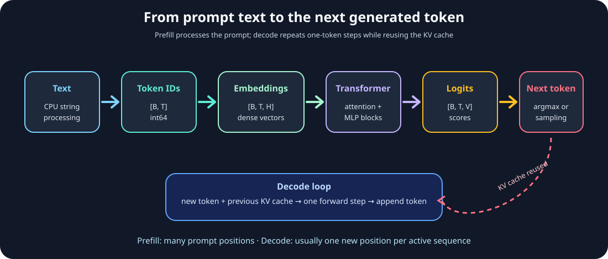

# Module 09 — LLM Inference Lifecycle: From Tokenization to Token Generation

_vLLM & GPU Inference Engineering Masterclass · Module 09 of 64_

**Practical:** Lightning AI · NVIDIA T4 · 1 GPU

Modules 01–08 gave us the hardware and measurement vocabulary to investigate a GPU. Now we will put a real causal language model on the device and follow one prompt through the complete inference path:

```text
text → tokenizer → token IDs → embeddings → Transformer blocks
     → hidden states → vocabulary logits → next token → repeat
```

This is the first module where we connect a user-visible generation result to concrete CPU and GPU tensors.

The companion files are [`llm_lifecycle.py`](../../code/module-09/llm_lifecycle.py) and [`llm_lifecycle.ipynb`](../../code/module-09/llm_lifecycle.ipynb). The default lab uses `distilgpt2`, a small causal language model that is practical for a T4. You can pass another compatible Hugging Face causal-LM model with `--model`.

## Learning objectives

By the end of this module, you should be able to:

- explain what a tokenizer produces and why token count is not character count;
- identify the shapes and devices of `input_ids`, hidden states, logits, and KV-cache entries;
- distinguish prefill from decode in a real forward pass;
- select the logits for the next token and decode a greedy continuation;
- explain why only one new token is usually processed per decode step;
- measure prompt forward time, generation time, inter-token time, and GPU memory;
- connect this lifecycle to the scheduling and memory behavior that vLLM optimizes.

## 1. The lifecycle in one picture



_Prefill processes the prompt as a sequence; decode repeatedly processes one new token while reusing the KV cache._

There are two very different computational phases:

| Phase | Input shape | Main work | Typical behavior |
| --- | --- | --- | --- |
| **Prefill** | `[batch, prompt_tokens]` | Process the entire prompt and build the KV cache | More parallel work; often GEMM-like |
| **Decode** | Usually `[batch, 1]` new tokens | Produce one next token per active sequence and extend the cache | Small token dimension; often bandwidth- and scheduling-sensitive |

The model weights are used in both phases. The shape of the token dimension changes how efficiently the GPU can reuse those weights.

## 2. What a causal language model predicts

Given tokens $x_1, x_2, \ldots, x_T$, a causal language model estimates:

$$
P(x_{t+1}\mid x_1,\ldots,x_t)
$$

The model returns a vector of scores for every input position and every vocabulary entry:

$$
\text{logits}\in\mathbb{R}^{B\times T\times V}
$$

where:

- $B$ is batch size;
- $T$ is the number of input positions;
- $V$ is vocabulary size.

For the next token after the prompt, we use only the final position:

$$
\text{next\_token\_logits}=\text{logits}[:, -1, :]
$$

The logits are unnormalized scores. Applying softmax gives probabilities, and a decoding policy such as greedy argmax, temperature sampling, top-k, or nucleus sampling chooses the next token.

### Why the output is larger than the hidden state

The final Transformer hidden state usually has shape `[B, T, H]`, where $H$ is the model hidden size. The language-model head projects that state into vocabulary space, producing `[B, T, V]`.

For a vocabulary of 50,000 tokens, one position produces 50,000 scores. This output projection is part of the work performed at every generation step.

## 3. Text becomes token IDs

The tokenizer is a CPU-side component. It turns text into integer IDs from a fixed vocabulary:

```python
encoded = tokenizer("GPU inference is useful", return_tensors="pt")
print(encoded["input_ids"].shape)
print(encoded["input_ids"].dtype)
```

The model consumes integer IDs, not strings. An attention mask usually accompanies them:

- `input_ids`: integer token indices, normally `torch.int64`;
- `attention_mask`: 1 for valid tokens and 0 for padding;
- optional position IDs or model-specific inputs.

Tokenization can produce a different number of tokens for two strings with the same character length. This matters because prompt length controls prefill work and KV-cache storage.

The tokenizer stays on the CPU in this lab. The resulting tensors are moved to the GPU before the model call:

```python
model_inputs = {
    name: value.to(device)
    for name, value in encoded.items()
}
```

## 4. Embeddings and Transformer blocks

The first model operation maps each integer ID to a dense vector:

$$
\text{input\_ids}\in\mathbb{N}^{B\times T}
\quad\longrightarrow\quad
\text{embeddings}\in\mathbb{R}^{B\times T\times H}
$$

The Transformer then applies repeated self-attention and feed-forward blocks. A simplified block contains:

1. normalization;
2. query, key, and value projections;
3. causal self-attention;
4. a residual connection;
5. another normalization;
6. a feed-forward projection and activation;
7. another residual connection.

The exact ordering differs across architectures, but the shape remains conceptually `[batch, sequence, hidden]`.

During prefill, every prompt position participates in the forward pass. During decode, the model receives only the new position while previously computed attention keys and values are read from the KV cache.

## 5. The KV cache: remembering the prompt efficiently

Self-attention needs keys and values from earlier positions. Recomputing them for the full prefix at every generated token would repeat work.

With caching enabled, the model returns a cache containing per-layer key/value tensors. On the next decode step:

```text
new token → new Q, K, V
previous K/V cache + new K/V → attention
```

The cache grows with sequence length and number of active requests. A rough per-token estimate is:

$$
M_{\text{KV/token}}
\approx
2\times L\times H_{\text{KV}}\times D_{\text{head}}
\times\text{bytes per element}
$$

The leading 2 is for keys and values. This is why longer contexts and higher concurrency consume more VRAM even when model weights do not change.

vLLM's PagedAttention and scheduler manage this memory across many sequences. Our small lab uses the model library's cache directly so that the underlying lifecycle is visible.

## 6. Prefill versus decode

Suppose the prompt contains 128 tokens and we generate 24 new tokens.

### Prefill

The first forward pass consumes all 128 prompt tokens:

```text
input_ids: [1, 128]
logits:    [1, 128, vocabulary_size]
KV cache:  contains 128 positions per layer
```

Only the final logits row is needed to choose the first generated token, but the model computes the prompt representation and fills the cache for all positions.

### Decode

Each next step consumes one new token:

```text
new input: [1, 1]
cache:     contains the previous positions
logits:    [1, 1, vocabulary_size]
```

The output token is appended to the sequence and the cache grows by one position. A production server batches the next tokens from many active requests so that the effective shape may be `[active_sequences, 1]` rather than `[1, 1]`.

This connects directly to earlier modules:

- Module 05: larger matrix shapes can improve reuse and Tensor Core utilization;
- Module 06: every model operation becomes one or more CUDA kernel launches;
- Module 07: model fit depends on weights, KV cache, workspace, and runtime headroom;
- Module 08: timing must separate tokenization, transfers, prefill, decode, and sampling.

## 7. Environment setup

Use a Lightning AI Studio with one NVIDIA T4. Install the model libraries in the environment if needed:

```bash
pip install torch transformers safetensors matplotlib
```

The first run downloads the model and tokenizer from Hugging Face. Subsequent runs can reuse the local cache. If the Studio has no network access, download the model in advance and pass its local directory with `--model`.

Check the runtime:

```bash
nvidia-smi
python -c "import torch; print(torch.cuda.is_available(), torch.cuda.get_device_name(0))"
```

The benchmark uses `model.eval()` and `torch.inference_mode()`. Evaluation mode disables training behavior such as dropout; inference mode avoids autograd bookkeeping for inference-only tensors.

## 8. Run the complete lifecycle script

From the repository root:

```bash
python code/module-09/llm_lifecycle.py \
  --model distilgpt2 \
  --prompt "GPU inference is useful because" \
  --max-new-tokens 24 \
  --json-output module09_results.json
```

The script reports:

- model class, parameter count, vocabulary size, hidden size, and layer count;
- token IDs, input shape, and a tokenizer round trip;
- logits shape and dtype;
- hidden-state shapes when `--capture-hidden-states` is enabled;
- the KV-cache type and sequence length;
- top next-token candidates;
- median prompt forward time;
- generated text, total generation time, inter-token time, and tokens/sec;
- CUDA memory before inputs, after forward, and after generation.

For a CPU-only smoke test, use:

```bash
python code/module-09/llm_lifecycle.py \
  --device cpu \
  --dtype fp32 \
  --max-new-tokens 4 \
  --warmup 1 \
  --repeats 2 \
  --generation-repeats 1
```

The CPU run verifies the lifecycle but is not a useful T4 performance measurement.

### Inspect hidden states

```bash
python code/module-09/llm_lifecycle.py \
  --capture-hidden-states \
  --max-input-tokens 64 \
  --max-new-tokens 8
```

Returning every layer's hidden state consumes extra memory. Keep this option for inspection, not for a production benchmark.

## 9. Notebook lab

Open [`llm_lifecycle.ipynb`](../../code/module-09/llm_lifecycle.ipynb) and run it top to bottom. The notebook follows this sequence:

1. inspect the model and GPU;
2. tokenize a prompt and print token IDs;
3. run a forward pass and inspect logits, hidden states, and cache;
4. display top next-token candidates;
5. measure prefill latency;
6. generate tokens with an explicit cache-aware greedy loop;
7. compare prompt lengths and record observations.

The notebook keeps the explicit generation loop visible so you can connect every generated token to a model call. The loop uses `torch.cat` for clarity; vLLM uses more efficient memory management and batches work across requests.

## 10. Timing the lifecycle correctly

CUDA launches are asynchronous with respect to the Python thread. A CPU wall-clock timer can stop before the GPU finishes. The script therefore uses CUDA events for GPU timing:

```python
start = torch.cuda.Event(enable_timing=True)
end = torch.cuda.Event(enable_timing=True)
start.record()
outputs = model(**model_inputs)
end.record()
end.synchronize()
milliseconds = start.elapsed_time(end)
```

This measures device-side elapsed time for the operation interval. It does not include model download, Python tokenization, or arbitrary CPU scheduling unless those actions occur inside the measured region.

Record the scopes separately:

| Scope | What it includes | Use |
| --- | --- | --- |
| Tokenization | CPU string processing | Input pipeline and prompt preparation |
| Model transfer | Host-to-device movement | Data placement cost |
| Prefill forward | Prompt through the model | TTFT model component |
| Decode loop | Repeated cached one-token steps | Inter-token latency and output rate |
| Full request | Tokenization through final text | User-visible latency |

The first run may also include model loading, CUDA initialization, kernel selection, and cache allocation. Warm up before comparing steady-state timings.

## 11. What to inspect in the output

### Input IDs

Confirm that the tokenizer produces a rank-2 integer tensor. The second dimension is the prompt token count, not the number of characters.

### Logits

For a batch of one and prompt length $T$, the output should look like:

```text
Logits: (1, T, vocabulary_size)
```

The final row is used for next-token selection. The earlier rows correspond to predictions at earlier positions and are useful for training or analysis but not required for the immediate next token.

### Hidden states

With `--capture-hidden-states`, the model commonly returns one tensor for the embedding output plus one tensor per Transformer layer. Architecture-specific implementations may vary, but the last two dimensions should represent sequence length and hidden size.

### KV cache

The cache description shows whether the model returned a legacy tuple or a newer cache object. The exact shape and number of tensors depend on the model architecture and Transformers version.

### Memory

Compare memory before and after the forward pass. The increase can include cache storage, output tensors, temporary buffers, and allocator reservations. It is not a direct measurement of only KV-cache bytes.

## 12. Connect the trace to vLLM

The simple script performs one request synchronously. vLLM turns the same lifecycle into a serving system:

| This lab | vLLM concern |
| --- | --- |
| Tokenizer produces input IDs | Request processing and batching |
| Prompt forward pass | Prefill scheduling and chunked prefill |
| `past_key_values` grows | Paged KV-cache allocation |
| One token per decode step | Continuous batching and iteration scheduling |
| `torch.cat` appends outputs | Token buffers and streaming responses |
| One model call at a time | Batched model runner execution |
| Python-level greedy argmax | Fused sampling and output processing |

The core model mathematics is the same. The major engineering difference is how the engine manages many sequences, memory blocks, kernel launches, sampling, and request priorities at once.

### Why vLLM does not simply call `generate()` for every request

An application-level `generate()` call is convenient, but it hides scheduling and allocation decisions. A serving engine needs to:

- admit and pause sequences;
- pack active tokens into efficient batches;
- allocate and recycle KV-cache blocks;
- overlap CPU preparation with GPU execution;
- stream completed tokens;
- enforce limits on context length and concurrent sequences.

Those are the topics of the next vLLM-focused phase.

## 13. Assignment

Run the script and notebook, then record:

- [ ] Model ID, Transformers version, PyTorch version, CUDA runtime, and GPU name.
- [ ] Parameter count, vocabulary size, hidden size, layer count, and dtype.
- [ ] Prompt text, prompt token count, and generated token count.
- [ ] Input IDs shape, logits shape, hidden-state shapes, and cache description.
- [ ] Median prefill time after warmup.
- [ ] Total generation time and inter-token time.
- [ ] GPU memory before inputs, after forward, and after generation.
- [ ] At least two prompt lengths and one explanation of how prefill changed.
- [ ] A paragraph connecting the simple loop to continuous batching and PagedAttention.

### Suggested comparison

Run the same model with prompt lengths approximately 8, 32, 128, and 256 tokens. Keep `max-new-tokens` fixed. Make a table:

| Prompt tokens | Prefill ms | Generation ms | Inter-token ms | Peak allocated MiB |
| ---: | ---: | ---: | ---: | ---: |
| 8 | your result | your result | your result | your result |
| 32 | your result | your result | your result | your result |
| 128 | your result | your result | your result | your result |
| 256 | your result | your result | your result | your result |

Explain why prompt length primarily changes prefill work and initial KV-cache population, while generation length primarily changes the number of decode iterations.

## 14. Knowledge check

A model receives a prompt with 128 tokens and generates 10 new tokens. With caching enabled, what is the usual input shape for each subsequent decode step?

A. `[1, 128]`, because the full prompt must be recomputed every time.

B. `[1, 10]`, because all output tokens are generated in one forward pass.

C. `[1, 1]`, because the new token is processed while previous keys and values are reused from the KV cache.

D. `[128, 1]`, because the sequence dimension becomes the batch dimension.

**Answer:** C. The exact batching shape can be larger when a serving engine combines multiple active sequences, but each sequence contributes its next token while its previous KV state is reused.

## 15. References

- [Hugging Face causal language modeling](https://huggingface.co/docs/transformers/tasks/language_modeling) — Causal next-token prediction and model APIs.
- [Hugging Face model outputs](https://huggingface.co/docs/transformers/main_classes/output) — Logits, hidden states, and cached key/value outputs.
- [PyTorch `inference_mode`](https://docs.pytorch.org/docs/stable/generated/torch.autograd.grad_mode.inference_mode.html) — Disabling autograd bookkeeping for inference.
- [PyTorch CUDA events](https://docs.pytorch.org/docs/stable/generated/torch.cuda.Event.html) — Device-side timing and synchronization.
- [PyTorch CUDA semantics](https://docs.pytorch.org/docs/stable/notes/cuda.html) — Asynchronous execution and accurate timing.
- [Efficient Memory Management for Large Language Model Serving with PagedAttention](https://arxiv.org/abs/2309.06180) — vLLM KV-cache management.

## What to remember

| Concept | Key takeaway |
| --- | --- |
| Tokenizer | Converts text into integer IDs; token count drives model work. |
| Embedding | Maps IDs to `[batch, sequence, hidden]` vectors. |
| Logits | Scores have shape `[batch, sequence, vocabulary]`; use the final row for the next token. |
| Prefill | Processes the prompt and builds the KV cache. |
| Decode | Processes new tokens iteratively while reusing cached keys and values. |
| Timing | Use warmups and CUDA events; separate prefill, decode, and full-request scopes. |
| vLLM | Improves the lifecycle through continuous batching, paged KV memory, scheduling, and optimized kernels. |

## Final thought question

Why can a model have a fast prompt forward pass but a much slower per-token generation loop, even when both use the same GPU and model weights? Answer using matrix shape, weight reuse, KV-cache access, kernel launches, and batching.

Module 09 complete.
