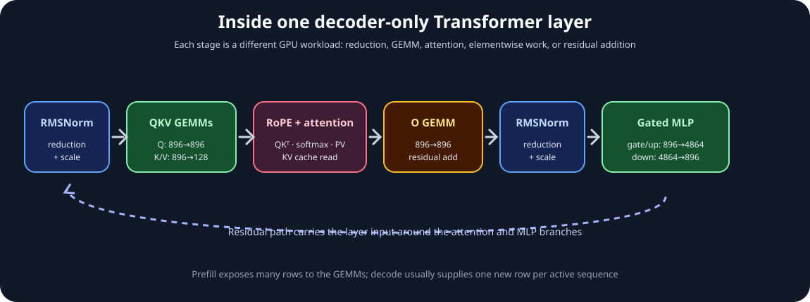
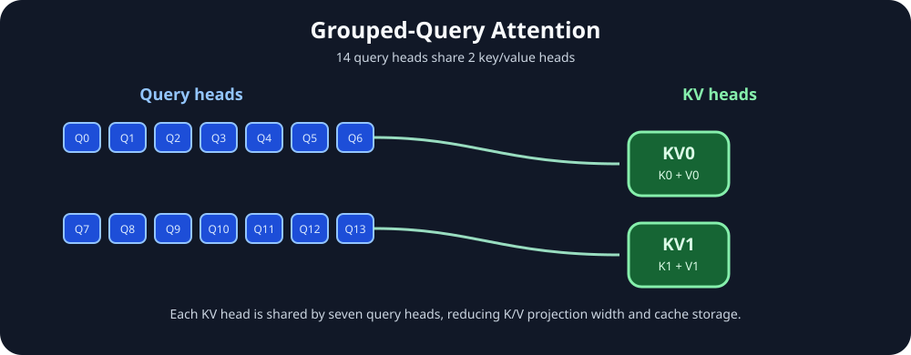
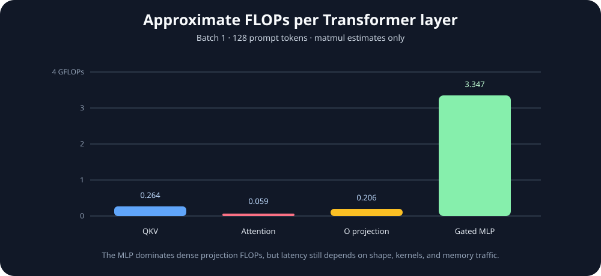

# Module 11 — Transformer Forward Pass as GPU Workloads

_vLLM & GPU Inference Engineering Masterclass · Module 11 of 64 · Phase 2: LLM Inference Fundamentals_

**Practical:** Lightning AI · NVIDIA T4 · 1 GPU

In Module 10, we loaded Qwen2.5-0.5B-Instruct on the T4, converted text into tokens, passed those tokens through the model, inspected logits, and generated tokens using a KV cache.

One major question remains:

> When we call `model(input_ids)`, what exactly happens on the GPU inside each Transformer layer?

We will answer that question as inference engineers:

- Which matrices are multiplied?
- What are their exact dimensions?
- How many FLOPs does each operation require?
- How many bytes of model weights are read?
- Which operations are likely compute-bound or memory-bound?
- Which operations become more expensive as context grows?
- What does the execution look like in PyTorch?

The companion files are [`transformer_forward_pass.py`](../../code/module-11/transformer_forward_pass.py) and [`transformer_forward_pass.ipynb`](../../code/module-11/transformer_forward_pass.ipynb).

## 1. One Qwen Transformer layer

For Qwen2.5-0.5B-Instruct, the relevant configuration is:

| Parameter | Symbol | Value |
| --- | --- | ---: |
| Hidden dimension | $d$ | 896 |
| Transformer layers | $L$ | 24 |
| Query heads | $H_q$ | 14 |
| Key/value heads | $H_{kv}$ | 2 |
| Head dimension | $d_h$ | 64 |
| MLP intermediate dimension | $d_{ff}$ | 4,864 |
| Vocabulary | $V$ | 151,936 |

For a batch of one and a prompt of 128 tokens:

$$
\boxed{X\in\mathbb{R}^{1\times128\times896}}
$$

The simplified layer path is:



_Residual connections bypass the attention and MLP branches; the diagram emphasizes the main tensor transformations._

The layer is not one monolithic GPU operation. It is a sequence of reductions, GEMMs, reshapes, attention operations, elementwise functions, and residual additions.

## 2. Stage 1 — RMSNorm

Before attention, Qwen applies RMS normalization. For a hidden vector $x\in\mathbb{R}^{896}$:

$$
\operatorname{RMSNorm}(x)=
\frac{x}{\sqrt{\frac{1}{d}\sum_{i=1}^{d}x_i^2+\epsilon}}
\odot\gamma
$$

RMSNorm performs elementwise arithmetic and a reduction over the hidden dimension. The output shape remains:

$$
[1,128,896]
$$

It is not a large matrix multiplication. Its performance can be sensitive to memory traffic, reduction efficiency, and kernel-launch overhead. Fused normalization kernels reduce intermediate reads and writes.

## 3. Stage 2 — Q, K, and V projections

The normalized hidden states are projected into queries, keys, and values:

$$
Q=XW_Q,\qquad K=XW_K,\qquad V=XW_V
$$

Qwen uses Grouped-Query Attention (GQA), so the projection widths differ.

### Query projection

There are 14 query heads with 64 features each:

$$
14\times64=896
$$

Therefore:

$$
W_Q\in\mathbb{R}^{896\times896},\qquad
Q\in\mathbb{R}^{1\times128\times896}
$$

After reshaping:

$$
\boxed{Q\in\mathbb{R}^{1\times14\times128\times64}}
$$

### Key and value projections

There are only 2 KV heads:

$$
2\times64=128
$$

So:

$$
W_K,W_V\in\mathbb{R}^{896\times128}
$$

and:

$$
\boxed{K,V\in\mathbb{R}^{1\times2\times128\times64}}
$$



_Each KV head is shared by a group of seven query heads. Efficient kernels need not physically duplicate K and V seven times._

GQA reduces KV-cache storage and K/V projection work. A comparable 14-KV-head configuration would store roughly seven times as many KV values.

### Projection FLOPs

For a matrix multiplication:

$$
F=2MNK
$$

For Q:

$$
F_Q=2\times128\times896^2
\approx205.52\text{ million FLOPs}
$$

For K and V:

$$
F_K=F_V=2\times128\times896\times128
\approx29.36\text{ million FLOPs}
$$

Therefore:

$$
\boxed{F_{QKV}\approx264.24\text{ million FLOPs}}
$$

The Q projection is much more expensive than either K or V projection because GQA narrows the K/V output width.

## 4. Stage 3 — RoPE and attention

RoPE rotates pairs of query and key features according to token position. It changes values, not shapes:

$$
Q:[1,14,128,64],\quad K:[1,2,128,64],\quad V:[1,2,128,64]
$$

Conceptually:

$$
\operatorname{Attention}(Q,K,V)=
\operatorname{softmax}\left(\frac{QK^\top}{\sqrt{64}}+M\right)V
$$

where $M$ represents causal masking.

For a 128-token prompt, the logical attention-score shape is:

$$
\boxed{[1,14,128,128]}
$$

That is 229,376 FP16 elements, or roughly 448 KiB if materialized. Optimized attention kernels may tile this operation and avoid writing the complete score matrix to global memory.

Ignoring causal triangular savings, the two attention matmuls require approximately:

$$
F_{QK^\top}=2BH_qS^2d_h
=2\times1\times14\times128^2\times64
\approx29.36\text{ million FLOPs}
$$

The probability-times-value multiplication has approximately the same cost, so:

$$
\boxed{F_{\text{attention matmuls}}\approx58.72\text{ million FLOPs}}
$$

Softmax, RoPE, masking, and other elementwise work are excluded from this estimate.

### Decode attention is different

During incremental decoding with 2,048 cached positions, one active request usually has a query length of one. The attention-score shape becomes:

$$
[1,14,1,2048]
$$

The new query compares against the cached history. The attention work is approximately linear in cached context length for that decode step, while prefill has the quadratic prompt-position structure. KV caching changes the computational profile by avoiding recomputation of old keys and values.

## 5. Stage 4 — Attention output projection

The 14 heads are combined into 896 features and passed through:

$$
W_O\in\mathbb{R}^{896\times896}
$$

The output shape is:

$$
\boxed{[1,128,896]}
$$

and the approximate work is:

$$
F_O=2\times128\times896^2
\approx205.52\text{ million FLOPs}
$$
$$
\text{residual output}=\text{attention output}+\text{layer input}
$$

The residual addition is elementwise. A second RMSNorm follows before the MLP branch.

## 6. Stage 5 — Gated MLP

Qwen uses a gated MLP with a SiLU activation. For $x\in\mathbb{R}^{896}$:

$$
g=xW_{\text{gate}},\qquad u=xW_{\text{up}}
$$

$$
m=\operatorname{SiLU}(g)\odot u
$$

$$
y=mW_{\text{down}}
$$

The intermediate dimension is 4,864. For 128 tokens, each projection requires:

$$
2\times128\times896\times4864
\approx1.116\text{ billion FLOPs}
$$

There are three such projections, so the MLP projection total is:

$$
\boxed{F_{\text{MLP}}\approx3.347\text{ billion FLOPs}}
$$

This excludes SiLU and gating elementwise operations. The MLP often contributes much more dense linear-layer arithmetic than QKV projection or attention matmuls.



_For a 128-token batch-1 prompt, the gated MLP dominates the approximate dense projection FLOPs in one layer._

## 7. Where the FLOPs go

Approximate matmul FLOPs for one layer at sequence length 128:

| Component | Approximate FLOPs |
| --- | ---: |
| QKV projections | 0.264 GFLOPs |
| Attention matmuls | 0.059 GFLOPs |
| Output projection | 0.206 GFLOPs |
| Gated MLP projections | 3.347 GFLOPs |
| **Total per layer** | **3.876 GFLOPs** |

Across 24 layers:

$$
24\times3.876\approx93.0\text{ GFLOPs}
$$

A straightforward full vocabulary projection for all 128 positions adds:

$$
2\times128\times896\times151936
\approx34.85\text{ GFLOPs}
$$

So the rough total for these selected matmuls is approximately 127.9 GFLOPs. This is not an exact model FLOP count: normalization, RoPE, softmax, activations, residuals, causal savings, and optimized kernels change the actual work.

When only the first generated token is needed, computing vocabulary logits for every prompt position is unnecessary. Efficient model runners can select the final position, avoiding extra output-projection work.

## 8. Weight bytes and arithmetic intensity

For one layer in FP16:

| Component | Weight elements | FP16 weight memory |
| --- | ---: | ---: |
| Q projection | 802,816 | 1.53 MiB |
| K projection | 114,688 | 0.22 MiB |
| V projection | 114,688 | 0.22 MiB |
| O projection | 802,816 | 1.53 MiB |
| Gate projection | 4,358,144 | 8.31 MiB |
| Up projection | 4,358,144 | 8.31 MiB |
| Down projection | 4,358,144 | 8.31 MiB |

The MLP projection weights alone occupy about 24.94 MiB per layer. The same weights are reused across all prompt positions during prefill, improving arithmetic intensity. During single-request decode, only one new token is processed, so there is much less reuse across token positions.

| Phase | Typical shape | Main pressure |
| --- | --- | --- |
| Prefill | Many rows through the projections | Larger GEMMs, more reuse, higher potential Tensor Core efficiency |
| Single-request decode | One new row per step | Weight traffic per FLOP, small GEMM/GEMV-like shapes |

Whether an operation is actually memory-bound or compute-bound depends on achieved bandwidth, kernel selection, caching, and execution details. FLOP counts form a hypothesis; measurements confirm it.

## 9. Practical Lightning AI lab

Use the same Qwen model from Module 10. If needed:

```bash
pip install -U "transformers>=4.45,<5" accelerate safetensors pandas
```

### Lab A — Inspect real layers and projection weights

```python
import pandas as pd
import torch
from transformers import AutoModelForCausalLM, AutoTokenizer

assert torch.cuda.is_available(), "Select a T4 GPU runtime."
device = "cuda:0"
model_id = "Qwen/Qwen2.5-0.5B-Instruct"

tokenizer = AutoTokenizer.from_pretrained(model_id)
model = AutoModelForCausalLM.from_pretrained(
    model_id,
    torch_dtype=torch.float16,
).to(device).eval()

cfg = model.config
print("Hidden size:", cfg.hidden_size)
print("Layers:", cfg.num_hidden_layers)
print("Attention heads:", cfg.num_attention_heads)
print("KV heads:", cfg.num_key_value_heads)
print("MLP intermediate:", cfg.intermediate_size)

layer = model.model.layers[0]
modules = {
    "q_proj": layer.self_attn.q_proj,
    "k_proj": layer.self_attn.k_proj,
    "v_proj": layer.self_attn.v_proj,
    "o_proj": layer.self_attn.o_proj,
    "gate_proj": layer.mlp.gate_proj,
    "up_proj": layer.mlp.up_proj,
    "down_proj": layer.mlp.down_proj,
}

rows = []
for name, module in modules.items():
    rows.append({
        "module": name,
        "weight_shape": tuple(module.weight.shape),
        "parameters": module.weight.numel(),
        "weight_MiB": module.weight.numel() * module.weight.element_size() / 2**20,
    })
display(pd.DataFrame(rows))
```

PyTorch stores `nn.Linear.weight` as `[out_features, in_features]`, even when the mathematical explanation writes $XW$. Thus the gate projection is stored as `[4864, 896]` and computes the equivalent of $XW^\top$.

### Lab B — Capture intermediate shapes with hooks

```python
captured = []
handles = []


def make_hook(name):
    def hook(module, inputs, output):
        captured.append({
            "module": name,
            "input_shape": tuple(inputs[0].shape),
            "output_shape": tuple(output.shape),
            "dtype": str(output.dtype),
        })
    return hook


for name, module in modules.items():
    handles.append(module.register_forward_hook(make_hook(name)))

input_ids = torch.randint(100, 50000, (1, 128), device=device)
with torch.inference_mode():
    model(input_ids=input_ids, use_cache=False, return_dict=True)

for handle in handles:
    handle.remove()

display(pd.DataFrame(captured))
```

Expected first-layer shapes include `[1,128,896] → [1,128,128]` for K/V, `[1,128,896] → [1,128,4864]` for gate/up, and `[1,128,4864] → [1,128,896]` for down. Exact internal outputs can vary with the Transformers implementation.

### Lab C — Calculate FLOPs and weight bytes

```python
def linear_stats(module, tokens):
    out_features, in_features = module.weight.shape
    flops = 2 * tokens * in_features * out_features
    weight_bytes = module.weight.numel() * module.weight.element_size()
    return flops, weight_bytes


rows = []
for name, module in modules.items():
    flops, weight_bytes = linear_stats(module, tokens=128)
    rows.append({
        "module": name,
        "GFLOPs": flops / 1e9,
        "weight_MiB": weight_bytes / 2**20,
        "FLOPs_per_weight_byte": flops / weight_bytes,
    })

stats_df = pd.DataFrame(rows)
display(stats_df)
print("Projection GFLOPs per layer:", stats_df["GFLOPs"].sum())
```

FLOP count alone does not determine latency. Matrix shape, layout, kernel selection, clock state, memory traffic, and available parallelism all matter.

### Lab D — Benchmark projections at one and 128 tokens

```python
import statistics


def benchmark_module(module, x, warmup=5, repeats=30):
    with torch.inference_mode():
        for _ in range(warmup):
            module(x)
        torch.cuda.synchronize()
        times = []
        for _ in range(repeats):
            start = torch.cuda.Event(enable_timing=True)
            end = torch.cuda.Event(enable_timing=True)
            start.record()
            module(x)
            end.record()
            end.synchronize()
            times.append(start.elapsed_time(end))
    return statistics.median(times)


benchmark_rows = []
for tokens in [1, 128]:
    for name, module in modules.items():
        input_features = module.weight.shape[1]
        x = torch.randn(1, tokens, input_features, device=device, dtype=torch.float16)
        milliseconds = benchmark_module(module, x)
        flops = 2 * tokens * input_features * module.weight.shape[0]
        benchmark_rows.append({
            "module": name,
            "tokens": tokens,
            "ms": milliseconds,
            "TFLOPS": flops / (milliseconds / 1000) / 1e12,
        })

benchmark_df = pd.DataFrame(benchmark_rows)
display(benchmark_df)
```

Larger token dimensions can improve achieved arithmetic throughput because projections become more GPU-efficient. The latency and efficiency changes will differ across Q, K, V, O, and MLP shapes.

### Lab E — Profile one forward pass

```python
from torch.profiler import ProfilerActivity, profile

input_ids = torch.randint(100, 50000, (1, 128), device=device)
with torch.inference_mode():
    for _ in range(3):
        model(input_ids=input_ids, use_cache=False)
torch.cuda.synchronize()

with profile(
    activities=[ProfilerActivity.CPU, ProfilerActivity.CUDA],
    record_shapes=True,
    profile_memory=True,
) as prof:
    with torch.inference_mode():
        model(input_ids=input_ids, use_cache=False, return_dict=True)
    torch.cuda.synchronize()

print(prof.key_averages().table(sort_by="self_cuda_time_total", row_limit=20))
```

Look for `aten::linear`, `aten::mm`, `aten::addmm`, attention backend operations, normalization, and elementwise kernels. Fusion can make the profiler show fewer standalone operations than the conceptual architecture contains. Profiler timing includes overhead, so use it to understand execution, not as the primary performance benchmark.

## 10. Connecting layer workloads to vLLM

Imagine three active requests:

| Request | Work selected this iteration |
| --- | --- |
| A | 1 decode token |
| B | 1 decode token |
| C | 64 prefill tokens |

The scheduler may construct an execution step containing 66 selected token positions. The model runner can arrange dense projection work into larger GPU operations, subject to attention metadata, KV-cache layout, and scheduling constraints.

That is why an inference engine needs both:

1. Efficient dense matrix execution.
2. Specialized attention and KV-cache management.

| Operation | Main engineering concern |
| --- | --- |
| QKV projections | GEMM shape, precision, weight reuse |
| Attention | Context length, KV reads, attention backend |
| Output projection | Dense arithmetic and weight traffic |
| RMSNorm | Reduction and memory traffic |
| Gated MLP | Large projections and Tensor Core efficiency |
| LM head | Vocabulary projection and unnecessary logits work |

Optimizing an inference engine is therefore different from simply calling a fast GEMM library.

## References

- Vaswani et al., [Attention Is All You Need](https://arxiv.org/abs/1706.03762).
- Ainslie et al., [GQA: Training Generalized Multi-Query Transformer Models](https://arxiv.org/abs/2305.13245).
- Shazeer, [GLU Variants Improve Transformer](https://arxiv.org/abs/2002.05202).
- Zhang and Sennrich, [Root Mean Square Layer Normalization](https://arxiv.org/abs/1910.07467).
- Qwen, [Qwen2.5-0.5B-Instruct configuration](https://huggingface.co/Qwen/Qwen2.5-0.5B-Instruct/blob/main/config.json).
- PyTorch, [Profiler documentation](https://docs.pytorch.org/docs/stable/profiler.html).

## Module 11 recap

$$
\boxed{\text{RMSNorm}\rightarrow\text{QKV GEMMs}\rightarrow\text{RoPE/Attention}\rightarrow\text{O GEMM}\rightarrow\text{RMSNorm}\rightarrow\text{MLP GEMMs}}
$$

For Qwen2.5-0.5B:

- GQA narrows K/V projections and reduces KV-cache storage.
- MLP projections account for a large share of dense linear-layer FLOPs.
- Attention work depends on query length and cached context length.
- Small decode batches offer less weight reuse than larger prefill batches.
- vLLM schedules these different workloads together while managing their cache state.

**Module 11 complete.**

Next: Module 12 — Prefill vs Decode: Compute-Bound vs Memory-Bound Inference.
