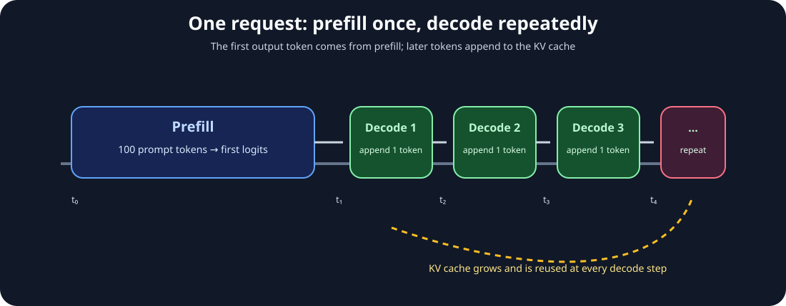
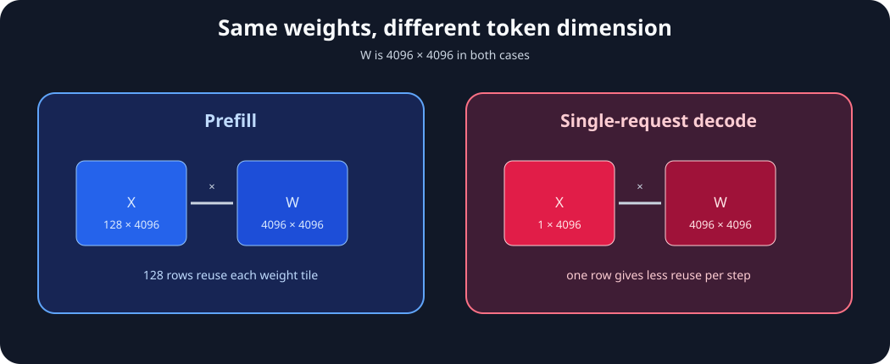
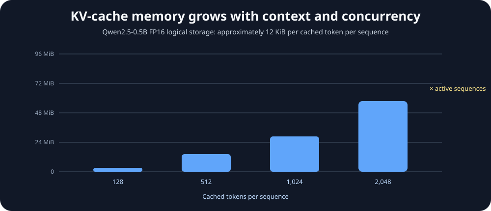
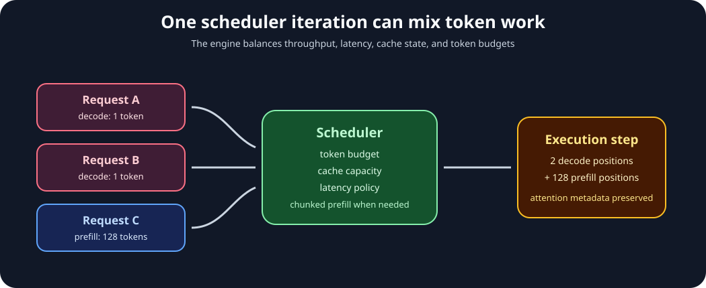

# Module 12 — Prefill vs Decode: Compute-Bound vs Memory-Bound LLM Inference

_vLLM & GPU Inference Engineering Masterclass · Module 12 of 64 · Phase 2: LLM Inference Fundamentals_

**Practical:** Lightning AI · NVIDIA T4 · 1 GPU

Why can an LLM process hundreds of prompt tokens efficiently yet generate its answer one token at a time relatively slowly? Both operations use the same model, weights, and GPU, but their hardware behavior can be completely different.

We will study this through intuition, tensor shapes, FLOPs, memory traffic, latency metrics, and T4 experiments using Qwen2.5-0.5B-Instruct in FP16.

## 1. Prefill and decode

Suppose a user sends 100 prompt tokens and the model generates five output tokens. In the basic autoregressive model, the work is:

$$
\boxed{1\text{ prefill}+(G-1)\text{ incremental decode passes}}
$$

Prefill processes the complete prompt and predicts the first output token. Each subsequent decode step processes the newly generated token while reusing the previous positions' KV cache.



_The first forward pass creates the prompt cache; later steps append one new position and reuse the history._

## 2. The matrix-shape difference

For a projection $Y=XW$ with $W\in\mathbb{R}^{4096\times4096}$:

### Prefill

For a 128-token prompt:

$$
X\in\mathbb{R}^{128\times4096},\qquad Y\in\mathbb{R}^{128\times4096}
$$

The GPU performs a matrix-matrix multiplication with many input rows and substantial weight reuse.

### Single-request decode

For one new token:

$$
X\in\mathbb{R}^{1\times4096},\qquad Y\in\mathbb{R}^{1\times4096}
$$

This resembles a matrix-vector operation. The weights are unchanged; the number of token positions processed together changes.



_The same weight matrix can see very different arithmetic intensity depending on the token dimension._

## 3. A numerical Roofline example

The FP16 weight matrix contains:

$$
4096^2\times2=33{,}554{,}432\text{ bytes}\approx33.55\text{ MB}
$$

For one decode token:

$$
F=2\times1\times4096\times4096=33.55\text{ million FLOPs}
$$

If weights are read once, weight-only arithmetic intensity is approximately 1 FLOP/byte.

For 128 prefill positions:

$$
F=2\times128\times4096^2\approx4.295\text{ billion FLOPs}
$$

The ideal weight-only arithmetic intensity becomes approximately 128 FLOPs/byte. For 512 positions it becomes approximately 512 FLOPs/byte.

| Input rows | Approximate FLOPs | Ideal weight-only AI |
| ---: | ---: | ---: |
| 1 | 0.0336 billion | 1 FLOP/byte |
| 16 | 0.537 billion | 16 FLOPs/byte |
| 128 | 4.295 billion | 128 FLOPs/byte |
| 512 | 17.18 billion | 512 FLOPs/byte |

Using the T4 FP16 reference of 65 TFLOPS and 300 GB/s:

$$
AI_{\text{critical}}=\frac{65{,}000}{300}\approx216.7\text{ FLOPs/byte}
$$

Under this simplified weight-streaming model, batch 1 and batch 128 sit below the balance point while batch 512 exceeds it. Full execution also includes input/output traffic, attention, cache behavior, and kernel inefficiency. Roofline analysis forms a hypothesis; it does not prove the actual bottleneck.

## 4. Attention changes with context length

For Qwen2.5-0.5B:

| Parameter | Value |
| --- | ---: |
| Layers | 24 |
| Query heads | 14 |
| KV heads | 2 |
| Head dimension | 64 |
| Hidden size | 896 |

### Prefill attention

For a prompt of $S$ tokens, the logical attention score shape is:

$$
QK^\top\in\mathbb{R}^{14\times S\times S}
$$

Ignoring causal triangular savings, the two attention matmuls require approximately:

$$
F_{\text{attention,prefill}}\approx4H_qS^2d_h
$$

Across 24 layers:

$$
F_{\text{attention,prefill}}\approx4\times24\times14\times S^2\times64=86016S^2
$$

Doubling prompt length approximately quadruples dense attention arithmetic.

### Decode attention

With 1,024 cached positions and one new query, the logical score shape is:

$$
[1,14,1,1024]
$$

The approximate all-layer attention work is:

$$
F_{\text{attention,decode}}
\approx4LH_qSd_h
\approx88.1\text{ million FLOPs}
$$

Decode performs less new arithmetic than full prefill, but it reads the cached K/V history and still executes the model's weight-heavy projections. That combination can make small-batch decode memory-sensitive.

## 5. KV-cache memory and concurrency

For this model, FP16 logical KV storage per cached token is:

$$
M_{\text{KV/token}}=2\times L\times H_{kv}\times d_h\times b
$$

$$
=2\times24\times2\times64\times2
=\boxed{12{,}288\text{ bytes}=12\text{ KiB/token}}
$$

| Cached positions | Logical K/V storage per sequence |
| ---: | ---: |
| 128 | 1.5 MiB |
| 512 | 6 MiB |
| 1,024 | 12 MiB |
| 4,096 | 48 MiB |
| 8,192 | 96 MiB |

For 2,048 cached tokens and 16 independent sequences, the logical cache is approximately 384 MiB. Weights, activations, allocator reservations, temporary attention memory, and other runtime state are additional.



_KV memory grows with layers, KV heads, head dimension, cached positions, and active sequences._

The exact device traffic depends on cache layout, residency, backend, paging, prefix sharing, and allocation overhead. Logical storage is a planning estimate, not a profiler counter.

## 6. TTFT, ITL, and throughput

### Time to First Token — TTFT

If the request arrives at $t_0$ and the first output token becomes available at $t_1$:

$$
\boxed{\text{TTFT}=t_1-t_0}
$$

TTFT can include request handling, tokenization, queueing, input transfer, prefill, first-token selection, and output delivery.

### Inter-Token Latency — ITL

For token arrival times $t_1,t_2,\ldots,t_G$:

$$
\text{ITL}_i=t_i-t_{i-1}
$$

For $G>1$:

$$
\boxed{\overline{\text{ITL}}=\frac{t_G-t_1}{G-1}}
$$

### Output-token throughput

For $G$ generated tokens over a measured interval $T$:

$$
\text{output tokens/sec}=\frac{G}{T_{\text{seconds}}}
$$

Throughput, TTFT, and ITL must be optimized together. Increasing batch size can improve aggregate tokens/sec while worsening an individual request's waiting time or token delivery latency.

## 7. Why vLLM mixes prefill and decode

Imagine an iteration containing:

| Request | Current stage | Work |
| --- | --- | --- |
| A | Decode | 1 new token |
| B | Decode | 1 new token |
| C | Prefill | 128 prompt tokens |

An inference engine can schedule these work types together subject to token budgets, attention metadata, cache capacity, and latency policy. Prefill exposes matrix arithmetic; decode often has less weight reuse at small batch sizes.

vLLM V1 can mix both types in an iteration and uses chunked prefill to balance throughput and latency. The exact grouping depends on scheduler configuration, available memory, request state, and workload.



_Scheduling combines different token workloads while preserving each sequence's attention and cache state._

## 8. Lightning AI lab

The companion files are [`prefill_decode_benchmarks.py`](../../code/module-12/prefill_decode_benchmarks.py) and [`prefill_decode_benchmarks.ipynb`](../../code/module-12/prefill_decode_benchmarks.ipynb).

Install dependencies if needed:

```bash
pip install -U "transformers>=4.45,<5" accelerate safetensors pandas matplotlib
```

### Experiment 1 — Prefill latency versus prompt length

Test $S\in\{64,128,256,512,1024\}$. Create synthetic IDs, run a fresh forward pass with `use_cache=True`, and report median GPU time and prompt tokens/sec.

```python
prefill_rows = []
for seq_len in [64, 128, 256, 512, 1024]:
    input_ids = torch.randint(100, 50000, (1, seq_len), device=device)
    ms = measure_prefill(model, input_ids, repeats=8)
    prefill_rows.append({
        "prompt_tokens": seq_len,
        "prefill_ms": ms,
        "prompt_tokens_per_sec": seq_len / (ms / 1000),
    })
prefill_df = pd.DataFrame(prefill_rows)
display(prefill_df)
```

Prompt tokens/sec may initially improve as GEMM shapes become more efficient, then degrade as attention and total work grow. Hugging Face may compute logits for every input position, so this is a baseline rather than a direct vLLM prefill measurement.

### Experiment 2 — Incremental decode versus cached context

Prefill first, outside the timed region. Then time only one forward pass with one new token and the existing cache for contexts 64, 256, 512, and 1,024.

```python
# This helper rebuilds each cache outside the timed decode sample.
decode_rows = benchmark_decode_contexts(
    model, device, [64, 256, 512, 1024], repeats=8
)
decode_df = pd.DataFrame(decode_rows)
display(decode_df)
```

Decode latency may increase with context because the new query attends to more cached K/V positions. Results can be noisy for a small model because launch overhead, allocations, kernel selection, and cache behavior are significant.

### Experiment 3 — Output length and end-to-end generation

The companion helper also measures total local generation for requested output lengths. The result includes prefill, incremental decode, and local generation overhead.

```python
generation_rows = benchmark_generation_lengths(
    model, tokenizer, device, [8, 16, 32, 64], repeats=3
)
generation_df = pd.DataFrame(generation_rows)
display(generation_df)
```

### Experiment 4 — Compare prefill and decode

Plot both datasets, but do not interpret equal milliseconds as equal efficiency. Prefill processes an entire prompt; decode processes one new token using an existing cache.

```python
import matplotlib.pyplot as plt

plt.figure(figsize=(8, 4))
plt.plot(prefill_df["prompt_tokens"], prefill_df["prefill_ms"], marker="o", label="Prefill")
plt.plot(decode_df["context_tokens"], decode_df["decode_ms"], marker="o", label="Decode")
plt.xlabel("Prompt / cached context length")
plt.ylabel("GPU execution time (ms)")
plt.title("T4 — Prefill versus incremental decode")
plt.grid(alpha=0.3)
plt.legend()
plt.show()
```

### Generation timing model

For $G$ output tokens, a simple timing model is:

$$
\boxed{T_{\text{total}}\approx T_{\text{prefill}}+(G-1)\overline{T}_{\text{decode}}+T_{\text{other}}}
$$

Measure total generation for 8, 16, 32, and 64 requested tokens. Report actual generated tokens, total latency, and output tokens/sec. Short outputs may be dominated by prefill and fixed overhead; longer outputs expose incremental decode more clearly.

## 9. Engineering interpretation

| Dimension | Prefill | Incremental decode |
| --- | --- | --- |
| Input per request | Many prompt positions | Usually 1 new token |
| Dense projections | Larger GEMMs | GEMV-like at batch 1 |
| Weight reuse | Often high | Often low at batch 1 |
| Attention | Quadratic prompt-position component | Linear in cached context per new query |
| KV cache | Created/populated | Read and extended |
| Common pressure | Compute and shape efficiency | Memory bandwidth and cache access |
| User metric | TTFT | ITL |

These are tendencies, not laws. A tiny prefill can be launch-bound, while a large decode batch can become compute-bound. Measure the actual shapes and scheduler behavior.

## References

- Williams, Waterman & Patterson, [Roofline Model](https://doi.org/10.1145/1498765.1498785).
- Dao et al., [FlashAttention](https://arxiv.org/abs/2205.14135).
- Kwon et al., [PagedAttention](https://arxiv.org/abs/2309.06180).
- Agrawal et al., [Sarathi-Serve](https://arxiv.org/abs/2403.02310).
- vLLM, [Anatomy of a High-Throughput LLM Inference System](https://vllm.ai/blog/2025-09-05-anatomy-of-vllm).
- Hugging Face, [KV-cache explanation](https://huggingface.co/docs/transformers/main/cache_explanation).

## Module 12 recap

$$
F_{\text{projection}}\approx2SKN
$$

$$
F_{\text{decode attention}}\propto S_{\text{cached}}
$$

$$
T_{\text{total}}\approx T_{\text{prefill}}+(G-1)T_{\text{decode}}+T_{\text{other}}
$$

Prefill and decode execute the same Transformer but expose different amounts of parallel arithmetic, weight reuse, attention work, and memory traffic.

**Module 12 complete.**

Next: [Module 13 — KV Cache from First Principles: Tensor Shapes, Memory Growth & GPU Storage](13-kv-cache.md).
