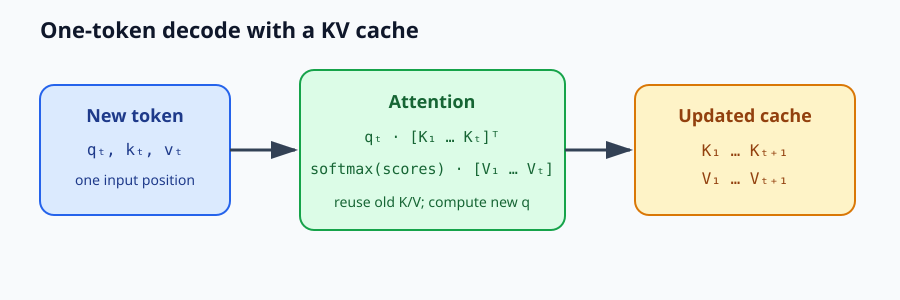
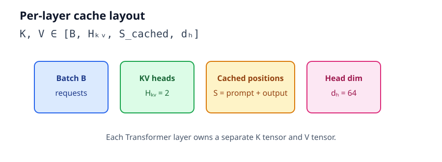
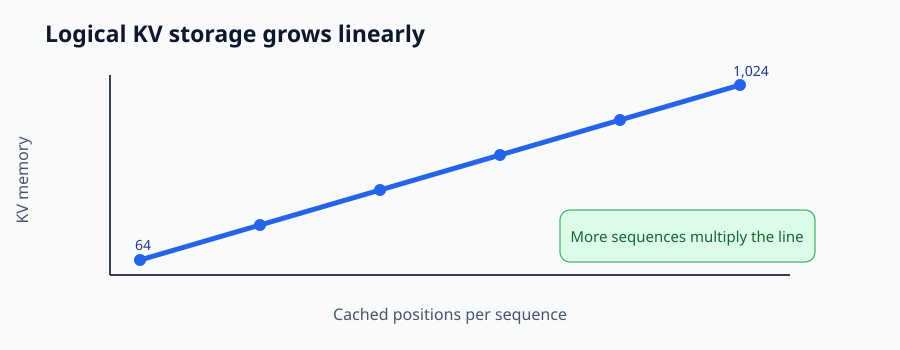
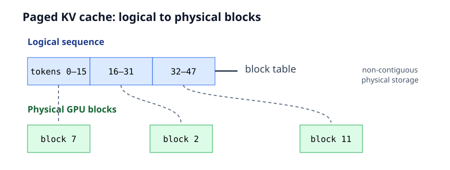

# Module 13 — KV Cache from First Principles: Tensor Shapes, Memory Growth & GPU Storage

_vLLM & GPU Inference Engineering Masterclass · Module 13 of 64 · Phase 2: LLM Inference Fundamentals_

**Hands-on:** Lightning AI · NVIDIA T4 · 1 GPU

In Module 12, we studied why prefill and incremental decoding expose different GPU workloads. Now we answer the question that makes incremental decoding possible:

> If the model processes only one new token, how can that token still attend to the complete previous context?

The answer is the key–value cache, usually called the KV cache. We will derive its tensor shapes, calculate its memory from model configuration, inspect real Qwen tensors, observe one-token growth, and connect the data structure to vLLM's paged cache.

The companion files are [`kv_cache_lab.py`](../../code/module-13/kv_cache_lab.py) and [`kv_cache_lab.ipynb`](../../code/module-13/kv_cache_lab.ipynb). The notebook is deliberately self-contained and detailed; it does not depend on state from another notebook.

## 1. Why the cache exists

Suppose a prompt contains five positions and the model predicts the first output token. To predict the next output token, a naïve implementation could run the whole model again over all six positions. That recomputes the Transformer representations of the first five positions even though causal attention guarantees they cannot depend on the new sixth position.

With caching, the model retains the attention state for earlier positions and processes only the new token. The cache trades GPU memory capacity for less repeated computation.



_The important reuse is at every Transformer layer: the new query reads the old K/V history, while the new key and value extend the cache._

## 2. Why attention stores K and V, but not Q

For one attention layer:

$$
Q=XW_Q,\qquad K=XW_K,\qquad V=XW_V
$$

and:

$$
\operatorname{Attention}(Q,K,V)=\operatorname{softmax}\left(\frac{QK^\top}{\sqrt{d_h}}+M\right)V.
$$

For a new token at position $t$, the model computes $q_t$, $k_t$, and $v_t$. Its attention output needs:

$$
q_t [k_1\ k_2\ \cdots\ k_t]^\top
$$

followed by the weighted combination of $v_1,\ldots,v_t$.

The earlier keys and values remain valid because earlier causal positions could not see the new token. Older queries are not needed: they were already used to produce outputs for their own positions. Therefore, incremental attention stores past K/V and computes only the current query.

## 3. A complete tiny numerical example

Let $d_h=2$ and assume two cached positions:

$$
k_1=[1,0],\quad k_2=[0,1],\quad v_1=[10,0],\quad v_2=[0,20].
$$

For a third token, let:

$$
q_3=[1,1],\quad k_3=[1,1],\quad v_3=[5,5].
$$

The scaled scores are:

$$
s_i=\frac{q_3^\top k_i}{\sqrt{2}}=[0.707,0.707,1.414].
$$

Softmax gives approximately:

$$
p=[0.248,0.248,0.503].
$$

The output is:

$$
o_3=0.248[10,0]+0.248[0,20]+0.503[5,5]
\approx\boxed{[5.0,7.47]}.
$$

No recomputation of $k_1,v_1,k_2,v_2$ was needed. This is the core operation repeated across all heads and layers of a real model.

## 4. Exact KV-cache tensor shape

A common per-layer layout is:

$$
K,V\in\mathbb{R}^{B\times H_{KV}\times S_{cached}\times d_h}
$$

where $B$ is batch size, $H_{KV}$ is the number of key/value heads, $S_{cached}$ is the number of stored positions, and $d_h$ is the head dimension.

For Qwen2.5-0.5B-Instruct:

| Parameter | Value |
| --- | ---: |
| Transformer layers | 24 |
| Query heads | 14 |
| KV heads | 2 |
| Head dimension | 64 |
| Lab dtype | FP16 |

For batch size 1 and 128 cached positions, each layer has:

$$
K:[1,2,128,64],\qquad V:[1,2,128,64].
$$

The cache is not one tensor shared by all layers. Each of the 24 layers owns its own K and V tensors.



_Qwen's two KV heads serve its fourteen query heads through grouped-query attention._

## 5. Derive KV-cache memory from first principles

For one layer, K contains $BH_{KV}Sd_h$ elements and V contains the same number. Across $L$ layers, with $b$ bytes per element:

$$
\boxed{M_{KV}=2BLH_{KV}Sd_hb}
$$

For one Qwen sequence in FP16:

$$
M_{KV/token}=2\times1\times24\times2\times1\times64\times2
=12{,}288\text{ bytes}=12\text{ KiB}.
$$

Therefore:

| Cached positions | Logical FP16 KV storage per sequence |
| ---: | ---: |
| 128 | 1.5 MiB |
| 1,024 | 12 MiB |
| 4,096 | 48 MiB |
| 8,192 | 96 MiB |

For 16 independent sequences of 4,096 positions:

$$
16\times48\text{ MiB}=768\text{ MiB}.
$$

These are logical live tensor bytes. Model weights, temporary activations, allocator reservations, CUDA context memory, and fragmentation consume additional VRAM.



_For a fixed architecture and dtype, KV memory grows linearly with context length; concurrency multiplies the result._

## 6. MHA versus MQA versus GQA

The KV-head count directly controls cache size.

| Design | KV heads | Cache behavior |
| --- | ---: | --- |
| MHA | 14 | Every query head has its own K/V head; largest cache |
| GQA | 2 | Groups of query heads share K/V; Qwen's middle ground |
| MQA | 1 | All query heads share one K/V head; smallest cache |

For a 24-layer, 4,096-token, 64-dimensional-head FP16 example:

| Architecture | KV heads | Logical KV memory |
| --- | ---: | ---: |
| MHA | 14 | 336 MiB |
| GQA | 2 | 48 MiB |
| MQA | 1 | 24 MiB |

Qwen's GQA configuration therefore uses seven times less logical KV storage than an otherwise comparable 14-KV-head MHA configuration. This also reduces potential KV reads, although actual physical traffic depends on the attention kernel and layout.

## 7. Cache growth and recomputation avoided

For fixed batch size and architecture:

$$
M_{KV}(S)\propto S.
$$

If a request has prompt length $S_0$ and generates $G$ tokens, a no-cache implementation may process approximately:

$$
S_0+(S_0+1)+\cdots+(S_0+G-1)=GS_0+\frac{G(G-1)}2
$$

token positions across its forward passes.

With caching, it processes the prompt once and then one new position for each subsequent prediction:

$$
S_0+G-1.
$$

For $S_0=100$ and $G=20$, this is 2,190 position-visits without caching versus 119 with caching. That is not a fixed 18.4× latency guarantee because the shapes and kernel efficiencies differ, but it shows why caching matters.



_Paged storage addresses allocation efficiency; it does not remove the fundamental need to retain K/V state._

## 8. Dynamic, static, and paged caches

### Dynamic cache

A simple implementation appends newly computed tensors:

```python
K_cache = torch.cat([K_cache, K_new], dim=-2)
V_cache = torch.cat([V_cache, V_new], dim=-2)
```

This is easy to understand but may allocate and copy as the sequence grows.

### Static cache

A static cache reserves a maximum shape such as `[1, 2, 4096, 64]` and writes each new position into its assigned slot. It avoids repeated shape changes and can help compilation, but unused capacity is reserved.

### Paged KV cache

vLLM divides logical sequences into KV blocks and maps those logical blocks to physical GPU blocks through a block table. Physical blocks need not be contiguous. This reduces large contiguous-allocation pressure, limits waste from partially filled blocks, and enables sharing strategies where supported.

## 9. Lightning AI lab

The complete artifacts are [`kv_cache_lab.py`](../../code/module-13/kv_cache_lab.py) and [`kv_cache_lab.ipynb`](../../code/module-13/kv_cache_lab.ipynb).

Install the dependencies:

```bash
pip install -U "transformers>=4.45,<5" accelerate safetensors pandas matplotlib
```

The notebook contains every cell below in executable order. The Python companion contains the same experiments with a command-line entry point.

### Lab A — Load the model and create a cache

```python
import gc
import statistics
import time

import matplotlib.pyplot as plt
import pandas as pd
import torch
from transformers import AutoModelForCausalLM, AutoTokenizer

assert torch.cuda.is_available(), "Select your T4 GPU."
device = torch.device("cuda:0")
model_id = "Qwen/Qwen2.5-0.5B-Instruct"
tokenizer = AutoTokenizer.from_pretrained(model_id)
model = AutoModelForCausalLM.from_pretrained(
    model_id, torch_dtype=torch.float16
).to(device).eval()
cfg = model.config

messages = [{
    "role": "user",
    "content": "Explain why the KV cache helps autoregressive decoding.",
}]
encoded = tokenizer.apply_chat_template(
    messages,
    tokenize=True,
    add_generation_prompt=True,
    return_dict=True,
    return_tensors="pt",
).to(device)

with torch.inference_mode():
    prefill = model(**encoded, use_cache=True, return_dict=True)
cache = prefill.past_key_values
print("GPU:", torch.cuda.get_device_name(0))
print("Prompt tokens:", encoded["input_ids"].shape[1])
print("Cache type:", type(cache).__name__)
print("Cached positions:", cache.get_seq_length())
```

### Lab B — Inspect shapes and count bytes

```python
def layer_key_value(cache, index=0):
    if hasattr(cache, "layers"):
        layer = cache.layers[index]
        return layer.keys, layer.values
    return cache[index]

def cache_layers(cache):
    return cache.layers if hasattr(cache, "layers") else cache

def kv_storage_bytes(cache):
    total = 0
    for layer in cache_layers(cache):
        tensors = (layer.keys, layer.values) if hasattr(layer, "keys") else layer
        for tensor in tensors:
            total += tensor.numel() * tensor.element_size()
    return total

key, value = layer_key_value(cache)
prompt_len = encoded["input_ids"].shape[1]
actual_bytes = kv_storage_bytes(cache)
batch_size = encoded["input_ids"].shape[0]
head_dim = cfg.hidden_size // cfg.num_attention_heads
expected_bytes = (
    2 * batch_size * cfg.num_hidden_layers * cfg.num_key_value_heads
    * prompt_len * head_dim * key.element_size()
)
print("K shape:", tuple(key.shape))
print("V shape:", tuple(value.shape))
print("Measured logical bytes:", actual_bytes)
print("Formula prediction:", expected_bytes)
print("Matching:", actual_bytes == expected_bytes)
```

### Lab C — Decode one token and verify growth

```python
next_token = prefill.logits[:, -1:, :].argmax(dim=-1)
old_len = cache.get_seq_length()
old_bytes = kv_storage_bytes(cache)
attention_mask = torch.cat(
    [encoded["attention_mask"], encoded["attention_mask"].new_ones((1, 1))],
    dim=-1,
)

with torch.inference_mode():
    decode_output = model(
        input_ids=next_token,
        attention_mask=attention_mask,
        past_key_values=cache,
        cache_position=torch.tensor(
            [old_len], dtype=torch.long, device=device
        ),
        use_cache=True,
        return_dict=True,
    )
new_cache = decode_output.past_key_values
new_len = new_cache.get_seq_length()
new_bytes = kv_storage_bytes(new_cache)
print("Old length:", old_len)
print("New length:", new_len)
print("Logical bytes added:", new_bytes - old_bytes)
assert new_len == old_len + 1
assert new_bytes - old_bytes == 12288
```

### Lab D — Plot linear cache growth

```python
rows = []
for seq_len in [64, 128, 256, 512, 1024, 2048]:
    input_ids = torch.randint(100, 50000, (1, seq_len), device=device)
    with torch.inference_mode():
        output = model(input_ids=input_ids, use_cache=True, return_dict=True)
    measured = kv_storage_bytes(output.past_key_values)
    predicted = 12288 * seq_len
    rows.append({
        "tokens": seq_len,
        "measured_MiB": measured / 1024**2,
        "predicted_MiB": predicted / 1024**2,
    })
    del output, input_ids
    gc.collect()

growth_df = pd.DataFrame(rows)
display(growth_df)
plt.figure(figsize=(8, 4))
plt.plot(growth_df["tokens"], growth_df["measured_MiB"], marker="o", label="Measured")
plt.plot(growth_df["tokens"], growth_df["predicted_MiB"], "--", label="Predicted")
plt.xlabel("Cached positions")
plt.ylabel("Logical KV storage (MiB)")
plt.title("Qwen2.5-0.5B — KV-cache growth")
plt.grid(alpha=0.3)
plt.legend()
plt.show()
```

### Lab E — Compare cached and uncached generation

```python
@torch.inference_mode()
def run_generation(input_ids, steps=8, use_kv_cache=True):
    sequence = input_ids.clone()
    current_input = input_ids
    cache = None
    attention_mask = torch.ones_like(sequence)
    for _ in range(steps):
        cache_position = None
        if use_kv_cache and cache is not None:
            cache_position = torch.tensor(
                [cache.get_seq_length()], dtype=torch.long, device=device
            )
        output = model(
            input_ids=current_input if use_kv_cache else sequence,
            attention_mask=attention_mask,
            past_key_values=cache if use_kv_cache else None,
            cache_position=cache_position,
            use_cache=use_kv_cache,
            return_dict=True,
        )
        token = output.logits[:, -1:, :].argmax(dim=-1)
        sequence = torch.cat([sequence, token], dim=-1)
        attention_mask = torch.cat(
            [attention_mask, attention_mask.new_ones((1, 1))], dim=-1
        )
        if use_kv_cache:
            cache = output.past_key_values
            current_input = token
    return sequence

def benchmark_generation(input_ids, steps=8, use_kv_cache=True, repeats=3):
    run_generation(input_ids, 2, use_kv_cache)  # warmup
    torch.cuda.synchronize()
    times = []
    for _ in range(repeats):
        torch.cuda.synchronize()
        start = time.perf_counter()
        output = run_generation(input_ids, steps, use_kv_cache)
        torch.cuda.synchronize()
        times.append((time.perf_counter() - start) * 1000)
        del output
    return statistics.median(times)

uncached_ms = benchmark_generation(encoded["input_ids"], use_kv_cache=False)
cached_ms = benchmark_generation(encoded["input_ids"], use_kv_cache=True)
print("Uncached milliseconds:", round(uncached_ms, 2))
print("Cached milliseconds:", round(cached_ms, 2))
print("Speedup:", round(uncached_ms / cached_ms, 2), "x")
```

## 10. Capacity, bandwidth, and allocation are different problems

A simplified capacity relationship is:

$$
M_{weights}+M_{KV}+M_{temporary}+M_{other}\leq M_{GPU}.
$$

When capacity is exceeded, a straightforward implementation raises an out-of-memory error. A serving engine can admit fewer requests, delay work, reclaim completed blocks, or preempt according to its policy.

Keep these questions separate:

- **Capacity:** Can all model state and active caches fit?
- **Bandwidth:** Can attention read the required K/V data quickly enough?
- **Allocation efficiency:** How much capacity is lost to fragmentation, unused reservations, or duplicate data?

PagedAttention primarily improves allocation efficiency. It does not eliminate KV storage or guarantee a particular tokens-per-second rate.

## 11. Engineering observations

- KV cache is request-specific and grows as generation progresses.
- GQA reduces cache capacity and potential K/V traffic by reducing KV-head count.
- Logical tensor bytes are not the same as `nvidia-smi` usage or allocator-reserved bytes.
- A larger cache may reduce recomputation while increasing memory pressure and attention reads.
- A GPU can have enough capacity for many caches but still fail a latency target because compute, bandwidth, scheduling, or queueing becomes the bottleneck.

## References

- Kwon et al., [Efficient Memory Management for Large Language Model Serving with PagedAttention](https://doi.org/10.1145/3600006.3613165).
- Ainslie et al., [GQA: Training Generalized Multi-Query Transformer Models from Multi-Head Checkpoints](https://arxiv.org/abs/2305.13245).
- Shazeer, [Fast Transformer Decoding: One Write-Head is All You Need](https://arxiv.org/abs/1911.02150).
- Hugging Face, [KV-cache explanation](https://huggingface.co/docs/transformers/main/cache_explanation).
- Qwen, [Qwen2.5-0.5B-Instruct configuration](https://huggingface.co/Qwen/Qwen2.5-0.5B-Instruct/blob/main/config.json).

## Module 13 recap

The KV cache stores past keys and values at every Transformer layer so a new query can attend to the history without recomputing old attention projections.

$$
\boxed{M_{KV}=2BLH_{KV}Sd_hb}
$$

For Qwen2.5-0.5B in FP16, one sequence uses 12 KiB per cached token. The cache grows linearly with context and concurrency. GQA makes that growth substantially smaller than MHA, while paged allocation makes the growing storage more manageable for a serving system.

**Module 13 complete.**

Next: Module 14 — Model Memory Accounting.
